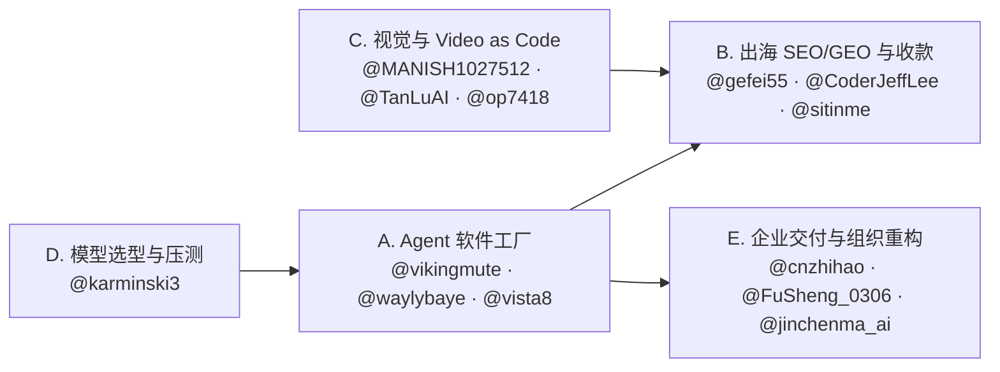

## §2 主题集群：按赛道找对应的「核心方法论」

20 位创作者虽然都发 AI 技术帖，但实际解决的问题可归为 **5 个正交集群**。想抄一套可复现的工作流，不要按粉丝数从头读，直接按你当前的任务入口挑组：

| 集群 | 代表创作者 | 核心交付物 | 最值得抄的 1–2 条方法论 |
| --- | --- | --- | --- |
| **A. Agent 工程与多分支「软件工厂」** | @vikingmute、@waylybaye、@vista8、@bozhou_ai、@icycat | 独立 App、全栈 SaaS 底座、macOS/Chrome 插件、开源 Skill | • **一项目一 Bot + Worktree 并行 + E2E 录屏验收**（@vikingmute） • **Xcode 多 Worktree 独立 DerivedData + 全局 CAS 1 分钟冷编译 & `make preview` 视图截图自检**（@waylybaye） • **把踩坑过程打包成 `npx skills add` 一句话安装 + Cron 定时跟进上游版本**（@vista8） • **`/doctor prompt-audit` 体检 `CLAUDE.md` + `/advisor opus` 关键节点请顾问省钱**（@bozhou_ai） |
| **B. 出海增长、SEO/GEO 与变现闭环** | @gefei55、@CoderJeffLee、@yaojingang、@sitinme、@AI_Jasonyu | 新词工具站、SaaS 情报库、GEO 开源系统、Stripe 收款流水线 | • **「一词一页」TDH 优先 + 生成器优先转化形态 + 后台 MCP 化交由 Claude Code 托管**（@gefei55） • **把网站当一本书规划（Entity → Topic Map → URL 三层）+ 代码/CMS/toolKey 三页分离 + Fan-out 轨迹选题**（@CoderJeffLee） • **优化单位从单条 Query 换成意图组 + 引用广度与吸收深度分离测量**（@yaojingang） • **扒垂直公开数据做窄赛道首个情报库（PaywallPro / KOL Hunter）**（@AI_Jasonyu） • **Stripe 未付款直达收银台链接召回 + 岗位级 Shared Bot 关键节点留人工闸**（@sitinme） |
| **C. AIGC 视觉、视频工程与「Video as Code」** | @MANISH1027512、@TanLuAI、@joshesye、@Adam38363368936、@liyue_ai、@op7418 | 商业品牌短片、AI 漫剧/短剧、代码渲染动效、参数化提示词库 | • **白模预演先定运镜调度（越粗糙越不污染转绘）+ 预演拉长再裁剪省积分**（@TanLuAI） • **Video as Code（Claude 写 Remotion/HyperFrames 抠像卡点）+ 先让 AI 拆 BGM 节拍排时间轴再生画面**（@MANISH1027512） • **参考视频直接喂 Codex + Renoise MCP，只声明「保留镜头节奏、换人物背景」一条龙成片**（@joshesye） • **商业短片三段式（参数 + 唯一核心记忆点 + 镜头表）+ 三图分工锁多镜头一致性**（@Adam38363368936） • **Design Token 插件化（dsh-guizang-design）+ 提示词「输入→规格→信息位→代码拼接对比图」四段式**（@op7418） |
| **D. 大模型与 Agent 硬核实测基准** | @karminski3 | 自建可复现 Benchmark、量化与推理压测、故障复现仓库 | • **用产物实际性能计分（从 0 写向量数据库跑 benchmark）替代刷题榜**（@karminski3） • **前端同一 Prompt 连抽 6 次验稳定性 + 统一 `reasoning_effort` 口径 + 260MB 真实提权日志压测 Agent**（@karminski3） |
| **E. 企业 FDE 交付、AI Native 组织与一人公司** | @FuSheng_0306、@cnzhihao、@jinchenma_ai | 企业 AI 落地咨询、高管全自动办公流、一人公司极简工作台 | • **高管「审核制」（一周不登飞书，Agent 预处理 + 人只做复杂审核）+ 视觉代理接管微信长程执行**（@FuSheng_0306） • **用「地基成本」（单接 ERP/MES 5–8 万）筛制造业客户 + 代码/Agent/人工三层报错兜底 + 基模只选稳不选炫**（@cnzhihao） • **「本地目录索引 + Notion 云端正文」轻量自生长知识库 + 非敏感外围四件套切入传统企业**（@jinchenma_ai） |

### 跨集群联动路径（怎么组合着学）

1. **独立开发全栈闭环（D → A → B）**：先按 @karminski3 的实测口径选定主力模型与 `reasoning_effort` 档位 → 用 @vikingmute / @waylybaye 的多 Worktree + 自动预览/E2E 录屏搭起单人开发流水线 → 按 @CoderJeffLee 的三类页面分离与 @gefei55 的「一词一页 + 生成器形态」上线拿搜索与 ChatGPT 流量 → 最后接上 @sitinme 的 Stripe 未付款链接召回。
2. **视觉与产品宣传自动化（A ↔ C）**：做完产品后不用手搓 AE 或剪映，直接用 @op7418 / @vikingmute 推荐的 `stageshow` 技能生成产品级 Faux UI 动效，或按 @MANISH1027512 / @joshesye 的 `Codex + Remotion / Renoise MCP` 走代码渲染宣传片。
3. **ToB 交付与组织内部提效（A → E）**：把个人验证跑通的 Skill 与岗位级 Shared Bot（@sitinme、@vista8）沉淀下来，对外按 @cnzhihao 的「20 人天上限 + 三层报错」或 @jinchenma_ai 的「外围四件套先行」做企业陪跑，对内按 @FuSheng_0306 的「全员岗位 Agent + 人工审核闸」改造团队。
