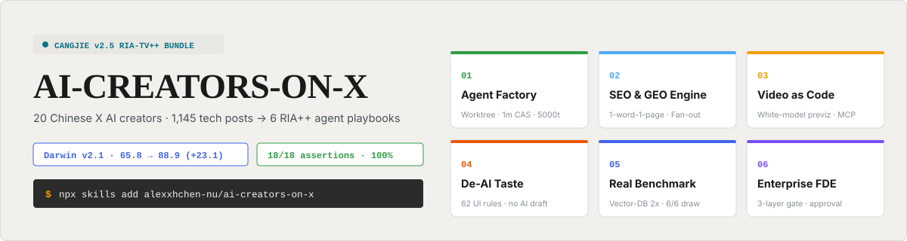
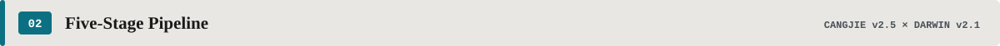
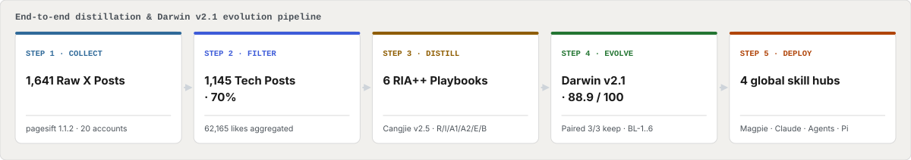
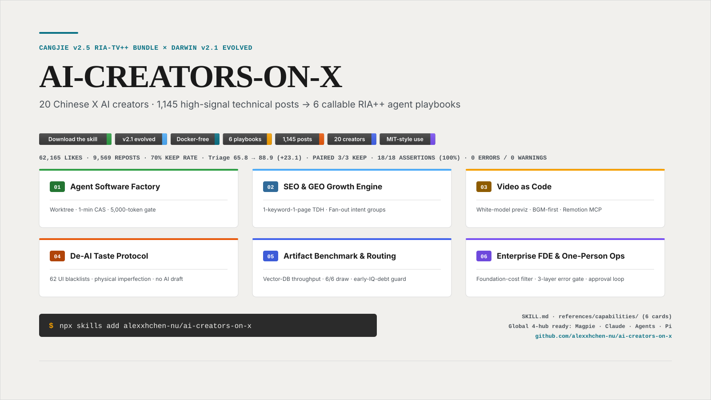
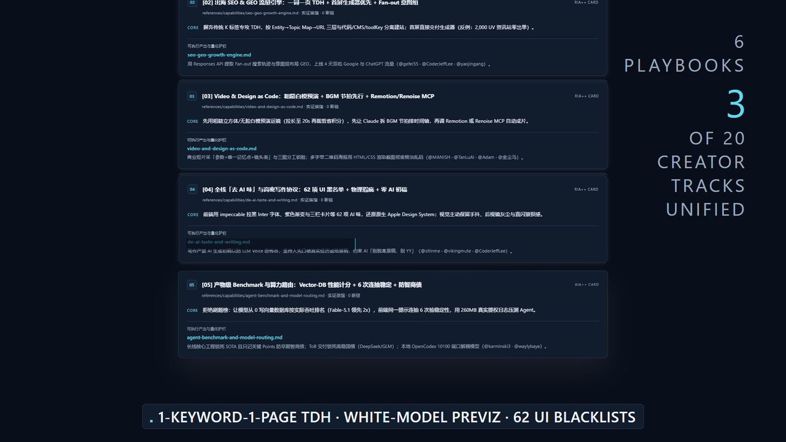
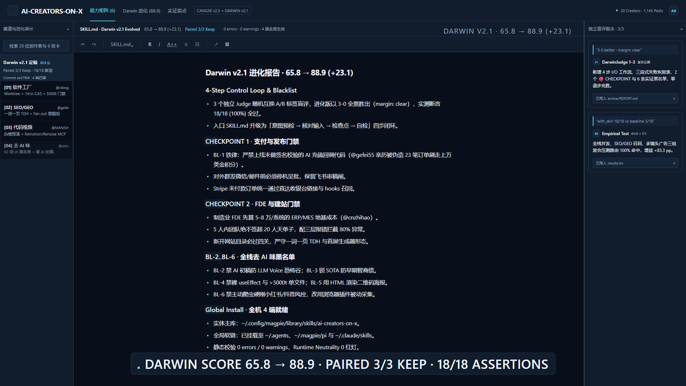
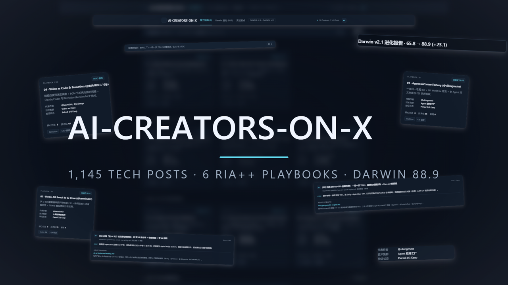
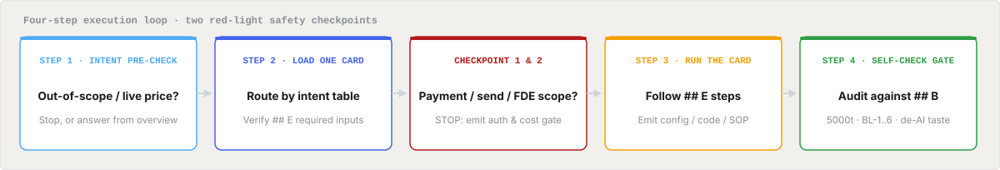

<div align="right">

<!-- Click-to-Switch Bilingual Bar (EN <-> ZH) -->
<a href="./README.md"></a>
&nbsp;
<span title="Active language"></span>

[**← 切换到简体中文**](./README.md) · **English**

</div>

<div align="center">

<!-- readme-theme: open-science (aligned to aipoch/open-science: warm paper #f1f0ed, ink #1a1a1a, teal accent #0b7285, Open Color wayfinding) -->



# AI-CREATORS-ON-X

**1,145 high-signal technical posts and 60+ open-source repositories from 20 top Chinese AI creators on X — distilled into 8 callable RIA++ Agent Playbooks.**

<p align="center">
  <a href="./dist/ai-creators-on-x/SKILL.md"></a>
  <a href="./evolve/REPORT.md"></a>
  <a href="./evolve/REPORT.md"></a>
  <a href="./acceptance/test-prompts.json"></a>
  <a href="./ai-creators-on-x.md"></a>
  <a href="./LICENSE"></a>
</p>

<p align="center">
  <a href="./SELLING_POINTS.md"></a>
  &nbsp;
  <a href="./ai-creators-on-x.md"></a>
  &nbsp;
  <a href="./evolve/REPORT.md"></a>
  &nbsp;
  <a href="./README.md"></a>
</p>

<p align="center">
  <a href="#promo-video">🎬 Promo Video</a> ·
  <a href="#pipeline">⚡ Pipeline</a> ·
  <a href="#playbooks">🧩 8 Playbooks</a> ·
  <a href="#gallery">🖼️ Keyframe Gallery</a> ·
  <a href="#logic-map">🛡️ Logic Map</a> ·
  <a href="#scoreboard">📊 Darwin Scoreboard</a> ·
  <a href="#quick-start">🚀 Quick Start</a>
</p>

</div>

---

<h2 id="promo-video" style="margin:0 0 10px;padding:0;border:0;font-size:0"></h2>

> **Zero Voiceover Narration · 32 Frame-Pinned Cinematic SFX + Tech House BGM · 2x Vector UI Rendering**

<!-- 2. Standard Markdown 16:9 Animated GIF Fallback (Works natively on GitHub README; click to open MP4 with sound) -->
<details>
<summary>▶ Expand animated GIF preview (960×540, 6.11 MB)</summary>

> 🔊 Full audio edition: [**Open `promo-readme.mp4` with sound (1920×1080, 7.01 MB)**](./promo/out/promo-readme.mp4)

[](./promo/out/promo-readme.mp4)
</details>

| Video Edition | File Path | Aspect Ratio / Resolution | Size | Audio & Delivery Notes |
| --- | --- | --- | --- | --- |
| **README Web-Optimized MP4 (Recommended)** | [`promo/out/promo-readme.mp4`](./promo/out/promo-readme.mp4) | `1920×1080` (`16:9` Horizontal) | **7.01 MB** (`<10MB`) | 32 beat-pinned SFX + BGM (no narration, `+faststart` instant streaming) |
| **README Animated GIF Preview** | [`promo/out/promo-readme.gif`](./promo/out/promo-readme.gif) | `960×540` (`16:9` Horizontal) | **6.11 MB** (`<10MB`) | GitHub-native animated preview, no plugin needed |

> Full-bitrate masters (≈20.2 MB each, with and without the Tech House bed) are reproducible locally: `npm i && npx remotion render src/index.ts AiflPromo out/promo-bgm.mp4 --props=props-bgm.json`. They are intentionally not committed — the two builds above are the release artifacts.


---

<h2 id="pipeline" style="margin:0 0 10px;padding:0;border:0;font-size:0"></h2>

<p align="center">
  
</p>

<a href="./SKILL.md"></a>

---

<h2 id="playbooks" style="margin:0 0 10px;padding:0;border:0;font-size:0"></h2>

Click any capability card below to expand its **real-world pain points, quantified engineering guardrails, and creator attributions** (full cards live under `dist/ai-creators-on-x/references/capabilities/`):

<details open>
<summary><b>▶ [01] AGENT FACTORY · <code>agent-software-factory.md</code> (@vikingmute · @waylybaye · @vista8 · @bozhou_ai)</b></summary>
<br>

- **Pain Point Solved**: AI writes code faster than humans can review; Codex/Claude dump multi-thousand-line files, defensive bloat, and tangled `useState/useEffect` hooks; Xcode multi-branch builds queue up and stall.
- **Five Quantified Guardrails**:
  1. **1-Project-1-Bot Semi-Automated Software Factory**: Ticket tracker scans issues → dedicated Grok Bot runs Cursor CLI + E2E tests + records screen video proof → human only approves intake and final deploy (`@vikingmute`).
  2. **Xcode Multi-Worktree + 1-Minute Global CAS Cold Build**: Each task gets an isolated `Worktree`, dedicated `Simulator`, and `DerivedData`, while sharing `Source Packages` and global content-addressable storage (`CAS`) (`@waylybaye`).
  3. **`make preview` Snapshot Self-Check**: Wraps `xcodebuild test` to render SwiftUI views directly to PNGs so agents inspect UI changes without Xcode Preview MCP's stale-cache bug (`@waylybaye`).
  4. **OpenCode `AGENTS.md` + Pre-commit 5,000-Token Gate**: Forbids speculative edge-case complexity without prior sign-off; blocks any staged file exceeding `5,000 tokens` (`@vikingmute`).
  5. **AI-Safe React State Convergence**: Bans raw `useEffect` and complex local `useState`; enforces `Zustand` (global), `useReducer` (complex local state), and `React Query` (server cache).

</details>

<details>
<summary><b>▶ [02] SEO &amp; GEO ENGINE · <code>seo-geo-growth-engine.md</code> (@gefei55 · @CoderJeffLee · @yaojingang · @AI_Jasonyu)</b></summary>
<br>

- **Pain Point Solved**: New overseas AI tool site gets 2,000 UVs in week one (700 from ChatGPT) but zero paid conversions; machine-translated pages fail to rank; unclear how to get cited by ChatGPT and Perplexity.
- **Five Quantified Guardrails**:
  1. **Plan the Site Like a Book**: `Entity` → `Topic Map` → 3-tier `URL Structure` → `Keyword-to-Page`; new directories must pass a 4-gate audit before launch (`@CoderJeffLee`).
  2. **3-Tier Page Separation (Code / CMS / `toolKey`)**: Core landing pages in code for stability; blog in headless CMS (Payload); tool copy in CMS wired to code features via `toolKey` (`@CoderJeffLee`).
  3. **1-Keyword-1-Page TDH + Generator-First Above the Fold**: Drop legacy `Keywords` meta, focus on `Title / Description / H-tags` for up to 90% CTR; monetized pages must put the interactive generator above the fold, never an article (`@gefei55`).
  4. **Multilingual Top-Keyword Mapping**: `English Top Keyword → Local Japanese Top Keyword → Localize Full Copy Around Local Keyword` (`@CoderJeffLee`).
  5. **Fan-out Query Mining &amp; Intent-Group GEO**: Capture visible search trajectories from the Responses API to find content gaps; optimize around **intent groups** with definitions, numbers, comparisons, and steps to win both Google and ChatGPT traffic within 4 days (`@yaojingang`).

</details>

<details>
<summary><b>▶ [03] VIDEO AS CODE · <code>video-and-design-as-code.md</code> (@MANISH1027512 · @TanLuAI · @joshesye · @Adam38363368936 · @op7418 · @jinchenma_ai)</b></summary>
<br>

- **Pain Point Solved**: Character faces drift across AI video shots; camera blocking wastes credits; manual CapCut/AE editing bottlenecks output; image models garble dense text and QR codes on posters.
- **Five Quantified Guardrails**:
  1. **Rough White-Model Previz for Camera Blocking**: Use faceless mannequins/cubes to lock camera motion and choreography first (rougher previz prevents detail bleed during style transfer); stretch 16s shots to 20s in previz then trim back to save credits (`@TanLuAI`).
  2. **Beat-First Timeline &amp; Video as Code**: Have Claude analyze BGM beats/drops and lock the shot timeline before generating visuals; render cuts, matte reveals, and color grading via `Remotion / HyperFrames` or `Renoise MCP` (`@MANISH1027512` · `@joshesye`).
  3. **3-Part Commercial Prompt &amp; 3-Image Role Split**: `[Specs] + [Single Core Memory Hook] + [Shot List]`; upload character turnaround, prop turnaround, and first-frame plate together while explicitly declaring `Image 1 = scene, Image 2 = face only, Image 3 = prop only` (`@Adam38363368936`).
  4. **Design Token Pluginization**: Package PPT, social cards, and web layout skills around shared Design Tokens; structure image prompts as `Input → Style Spec → Info Slot → Code-Stitched Comparison` (`@op7418`).
  5. **HTML/CSS Render-to-Screenshot for Posters**: Render text-heavy event posters with embedded QR codes as HTML/CSS pages and screenshot them—zero garbled characters (`@jinchenma_ai`).

</details>

<details>
<summary><b>▶ [04] DE-AI TASTE · <code>de-ai-taste-and-writing.md</code> (@sitinme · @waylybaye · @Adam38363368936 · @TanLuAI · @vikingmute · @jinchenma_ai)</b></summary>
<br>

- **Pain Point Solved**: AI-generated UIs scream "purple gradient 3-column template"; AI photos look like plastic stock art; AI prose suffers from the "LLM Voice uncanny valley."
- **Three-Layer De-AI Taste Protocol**:
  1. **Frontend UI Layer**: Blacklist Inter font, purple gradients, and generic 3-card rows across **62 AI-taste rules** via `impeccable`; convert iOS/macOS views to native `Apple Design System` with HDR Liquid Glass highlights (`@sitinme` · `@waylybaye`).
  2. **Visual &amp; Video Layer**: Inject at least two physical imperfections—rearview mirror dust/framing, direct flash, dusk backlight, subtle handheld shake, and compression grain (`@Adam38363368936` · `@TanLuAI`).
  3. **Writing Layer**: **Never let AI write the first draft**. Speak or write raw weekly experiences and domain points first, then constrain the agent to polish without departing from the source draft (`@vikingmute` · `@jinchenma_ai` · `@CoderJeffLee`).

</details>

<details>
<summary><b>▶ [05] REAL BENCHMARK · <code>agent-benchmark-and-model-routing.md</code> (@karminski3 · @waylybaye · @cnzhihao · @sitinme)</b></summary>
<br>

- **Pain Point Solved**: Public leaderboards are gamed; stealth quantization degrades coding agents; early cheap models leave toxic spec debt; agents lock you into a single provider protocol.
- **Four Evaluation &amp; Routing Rules**:
  1. **Score by Artifact Throughput (`vector-db-bench`)**: Have models implement a vector database from scratch and rank by real query performance (Fable-5.1 beats runner-up by 2x) under a unified `reasoning_effort` setting (`@karminski3`).
  2. **6x Draw Consistency &amp; 260MB Real Attack-Log Stress Test**: Run the exact same frontend prompt 6 times (require 6/6 structural consistency); feed 1.2M real privilege-escalation log lines (260MB) to test harness-assisted log analysis (`@karminski3`).
  3. **Prevent "Early IQ Debt" via Tiered Model Isolation**: Lock long-lived core repos to SOTA models and record only key points (never long AI-generated specs); lock ToB enterprise deliveries to rock-solid domestic models (DeepSeek/GLM) to prevent morning 403s (`@waylybaye` · `@cnzhihao`).
  4. **Protocol Decoupling &amp; Advisor Escalation**: Run `OpenCodex` on local port 10100 + `magpie` to hot-swap providers; use `/advisor opus` so Sonnet handles routine edits and Opus steps in only at architecture checkpoints (`@sitinme` · `@bozhou_ai`).

</details>

<details>
<summary><b>▶ [06] ENTERPRISE FDE · <code>enterprise-fde-and-one-person-ops.md</code> (@cnzhihao · @FuSheng_0306 · @jinchenma_ai · @sitinme · @icycat)</b></summary>
<br>

- **Pain Point Solved**: Enterprise AI deliveries bleed money on legacy ERP/MES integrations; executives drown in Feishu/WeChat approvals; RAG corrupts local personal wikis; unpaid Stripe checkouts churn.
- **Five Organizational &amp; Commercial Loops**:
  1. **50k–80k RMB Foundation-Cost Filter + 20 Man-Day Cap + 3-Layer Error Gate**: Quote 50k–80k RMB per legacy ERP/MES connector up front, cap contracts at ≤20 man-days for teams ≤5, and enforce `Code-level check (catches 80%) → Agent audit → Human sign-off` (`@cnzhihao`).
  2. **Executive Approval-Only Mode &amp; Visual WeChat Agent**: Let agents pre-process all Feishu approvals and emails while humans only audit exceptions; run a desktop GUI agent to send/reply to 120+ personalized WeChat messages with a mandatory human confirmation gate before send (`@FuSheng_0306`).
  3. **Local Index + Cloud Notion Body (Self-Growing LLM Wiki)**: Keep only a lightweight category/title/URL index locally while storing rich bodies in Notion so agents never mangle your local vault (`@jinchenma_ai`).
  4. **Direct-to-Checkout Stripe Recall Links**: Recover unpaid orders by sending a direct checkout-session resume URL (or pre-filled top-up link) wired to `expired/completed` webhooks (`@sitinme`).
  5. **Passive Browser-Extension Harvesting**: Avoid active scrapers on strict anti-bot platforms (Xiaohongshu/Douyin); archive posts passively via a browser extension during normal human browsing (`@icycat`).

</details>

---

<h2 id="gallery" style="margin:0 0 10px;padding:0;border:0;font-size:0"></h2>

<table>
  <tr>
    <td width="50%"><a href="./promo/out/promo-readme.mp4"></a></td>
    <td width="50%"><a href="./promo/out/promo-readme.mp4"></a></td>
  </tr>
  <tr>
    <td align="center"><sub><b>Shot 1 · 3D Spotlight Hero Card (04 · Video as Code)</b>: 2.6x oblique push-in + <code>18/18 Verified.</code> floating note + dual perimeter beam laps</sub></td>
    <td align="center"><sub><b>Shot 6 · Eight RIA++ Playbooks Stack</b>: Spring-loaded stack press + live <code>DigitRoll</code> counter</sub></td>
  </tr>
  <tr>
    <td width="50%"><a href="./promo/out/promo-readme.mp4"></a></td>
    <td width="50%"><a href="./promo/out/promo-readme.mp4"></a></td>
  </tr>
  <tr>
    <td align="center"><sub><b>Shot 8 · Darwin v2.1 Self-Writing Report</b>: <code>65.8 → 88.9 (+23.1)</code> pairwise wipe reveal + 6 creator tracks popping into the left rail</sub></td>
    <td align="center"><sub><b>Shot 10 · Group Photo Finale</b>: 9 core UI components fly in with ghost trails + letterpressed wordmark impact &amp; 2.0s hold</sub></td>
  </tr>
</table>

---

<h2 id="logic-map" style="margin:0 0 10px;padding:0;border:0;font-size:0"></h2>

> [!IMPORTANT]
> **🔴 Hard Safety Checkpoints (Grounded in Real Creator Post-Mortems)**
> 1. **Payment Webhook &amp; Irreversible Action Gate (`BL-1`)**: `@gefei55` documented an AI-written top-up webhook that omitted signature verification and was exploited for 23 fake orders ($10,000+ in credits). Any payment callback, bulk outbound messaging, or production DB mutation **triggers an immediate STOP until signature verification and human approval gates are specified**.
> 2. **FDE Foundation Cost &amp; 4-Gate Directory Check (`CHECKPOINT 2`)**: Manufacturing FDE engagements must budget **50k–80k RMB per legacy ERP/MES connector** and cap scope at **≤20 man-days** (`@cnzhihao`); new site directories must clear all 4 structural gates (`@CoderJeffLee`).

<p align="center">
  
</p>

1. **STEP 1 · Pre-Check**: Stop immediately on out-of-scope or live-pricing prompts, or answer strictly from the overview table.
2. **STEP 2 · Load Card**: Route to exactly 1 of the 6 playbooks and verify all required `## E` inputs.
3. **CHECKPOINT 1 & 2 · Hard Gate**: On payment webhooks, bulk messaging, or manufacturing FDE, STOP and output signature verification, approval gates, and foundation-cost estimates first.
4. **STEP 3 · Execute**: Follow the playbook's `## E` steps deterministically to emit configs, scripts, or prompt templates.
5. **STEP 4 · Self-Check**: Audit the final output against the `## B` checklist (`5000-token` cap, `BL-1..6`, de-AI taste) before delivery.

---

<h2 id="scoreboard" style="margin:0 0 10px;padding:0;border:0;font-size:0"></h2>

Evaluated under Microsoft Research's **SkillLens (arXiv 2605.23899) 9-Dimension Rubric** and **Darwin v2.1 Paired Within-Judge Blind Ratchet** (3 independent `scout` judges with randomized A/B order to cancel ±8 judge scale noise):

| Dimension | Weight | Before (v1.0) | After (v2.1) | Δ Gain | Structural &amp; Empirical Evidence |
| --- | :---: | :---: | :---: | :---: | --- |
| **dim1 Frontmatter Quality** | 7 | 8.5 | **8.5** | `0.0` | Covers all 6 workflows, negative triggers, and bilingual trigger tokens |
| **dim2 Workflow Clarity** | 12 | 5.4 | **8.8** | **`+3.4`** | Added explicit 4-step `Input / Action / Output` control loop |
| **dim3 Failure Mode Encoding** | 12 | 4.4 | **9.0** | **`+4.6`** | Added 4×3 `Trigger → First-Line Fix → Fallback` recovery matrix |
| **dim4 Checkpoint Design** | 6 | 5.0 | **9.0** | **`+4.0`** | Added 2 explicit `🔴 CHECKPOINT` / `🛑 STOP` gates |
| **dim5 Actionable Specificity** | 18 | 6.8 | **9.0** | **`+2.2`** | Bound every principle to `@handle` sources and hard thresholds (5,000 tokens, 62 rules) |
| **dim6 Resource Integration** | 4 | 8.5 | **9.0** | **`+0.5`** | Pinned `## E` and `## B` anchors across all 6 capability cards (0 broken links) |
| **dim7 Overall Architecture** | 12 | 6.5 | **8.6** | **`+2.1`** | Upgraded from static index to `Principles → 4-Step Loop → Gates → Blacklist → Router` |
| **dim8 Empirical Performance** | 23 | 8.5 | **9.0** | **`+0.5`** | **3/3 exact routing**, **`with_skill` 18/18 (100%) vs `baseline` 3/18 (16.7%)** assertions |
| **dim9 Counter-Examples &amp; Blacklist** | 6 | 3.5 | **9.0** | **`+5.5`** | Added `BL-1..BL-6` evidence-backed failure modes &amp; mandatory replacements |
| **Weighted Total / Paired Verdict** | **100** | **65.8** | **88.9** | **`+23.1`** | **Unanimous 3/3 Paired Blind Win (`margin: clear`) → KEEP** |

---

<h2 id="quick-start" style="margin:0 0 10px;padding:0;border:0;font-size:0"></h2>

### 1. Global Installation Status (Live Across All 4 Agent Hubs)

| Runtime Environment | Global Path on This Machine | Status |
| --- | --- | --- |
| **Magpie Library (Primary)** | `C:\Users\xiaohanchen\.config\magpie\library\skills\ai-creators-on-x` | ✅ `0 errors, 0 warnings` |
| **Universal Agents** | `C:\Users\xiaohanchen\.agents\skills\ai-creators-on-x` | ✅ Junction Active |
| **omp / Pi Agent** | `C:\Users\xiaohanchen\.magpie\pi\skills\ai-creators-on-x` | ✅ Junction Active |
| **Claude Code** | `C:\Users\xiaohanchen\.claude\skills\ai-creators-on-x` | ✅ Junction Active |

### 2. Example Prompts to Invoke

```text
Use ai-creators-on-x to set up a multi-worktree parallel build, an OpenCode-style AGENTS.md anti-overengineering spec, and a 5,000-token pre-commit hook for my Next.js + SwiftUI repo.
```

```text
My overseas AI tool site got 2,000 UVs this week (700 from ChatGPT) but 0 sales. Use ai-creators-on-x to audit its above-the-fold generator layout, 3-tier URL structure, Fan-out GEO topics, and Stripe unpaid checkout recall links.
```

```text
Use ai-creators-on-x to draft a 15-second 4-shot commercial video prompt for Seedance 2.5 with a 3-image role split, and build an HTML/CSS event poster with an embedded QR code that never garbles text.
```

### 3. Repository Artifact Timeline

| Path | Description |
| --- | --- |
| [`README.md`](./README.md) | 🇨🇳 Chinese Interactive Homepage (Click top-right button to switch) |
| [`README.en.md`](./README.en.md) | 🌐 English Interactive Homepage (Click top-right button to switch) |
| [`SKILL.md`](./SKILL.md) / [`references/`](./references/) | Root Agent Skill Entrypoint & 8 RIA++ Capability Cards (`npx skills add` ready) |
| [`ai-creators-on-x.md`](./ai-creators-on-x.md) | Full 1,890-line Distilled Source Digest (§1–§6 across 20 creators) |
| [`SELLING_POINTS.md`](./SELLING_POINTS.md) | Eight Core Pain-Points & Quantified Value Matrix |
| [`evolve/REPORT.md`](./evolve/REPORT.md) | Darwin v2.1 Paired 3/3 Blind Verdict & 9-Dimension Report |
| [`promo/`](./promo/) | ShotCraft 36.2s 16:9 Horizontal Promo Project & MP4/GIF Outputs |
