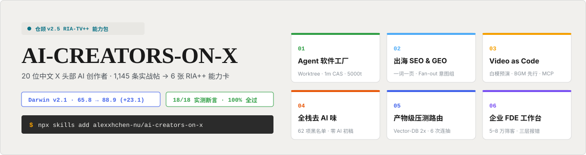
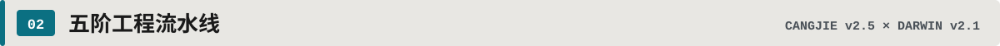
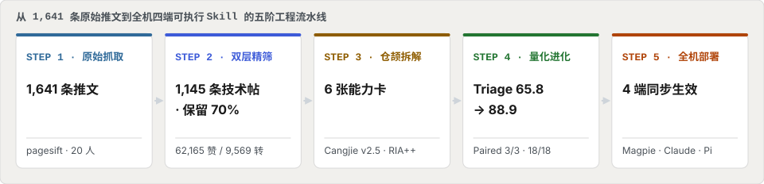
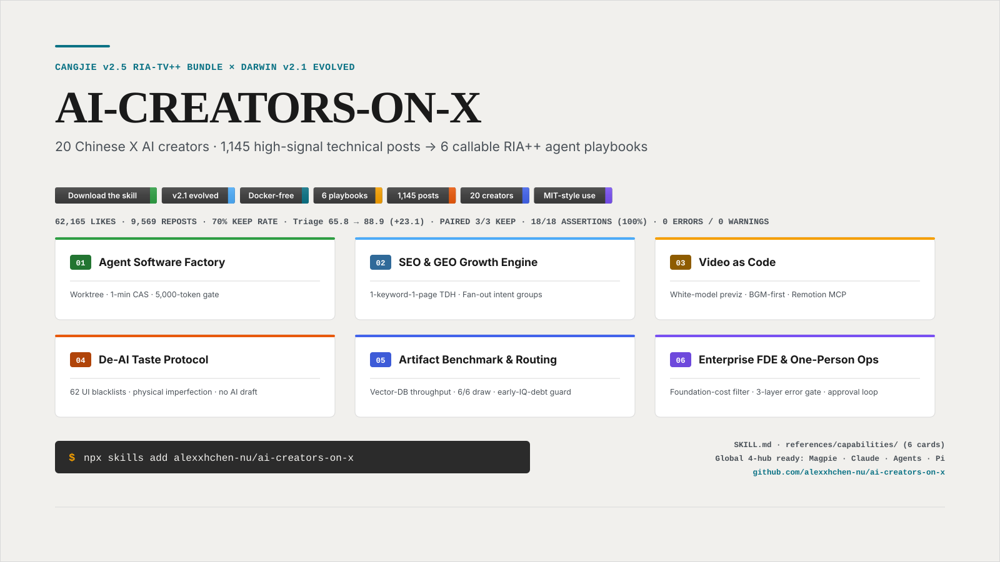
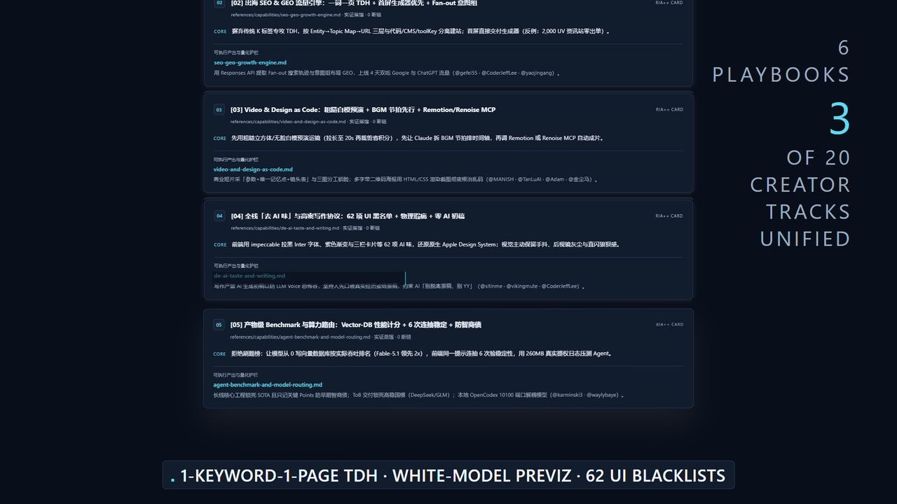
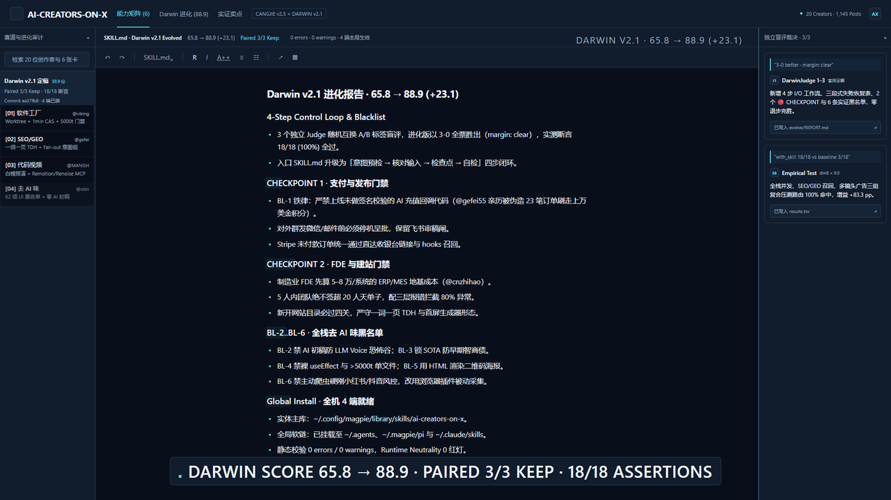
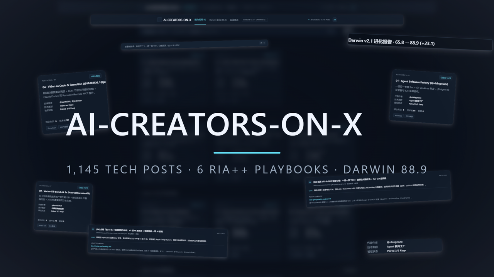
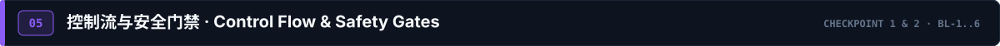
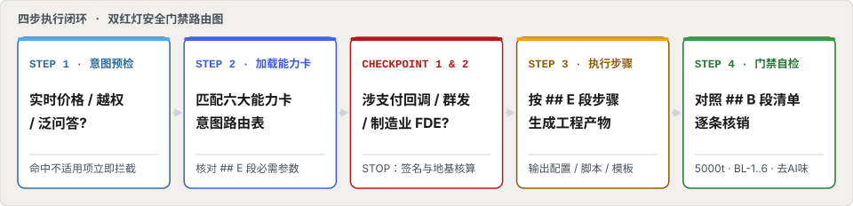

<div align="right">

<!-- Click-to-Switch Bilingual Bar (ZH <-> EN) -->
<span title="当前语言"></span>

&nbsp;
<a href="./README.en.md"></a>

**简体中文** · [**English Version →**](./README.en.md)

</div>

<div align="center">

<!-- readme-theme: open-science (aligned to aipoch/open-science: warm paper #f1f0ed, ink #1a1a1a, teal accent #0b7285, Open Color wayfinding) -->



# AI-CREATORS-ON-X

**把 20 位中文 X（Twitter）头部 AI 创作者的 1,145 条高纯度技术帖与 60+ 开源仓库，蒸馏为 6 张随叫随到的 RIA++ 实战能力卡。**

<p align="center">
  <a href="./dist/ai-creators-on-x/SKILL.md"></a>
  <a href="./evolve/REPORT.md"></a>
  <a href="./evolve/REPORT.md"></a>
  <a href="./acceptance/test-prompts.json"></a>
  <a href="./ai-creators-on-x.md"></a>
  <a href="./LICENSE"></a>
</p>

<p align="center">
  <a href="./SELLING_POINTS.md"></a>
  &nbsp;
  <a href="./ai-creators-on-x.md"></a>
  &nbsp;
  <a href="./evolve/REPORT.md"></a>
  &nbsp;
  <a href="./README.en.md"></a>
</p>

<p align="center">
  <a href="#promo-video">🎬 横屏宣传片</a> ·
  <a href="#pipeline">⚡ 蒸馏流水线</a> ·
  <a href="#playbooks">🧩 六大能力卡</a> ·
  <a href="#gallery">🖼️ 镜头画廊</a> ·
  <a href="#logic-map">🛡️ 门禁路由图</a> ·
  <a href="#scoreboard">📊 进化账本</a> ·
  <a href="#quick-start">🚀 快速安装</a>
</p>

</div>

---

<h2 id="promo-video" style="margin:0 0 10px;padding:0;border:0;font-size:0"></h2>

> **零人声旁白（No Narration）· 32 处逐帧钉死电影级 SFX + Tech House BGM · 2x 矢量界面渲染**

<!-- 1. HTML5 播放器（VS Code / Typora / Obsidian / 网页 Markdown 均支持 <video>） -->
<video src="./promo/out/promo-readme.mp4" poster="./product-card/card-openscience.png" width="100%" controls loop muted playsinline>
  当前 Markdown 渲染器不支持 HTML5 视频，请点击下方预览图打开 MP4。
</video>

<!-- 2. GitHub 原生：动图预览，点击即打开带声音的 MP4 -->
<details>
<summary>▶ <a href="./promo/out/promo-readme.mp4">打开 MP4 播放（含声音）</a> —— 动图预览</summary>

[](./promo/out/promo-readme.mp4)
</details>

<!-- 3. Obsidian / Typora：上方 HTML5 播放器已覆盖本地渲染器，无需额外内嵌 -->

| 宣传片版本 | 文件路径 | 画幅 / 分辨率 | 体积 | 音轨与用途说明 |
| --- | --- | --- | --- | --- |
| **README 轻量有声版（推荐）** | [`promo/out/promo-readme.mp4`](./promo/out/promo-readme.mp4) | `1920×1080` (`16:9` 横屏) | **7.01 MB** (`<10MB`) | 32 处钉帧 SFX + BGM，`+faststart` 流式秒开 |
| **横屏动图预览** | [`promo/out/promo-readme.gif`](./promo/out/promo-readme.gif) | `960×540` (`16:9` 横屏) | **6.11 MB** (`<10MB`) | GitHub 原生免插件内嵌 |
> 无损母版（各约 20.2 MB，含/不含 Tech House 底乐）可在本地复现：`npm i && npx remotion render src/index.ts AiflPromo out/promo-bgm.mp4 --props=props-bgm.json`。母版刻意不入库，上表两项即为发布产物。


---

<h2 id="pipeline" style="margin:0 0 10px;padding:0;border:0;font-size:0"></h2>

<p align="center">
  
</p>

<a href="./SKILL.md"></a>

---

<h2 id="playbooks" style="margin:0 0 10px;padding:0;border:0;font-size:0"></h2>

点击下方任意能力卡即可展开查看 **真实痛点、量化工程门禁、可执行命令与代表创作者**（完整卡片位于 `dist/ai-creators-on-x/references/capabilities/`）：

<details open>
<summary><b>▶ [01] AGENT FACTORY · <code>agent-software-factory.md</code>（@vikingmute · @waylybaye · @vista8 · @bozhou_ai）</b></summary>
<br>

- **解决痛点**：AI 写码太快，PR 根本看不过来；Codex/Claude 狂塞几千行大文件与冗余防御代码、乱写 `useState/useEffect`；Xcode 多分支排队编译慢如蜗牛。
- **五条硬核护栏**：
  1. **一项目一专属 Bot 半自动软件工厂**：Ticket tracker 搜 issue 提需求 → Agent 编码跑通 E2E 并交付操作录屏 → 人仅管首尾确认（`@vikingmute`）。
  2. **Xcode 多 Worktree + 全局 CAS 1 分钟冷编译**：每个任务独立 `Worktree`、独立 `Simulator` 与 `DerivedData`，全局共享 `Source Packages` 与 `CAS`（`@waylybaye`）。
  3. **`make preview` 视图截图自检**：基于 `xcodebuild test` 把 SwiftUI View 渲染成图片供 Agent 自检，绕开官方 Preview MCP 并发返回旧图缺陷（`@waylybaye`）。
  4. **OpenCode `AGENTS.md` + Pre-commit 5,000-Token 门禁**：严禁未经批准为罕见边缘情况增加复杂度；拦截 `>5,000 tokens` 的 staged 单文件（`@vikingmute`）。
  5. **React 状态收敛**：禁用裸 `useEffect` 与复杂本地 `useState`，强制 `Zustand`（全局）+ `useReducer`（复杂交互）+ `React Query`（服务端）。

</details>

<details>
<summary><b>▶ [02] SEO &amp; GEO ENGINE · <code>seo-geo-growth-engine.md</code>（@gefei55 · @CoderJeffLee · @yaojingang · @AI_Jasonyu）</b></summary>
<br>

- **解决痛点**：新站上线一周来了 2,000 UV（ChatGPT 占 700）却零出单；多语言页面 AI 直译毫无排名；不知道怎么让 ChatGPT 与 Perplexity 引用自家网站。
- **五条硬核护栏**：
  1. **把网站当一本书规划**：`Entity`（讲什么）→ `Topic Map`（大纲）→ `URL Structure`（三层目录）→ `Keyword-to-Page`，新开目录必过四关（`@CoderJeffLee`）。
  2. **代码 / CMS / `toolKey` 三页分离**：首页与核心页写代码求稳；博客归无头 CMS（Payload）；工具页文案放 CMS、功能留代码用 `toolKey` 对接（`@CoderJeffLee`）。
  3. **「一词一页」TDH 优先 + 首屏生成器形态**：舍弃 K 专攻 TDH，精准词 CTR 高达 90%；付费转化必须做成直接交付结果的「生成器形态」而非资讯页（`@gefei55`）。
  4. **多语言主词映射**：`英文 Top Keyword → 日语 Top Keyword → 围绕日语主词本地化全文`，严禁全文机翻（`@CoderJeffLee`）。
  5. **Fan-out 轨迹选题 + 意图组 GEO**：提取 Responses API 搜索轨迹找内容缺口；按「推荐决策意图组」布局定义/数字/对比/步骤，上线 4 天双吃 Google 与 ChatGPT 流量（`@yaojingang`）。

</details>

<details>
<summary><b>▶ [03] VIDEO AS CODE · <code>video-and-design-as-code.md</code>（@MANISH1027512 · @TanLuAI · @joshesye · @Adam38363368936 · @op7418 · @jinchenma_ai）</b></summary>
<br>

- **解决痛点**：图生视频多镜头人物变脸、积分烧光却运镜失控；手动用剪映/AE 剪片耗时；用生图模型做海报文字必乱码且二维码扫不出来。
- **五条硬核护栏**：
  1. **粗糙白模预演定调度**：用粗糙立方体/无脸人预演镜头运动与走位（越粗糙越不污染转绘），16s 成片拉长到 20s 预演再裁剪省积分（`@TanLuAI`）。
  2. **音乐节拍先行 + Video as Code**：先让 Claude 分析 BGM 节拍与高潮排定镜头时间轴，再写 `Remotion / HyperFrames` 代码或调 `Renoise MCP` 完成抠像卡点（`@MANISH1027512` · `@joshesye`）。
  3. **商业短片三段式 + 三图分工锁一致性**：`【参数】+【唯一核心记忆点】+ 镜头表`；同时传人物三视图、道具三视图与首帧图，开头写死「图 1 管场景、图 2 只管人脸、图 3 只管小狗」（`@Adam38363368936`）。
  4. **Design Token 插件化**：把 PPT、社媒卡片、网页排版共用一套 Design Token，提示词按「输入→风格规格→信息位→代码拼接对比图」四段建库（`@op7418`）。
  5. **HTML/CSS 渲染截图做海报**：带二维码与多文字的海报一律让 AI 写成网页嵌入二维码图片，浏览器调好后截图导出，彻底终结生图乱码（`@jinchenma_ai`）。

</details>

<details>
<summary><b>▶ [04] DE-AI TASTE · <code>de-ai-taste-and-writing.md</code>（@sitinme · @waylybaye · @Adam38363368936 · @TanLuAI · @vikingmute · @jinchenma_ai）</b></summary>
<br>

- **解决痛点**：AI 写的前端界面一股紫色渐变三栏卡片味；生成的照片精致塑料感；写出的文章全是「首先、其次、总而言之」的 LLM Voice 恐怖谷废话。
- **四层去 AI 味铁律**：
  1. **前端 UI 层**：用 `frontend-design` 与 `impeccable` 拉黑 Inter 字体、紫色渐变、三栏卡片等 **62 种 AI 味特征**；Apple 端坚持还原原生 `Apple Design System` 与 Liquid Glass 高光（`@sitinme` · `@waylybaye`）。
  2. **视觉摄影层**：至少注入两项物理不完美——后视镜灰尘与反光框景、闪光灯直闪、傍晚逆光错位、轻微手抖与曝光波动，保留「偷拍狼狈感」（`@Adam38363368936` · `@TanLuAI`）。
  3. **文本写作层**：**严禁让 AI 直接生成初稿**；必须由人先口喷过去一周真实经历与观点（或给完整原稿），要求 AI「别脱离原稿表达、别 YY」（`@vikingmute` · `@jinchenma_ai` · `@CoderJeffLee`）。

</details>

<details>
<summary><b>▶ [05] REAL BENCHMARK · <code>agent-benchmark-and-model-routing.md</code>（@karminski3 · @waylybaye · @cnzhihao · @sitinme）</b></summary>
<br>

- **解决痛点**：官方跑分榜被刷榜污染，不知道新模型到底有没有降智；早期便宜模型留下的错误文档坑死后续迭代；Codex/Claude 绑定单一协议无法换脑。
- **四条评测与路由法则**：
  1. **用产物实际性能计分（`vector-db-bench`）**：让模型从 0 实现向量数据库并按吞吐排名（Fable-5.1 为第二名 2x），统一 `reasoning_effort` 口径（`@karminski3`）。
  2. **前端 6 次连抽验稳定性 + 260MB 真实提权日志压测**：同一提示连跑 6 次看实现细节是否一致；用 120 万条真实日志压测 Agent 查攻击写防火墙规则（`@karminski3`）。
  3. **场景隔离防「早期智商债」**：长线核心代码库坚持用 SOTA 模型且不让 AI 写长 Spec（只记关键 Points）；ToB 客户交付锁死高稳定国模（DeepSeek/GLM）防早起 403（`@waylybaye` · `@cnzhihao`）。
  4. **协议解耦与顾问分级**：用 `OpenCodex` 本机 10100 端口双向翻译协议 + `magpie` 统一换模型；日常用 `/advisor opus` 让 Sonnet 干活、关键节点请 Opus 把关（`@sitinme` · `@bozhou_ai`）。

</details>

<details>
<summary><b>▶ [06] ENTERPRISE FDE · <code>enterprise-fde-and-one-person-ops.md</code>（@cnzhihao · @FuSheng_0306 · @jinchenma_ai · @sitinme · @icycat）</b></summary>
<br>

- **解决痛点**：给传统企业做 AI 落地被 ERP/MES 接口拖垮亏钱；高管被飞书审批和微信消息淹没；一人公司知识库被 AI 改乱；Stripe 未付款订单流失。
- **五条组织与商业闭环**：
  1. **5–8 万地基成本筛客 + 20 人天红线 + 三层报错**：制造业单接一个 CRM/ERP/MES 系统需 5–8 万元，5 人内绝不签超 20 人天单子；建立「代码层报错（拦 80%）→ Agent 检查层 → 人工验证」（`@cnzhihao`）。
  2. **高管一周不登飞书「审核制」+ 视觉代理长程接管微信**：审批邮件全交 Agent 预处理，人只做复杂审核；用电脑端视觉代理按「搜人→核对→读上下文→写祝福→等确认→发送」收发 120+ 条微信零失误（`@FuSheng_0306`）。
  3. **本地目录索引 + Notion 云端正文自生长知识库（LLM Wiki）**：放弃重度 RAG，本地只存分类/标题/链接索引，正文留 Notion，防止 AI 把本地库改乱（`@jinchenma_ai`）。
  4. **Stripe 未付款直达收银台链接召回**：召回邮件核心不在文案而在直达恢复链接（无链接则跳回充值页预填上次金额与支付方式），配齐 `expired/completed` hooks（`@sitinme`）。
  5. **强风控社媒被动采集插件法**：放弃主动爬虫硬刚小红书/抖音验证码，改用自研浏览器插件在人工搜索浏览时被动归档（`@icycat`）。

</details>

---

<h2 id="gallery" style="margin:0 0 10px;padding:0;border:0;font-size:0"></h2>

<table>
  <tr>
    <td width="50%"><a href="./promo/out/promo-readme.mp4"></a></td>
    <td width="50%"><a href="./promo/out/promo-readme.mp4"></a></td>
  </tr>
  <tr>
    <td align="center"><sub><b>Shot 1 · 3D 聚光主角卡（04 · Video as Code）</b>：2.6x 侧斜推近 + <code>18/18 Verified.</code> 悬浮批注 + 光束绕框两周</sub></td>
    <td align="center"><sub><b>Shot 6 · 六大 RIA++ 能力卡堆叠</b>：下压回弹入槽 + 右上角 <code>DigitRoll</code> 计数器实时滚动</sub></td>
  </tr>
  <tr>
    <td width="50%"><a href="./promo/out/promo-readme.mp4"></a></td>
    <td width="50%"><a href="./promo/out/promo-readme.mp4"></a></td>
  </tr>
  <tr>
    <td align="center"><sub><b>Shot 8 · Darwin v2.1 进化报告自写</b>：<code>65.8 → 88.9 (+23.1)</code> 成对擦除揭示 + 左栏 6 大赛道逐条弹入</sub></td>
    <td align="center"><sub><b>Shot 10 · 群像合体终章</b>：9 大界面组件带残影飞入列阵 + 中央字标重锤砸落静置 2.0s</sub></td>
  </tr>
</table>

---

<h2 id="logic-map" style="margin:0 0 10px;padding:0;border:0;font-size:0"></h2>

> [!IMPORTANT]
> **🔴 CHECKPOINT 硬门禁（源自 20 位创作者真实翻车教训）**
> 1. **支付回调与不可逆操作门禁（`BL-1`）**：`@gefei55` 亲历 AI 编写的充值回调漏掉签名校验，被伪造 23 笔订单刷走上万美金积分。凡涉及支付回调、微信/邮件群发、生产库改写，**必须强制停机输出签名校验与人工审稿闸方案**。
> 2. **FDE 地基成本与建站四关门禁（`CHECKPOINT 2`）**：制造业 FDE 先算 **5–8 万元/系统**地基成本并卡死 **20 人天上限**（`@cnzhihao`）；新开网站目录必过四关（`@CoderJeffLee`）。

<p align="center">
  
</p>

---

<h2 id="scoreboard" style="margin:0 0 10px;padding:0;border:0;font-size:0"></h2>

基于微软研究院 **SkillLens（arXiv 2605.23899）9 维 Rubric** 与 **Darwin v2.1 Paired 同-Judge 盲评棘轮**（3 个独立 `scout` 子代理随机互换 A/B 标签，消除单评 ±8 换尺噪音）：

| 维度 | 权重 | Before (v1.0) | After (v2.1) | Δ 提升 | 关键结构与实测证据 |
| --- | :---: | :---: | :---: | :---: | --- |
| **dim1 Frontmatter 质量** | 7 | 8.5 | **8.5** | `0.0` | 覆盖 6 大工作流、不适用边界与中英 Triggers |
| **dim2 工作流清晰度** | 12 | 5.4 | **8.8** | **`+3.4`** | 新增 4 步显式 `输入 / 动作 / 输出` 闭环 |
| **dim3 失败模式编码** | 12 | 4.4 | **9.0** | **`+4.6`** | 新增 4×3 `触发条件 → 一线修复 → 仍失败兜底` 恢复表 |
| **dim4 检查点设计** | 6 | 5.0 | **9.0** | **`+4.0`** | 新增 2 个显性 `🔴 CHECKPOINT` / `🛑 STOP` 门禁 |
| **dim5 可执行具体性** | 18 | 6.8 | **9.0** | **`+2.2`** | 补齐每条原则 `@handle` 归属与量化阈值（5,000 tokens、62 项黑名单等） |
| **dim6 资源整合度** | 4 | 8.5 | **9.0** | **`+0.5`** | 精确绑定 6 张能力卡的 `## E` 与 `## B` 章节锚点（0 断链） |
| **dim7 整体架构** | 12 | 6.5 | **8.6** | **`+2.1`** | 从静态索引升级为「原则 → 4 步控制流 → 门禁/恢复 → 黑名单 → 路由」 |
| **dim8 实测表现** | 23 | 8.5 | **9.0** | **`+0.5`** | 3 组复合场景路由 **3/3 命中**，断言 **`with_skill` 18/18 (100%) vs `baseline` 3/18 (16.7%)** |
| **dim9 反例与黑名单** | 6 | 3.5 | **9.0** | **`+5.5`** | 新增 `BL-1..BL-6` 实证翻车反例与强制替代做法 |
| **加权总分 / 盲评裁决** | **100** | **65.8** | **88.9** | **`+23.1`** | **Paired 盲评 3/3 全票判 After 胜出（`margin: clear`）→ KEEP** |

---

<h2 id="quick-start" style="margin:0 0 10px;padding:0;border:0;font-size:0"></h2>

### 1. 本机 4 端全局安装状态（已同步生效）

| 运行环境 | 本机全局路径 | 状态 |
| --- | --- | --- |
| **Magpie 主库（实体）** | `C:\Users\xiaohanchen\.config\magpie\library\skills\ai-creators-on-x` | ✅ `0 errors, 0 warnings` |
| **Universal Agents** | `C:\Users\xiaohanchen\.agents\skills\ai-creators-on-x` | ✅ Junction 已连通 |
| **omp / Pi Agent** | `C:\Users\xiaohanchen\.magpie\pi\skills\ai-creators-on-x` | ✅ Junction 已连通 |
| **Claude Code** | `C:\Users\xiaohanchen\.claude\skills\ai-creators-on-x` | ✅ Junction 已连通 |

### 2. 直接对你的 Agent 这样说（触发示例）

```text
用 ai-creators-on-x 帮我给当前的 Next.js + SwiftUI 项目配一套多 Worktree 并发编译、AGENTS.md 反过度工程和 5000-token Pre-commit 拦截钩子。
```

```text
我的出海 AI 工具站上线一周有 2000 UV 却零出单，按 ai-creators-on-x 的 SEO/GEO 引擎帮我诊断页面形态、规划三层 URL 并接入 Stripe 未付款直达收银台召回。
```

```text
按 ai-creators-on-x 的 Video as Code 与去 AI 味协议，帮我写一段 15 秒 4 镜头商业短片的 Seedance 2.5 三段式提示词（带三图分工锁脸），再用 HTML/CSS 做一张带二维码的活动海报。
```

### 3. 仓库核心文件索引

| 文件路径 | 核心内容说明 |
| --- | --- |
| [`README.md`](./README.md) | 🇨🇳 中文交互式旗舰首页（点击右上角胶囊按钮一键切换英文） |
| [`README.en.md`](./README.en.md) | 🌐 英文交互式旗舰首页（点击右上角胶囊按钮一键切换中文） |
| [`SKILL.md`](./SKILL.md) / [`references/`](./references/) | 仓库根目录标准 Skill 入口与 6 张 RIA++ 能力卡（支持 `npx skills add` 直装） |
| [`ai-creators-on-x.md`](./ai-creators-on-x.md) | 20 位创作者 1,890 行完整蒸馏长文（§1–§6 全文与外链核验表） |
| [`SELLING_POINTS.md`](./SELLING_POINTS.md) | 六大核心痛点与量化卖点速查手册 |
| [`evolve/REPORT.md`](./evolve/REPORT.md) | Darwin v2.1 Paired 3/3 盲评与 9 维进化报告 |
| [`promo/`](./promo/) | ShotCraft 36.2s 16:9 横屏宣传片 Remotion 工程与 MP4/GIF 产物 |
