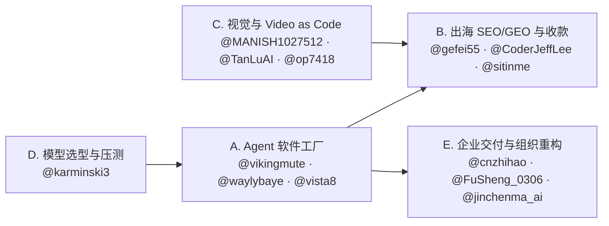

# AI Creators on X

20 个中文 AI 创作者，1,145 条技术类帖文，蒸馏成：**横向对比 → 每人方法论 → 工具与链接资产**。

- 来源：`tech/` 下 20 份页面抓取（pagesift 1.1.2，2026-11-04 抓取点），每份都保留原帖链接与互动数。
- 范围：原始 1,641 条抓取结果经主题判定后保留 1,145 条（70%），只保留 coding / AI Agent / tech_tools；新闻复述、纯情绪帖已剔除。
- 原文可追溯：每个结论后带 `YYYY-MM-DD` 与帖文链接，`[INFERENCE]` 表示这是我的推断而非原文陈述。

## 怎么用这份文档

| 你想做的事 | 去哪 |
| --- | --- |
| 选几个人长期跟 | §1 总览表（粉丝 / 保留率 / 每帖均赞） |
| 学一套可复现的工作流 | §2 主题集群 → 对应创作者的「核心方法论」 |
| 找工具、找现成链接资产 | §3 工具热度 + 各人「链接资产」表 |
| 看提示词、命令、SOP 原文 | 各人「可复用片段」 |
| 判断某个赛道现在的共识 | §4 跨创作者共识与分歧 |

---

## §1 总览：20 人一张表

粉丝、抓取量、以及「每帖均赞」——后者比粉丝数更能说明内容对同行的实际说服力（样本内 20 人合计 62,165 赞 / 1,145 帖，均 54.3）。

| 创作者 | 名称 | 粉丝 | 学习方向 | 技术帖保留 | 帖数 | 每帖均赞 | 总赞 |
| --- | --- | --- | --- | --- | --- | --- | --- |
| [@op7418](https://x.com/op7418) | 歸藏(guizang.ai) | 185.9K | AI 图像 / 视频 / 设计工具 | 71/83 | 71 | 78.8 | 5594 |
| [@waylybaye](https://x.com/waylybaye) | Baye | 164.4K | 一人做 App（独立开发） | 57/82 | 57 | 129.9 | 7405 |
| [@vista8](https://x.com/vista8) | 向阳乔木 | 136.4K | AI 编程 / vibe coding | 71/81 | 71 | 93.2 | 6614 |
| [@AI_Jasonyu](https://x.com/AI_Jasonyu) | 鱼总聊AI | 72.3K | SaaS & APP 出海 | 37/82 | 37 | 48.8 | 1806 |
| [@vikingmute](https://x.com/vikingmute) | Viking | 69.6K | SaaS | 66/80 | 66 | 111.9 | 7388 |
| [@gefei55](https://x.com/gefei55) | 哥飞 | 67.7K | 出海 SEO | 30/83 | 30 | 61.9 | 1858 |
| [@FuSheng_0306](https://x.com/FuSheng_0306) | 傅盛 | 63.7K | 成熟公司 AI Native 转型 | 48/83 | 48 | 99.9 | 4793 |
| [@liyue_ai](https://x.com/liyue_ai) | 李岳 | 54.7K | 图生视频 / 提示词分享 | 56/81 | 56 | 48.2 | 2698 |
| [@MANISH1027512](https://x.com/MANISH1027512) | 古一 | 47.5K | AIGC 视觉 | 49/81 | 49 | 60.9 | 2985 |
| [@karminski3](https://x.com/karminski3) | karminski-牙医 | 40.1K | 大模型性能实测 | 78/83 | 78 | 93.2 | 7267 |
| [@jinchenma_ai](https://x.com/jinchenma_ai) | 金尘马 | 32.9K | 一人公司 | 54/82 | 54 | 19.1 | 1034 |
| [@bozhou_ai](https://x.com/bozhou_ai) | 泊舟 | 32.8K | AI 编程 | 62/81 | 62 | 26.8 | 1662 |
| [@sitinme](https://x.com/sitinme) | sitin | 32.8K | AI 出海网站 | 74/80 | 74 | 6.2 | 460 |
| [@joshesye](https://x.com/joshesye) | 行者AI视频 | 25.8K | AI 视频 | 52/82 | 53 | 34.4 | 1825 |
| [@yaojingang](https://x.com/yaojingang) | 姚金刚 | 23.4K | GEO | 60/84 | 60 | 68.4 | 4106 |
| [@Adam38363368936](https://x.com/Adam38363368936) | Adam也叫吉米 | 18.6K | AI 品牌广告 | 69/81 | 69 | 12.0 | 829 |
| [@TanLuAI](https://x.com/TanLuAI) | 探路AI | 9,807 | AI 视频 | 83/84 | 83 | 33.6 | 2790 |
| [@icycat](https://x.com/icycat) | 冷酷小猫 IcyCat | 8,402 | 浏览器插件开发 | 47/83 | 47 | 4.5 | 213 |
| [@CoderJeffLee](https://x.com/CoderJeffLee) | 写增长的子木 | 7,743 | AI 工具站 | 30/82 | 30 | 12.9 | 388 |
| [@cnzhihao](https://x.com/cnzhihao) | 做 FDE 的智昊 | 2,531 | FDE | 50/83 | 50 | 9.0 | 450 |

**读法**

- 粉丝量与影响力不同步：@waylybaye（164.4K）每帖均赞 129.9、@vikingmute（69.6K）111.9，都高于粉丝最多的 @op7418（185.9K，78.8）。前者写线程化的工程判断，后者写工具速报——工具速报涨粉快、单帖说服力低。
- 保留率是「本号有多少内容真属于技术范畴」：@sitinme 74/80 与 @TanLuAI 83/84 近乎全量技术，@CoderJeffLee 30/82 只剩三分之一（其余为增长/商业），@AI_Jasonyu 37/82。
- 每帖均赞最低的 @icycat（4.5）、@sitinme（6.2）、@cnzhihao（9.0）不是内容差，而是写「过程日志」——发版记录、踩坑、日更打卡，价值在读起来像工程手记而非观点，链接资产反而最密。

---

## §2 主题集群：按赛道找对应的「核心方法论」

20 位创作者虽然都发 AI 技术帖，但实际解决的问题可归为 **5 个正交集群**。想抄一套可复现的工作流，不要按粉丝数从头读，直接按你当前的任务入口挑组：

| 集群 | 代表创作者 | 核心交付物 | 最值得抄的 1–2 条方法论 |
| --- | --- | --- | --- |
| **A. Agent 工程与多分支「软件工厂」** | @vikingmute、@waylybaye、@vista8、@bozhou_ai、@icycat | 独立 App、全栈 SaaS 底座、macOS/Chrome 插件、开源 Skill | • **一项目一 Bot + Worktree 并行 + E2E 录屏验收**（@vikingmute）<br>• **Xcode 多 Worktree 独立 DerivedData + 全局 CAS 1 分钟冷编译 & `make preview` 视图截图自检**（@waylybaye）<br>• **把踩坑过程打包成 `npx skills add` 一句话安装 + Cron 定时跟进上游版本**（@vista8）<br>• **`/doctor prompt-audit` 体检 `CLAUDE.md` + `/advisor opus` 关键节点请顾问省钱**（@bozhou_ai） |
| **B. 出海增长、SEO/GEO 与变现闭环** | @gefei55、@CoderJeffLee、@yaojingang、@sitinme、@AI_Jasonyu | 新词工具站、SaaS 情报库、GEO 开源系统、Stripe 收款流水线 | • **「一词一页」TDH 优先 + 生成器优先转化形态 + 后台 MCP 化交由 Claude Code 托管**（@gefei55）<br>• **把网站当一本书规划（Entity → Topic Map → URL 三层）+ 代码/CMS/toolKey 三页分离 + Fan-out 轨迹选题**（@CoderJeffLee）<br>• **优化单位从单条 Query 换成意图组 + 引用广度与吸收深度分离测量**（@yaojingang）<br>• **扒垂直公开数据做窄赛道首个情报库（PaywallPro / KOL Hunter）**（@AI_Jasonyu）<br>• **Stripe 未付款直达收银台链接召回 + 岗位级 Shared Bot 关键节点留人工闸**（@sitinme） |
| **C. AIGC 视觉、视频工程与「Video as Code」** | @MANISH1027512、@TanLuAI、@joshesye、@Adam38363368936、@liyue_ai、@op7418 | 商业品牌短片、AI 漫剧/短剧、代码渲染动效、参数化提示词库 | • **白模预演先定运镜调度（越粗糙越不污染转绘）+ 预演拉长再裁剪省积分**（@TanLuAI）<br>• **Video as Code（Claude 写 Remotion/HyperFrames 抠像卡点）+ 先让 AI 拆 BGM 节拍排时间轴再生画面**（@MANISH1027512）<br>• **参考视频直接喂 Codex + Renoise MCP，只声明「保留镜头节奏、换人物背景」一条龙成片**（@joshesye）<br>• **商业短片三段式（参数 + 唯一核心记忆点 + 镜头表）+ 三图分工锁多镜头一致性**（@Adam38363368936）<br>• **Design Token 插件化（dsh-guizang-design）+ 提示词「输入→规格→信息位→代码拼接对比图」四段式**（@op7418） |
| **D. 大模型与 Agent 硬核实测基准** | @karminski3 | 自建可复现 Benchmark、量化与推理压测、故障复现仓库 | • **用产物实际性能计分（从 0 写向量数据库跑 benchmark）替代刷题榜**（@karminski3）<br>• **前端同一 Prompt 连抽 6 次验稳定性 + 统一 `reasoning_effort` 口径 + 260MB 真实提权日志压测 Agent**（@karminski3） |
| **E. 企业 FDE 交付、AI Native 组织与一人公司** | @FuSheng_0306、@cnzhihao、@jinchenma_ai | 企业 AI 落地咨询、高管全自动办公流、一人公司极简工作台 | • **高管「审核制」（一周不登飞书，Agent 预处理 + 人只做复杂审核）+ 视觉代理接管微信长程执行**（@FuSheng_0306）<br>• **用「地基成本」（单接 ERP/MES 5–8 万）筛制造业客户 + 代码/Agent/人工三层报错兜底 + 基模只选稳不选炫**（@cnzhihao）<br>• **「本地目录索引 + Notion 云端正文」轻量自生长知识库 + 非敏感外围四件套切入传统企业**（@jinchenma_ai） |

### 跨集群联动路径（怎么组合着学）



1. **独立开发全栈闭环（D → A → B）**：先按 @karminski3 的实测口径选定主力模型与 `reasoning_effort` 档位 → 用 @vikingmute / @waylybaye 的多 Worktree + 自动预览/E2E 录屏搭起单人开发流水线 → 按 @CoderJeffLee 的三类页面分离与 @gefei55 的「一词一页 + 生成器形态」上线拿搜索与 ChatGPT 流量 → 最后接上 @sitinme 的 Stripe 未付款链接召回。
2. **视觉与产品宣传自动化（A ↔ C）**：做完产品后不用手搓 AE 或剪映，直接用 @op7418 / @vikingmute 推荐的 `stageshow` 技能生成产品级 Faux UI 动效，或按 @MANISH1027512 / @joshesye 的 `Codex + Remotion / Renoise MCP` 走代码渲染宣传片。
3. **ToB 交付与组织内部提效（A → E）**：把个人验证跑通的 Skill 与岗位级 Shared Bot（@sitinme、@vista8）沉淀下来，对外按 @cnzhihao 的「20 人天上限 + 三层报错」或 @jinchenma_ai 的「外围四件套先行」做企业陪跑，对内按 @FuSheng_0306 的「全员岗位 Agent + 人工审核闸」改造团队。

---

## §3 工具热度：1,145 帖的字面计数

统计口径：对 20 份抓取文本做关键词字面匹配（大小写不敏感），一条帖多次出现按多次计，只用于看相对热度，不是精确引用数。`Claude / Opus / Sonnet` 一行的计数包含 `Claude Code` 的 73 次。

| 工具 / 技术 | 提及次数 | 主要提及者（次数） |
| --- | --- | --- |
| Claude / Opus / Sonnet | 247 | @bozhou_ai 58、@sitinme 44、@MANISH1027512 25 |
| Codex | 133 | @sitinme 25、@jinchenma_ai 15、@vista8 14 |
| Grok | 104 | @sitinme 24、@vikingmute 24、@op7418 11 |
| Claude Code | 73 | @sitinme 29、@bozhou_ai 22、@op7418 7 |
| DeepSeek | 73 | @karminski3 13、@vista8 13、@op7418 11 |
| Seedance | 53 | @Adam38363368936 32、@TanLuAI 6、@liyue_ai 5 |
| MCP | 44 | @cnzhihao 9、@MANISH1027512 9、@vikingmute 7 |
| Qwen / 通义 | 36 | @karminski3 25、@joshesye 3、@liyue_ai 2 |
| Obsidian | 28 | @vista8 18、@yaojingang 4、@jinchenma_ai 3 |
| Cursor | 26 | @vikingmute 9、@bozhou_ai 8、@sitinme 5 |
| Gemini | 24 | @bozhou_ai 6、@MANISH1027512 3、@op7418 3 |
| Swift / iOS | 16 | @waylybaye 9、@op7418 4、@joshesye 2 |
| React / Next.js | 14 | @vikingmute 12、@cnzhihao 1、@icycat 1 |
| Kimi | 12 | @sitinme 5、@karminski3 4、@liyue_ai 2 |
| Vercel | 7 | @vikingmute 5、@gefei55 1、@MANISH1027512 1 |
| Cloudflare | 7 | @jinchenma_ai 2、@yaojingang 2、@karminski3 1 |
| ComfyUI | 6 | @TanLuAI 6 |
| Nano Banana | 5 | @MANISH1027512 3、@Adam38363368936 1、@sitinme 1 |
| Midjourney | 5 | @MANISH1027512 4、@AI_Jasonyu 1 |
| 可灵 / Kling | 5 | @Adam38363368936 2、@AI_Jasonyu 1、@joshesye 1 |
| Flux | 4 | @joshesye 4 |
| Suno | 4 | @op7418 4 |
| Figma | 3 | @waylybaye 3 |

**三个集中点**

1. **Claude 系是默认编程层**：247 次，且分布不是单点——@bozhou_ai、@sitinme、@MANISH1027512、@vista8 都在用，说明它已经从「尝鲜」变成工作台。Codex 133 次紧随，两人（@sitinme、@bozhou_ai）在同一帖里做 Claude Code / Codex 对照，这是本样本里最可信的横向评测素材。
2. **Grok 的 104 次集中在 Grok Bot / 社交检索**，不是模型能力讨论：@sitinme 与 @vikingmute 各 24 次，用法是把自家历史帖变成可检索知识库（见 @op7418「一句话建提示词库」）。这是 2026-11 的形态，不是通用做法。
3. **MCP 44 次但落点分散**：@cnzhihao（FDE 交付）、@MANISH1027512（视觉资源库接 Agent）、@vikingmute（SaaS 集成）三种不同动机，说明 MCP 已成为「把内部资产接给 Agent」的标准插口，而非单独的产品卖点。

---

## §4 跨创作者共识与分歧

把 20 人的 1,145 条技术帖放在同一时间截面（2026-08 至 2026-11）横向对齐，可以看到中文 AI 一线实践者已经在 **6 件事上达成强共识**，同时在 **5 个关键工程与商业问题上出现鲜明分歧**。

### 一、六条跨赛道强共识

1. **Agent 的瓶颈已从「模型不够聪明」转移到「人类审核带宽与注意力上限」**
   - @vista8 引述并验证：人类一般只能同时跟进 3–5 个活跃 session，项目一多连找某个迭代都要翻半天（`2026-11-01`）。
   - @vikingmute 指出代码量大到人工根本读不过来，传统逐行 PR Review 已沦为「点绿灯的仪式感」，必须改为 Git worktree 并行 + 多 Agent 交叉审查 + E2E 录屏验收（`2026-10-16`、`2026-10-28`）。
   - @jinchenma_ai 与 @FuSheng_0306 从组织端印证：AI 产出的高严谨材料越多，人越审不过来；人的角色必须收缩为「在关键闸门做审核与改进 Agent」（@sitinme 的飞书审稿人工闸、@FuSheng_0306 的一周不登飞书只审呈批件）。

2. **「为 AI 重写接口」：CLI、MCP 与代码同构正在取代 GUI 点击**
   - 创作者普遍放弃让 AI 看截图点 GUI，转而把软件与后台改造成 Agent 原生可读写的接口：@gefei55 提出把网站后台通过 MCP 重做一遍，「不是给人用，而是给 Claude Code 用，人类只看数据」（`2026-11-02`）；@vikingmute 选用走 OS 无障碍树而非截图 Vision 的 `agent-desktop`，并用支持 `/llms.txt` 与 `/mcp` 的 Nimbus Docs 写文档；@MANISH1027512 将一万多条视觉风格与运镜库封装为 VSC Plugin 供 Codex/Claude Code 直接调阅；@FuSheng_0306 因开源修图软件 Compositor 支持 Agent 直接读写 `.comp` 目录实时更新画布而考虑退订 Adobe。

3. **视频与设计正在全面「代码化」（Video / Marketing as Code）**
   - 跨越编程组与视觉组的共同趋势是不再手搓剪映、AE 或 Figma：@MANISH1027512 用 Claude 写 Remotion/HyperFrames 完成定格抠像、卡点与调色；@joshesye 用 Codex 接 Renoise MCP 自动拆镜剪辑；@icycat 用 `p5.js + Remotion` 和 `auto-motion` 自动生成竖屏 MG 动画；@waylybaye 践行 Marketing as Code，所有 App Store 截图与引导动画全用真实 SwiftUI 代码绘制；@jinchenma_ai 用 HTML/CSS 写海报嵌入二维码再截图，彻底绕开生图模型的文字乱码。

4. **Skill 与岗位级 Bot 成为新的「知识封装与分发单位」**
   - 开源项目与个人经验的交付形态已从「写教程文档」变成「一行命令让 Agent 装上就会」：@vista8 把 Mac App 开发打包成 `npx skills add joeseesun/qiaomu-macos-dev`；@CoderJeffLee 开源 `open-growth-skills`；@sitinme 强调把散在个人聊天里的提示词沉淀为可统一更新的「岗位级 Shared Bot」。同时 @karminski3 给出关键提醒：不能把 Skill 写成死文档，必须保持代码/数据同构才能应付未见过的格式（`2026-09-14`）。

5. **「去 AI 味」成为代码、UI、视觉与写作的共同刚需**
   - **代码层**：@vikingmute 引入 OpenCode `AGENTS.md`，严禁 AI 为罕见边缘情况擅自加防御性代码与单次 helper，并用 Pre-commit Hook 拦截超 5,000 tokens 的大文件。
   - **前端 UI 层**：@sitinme 用 `frontend-design` 与 `impeccable` 拉黑 Inter 字体、紫色渐变与三栏卡片等 62 种 AI 味；@vista8 试用 Hallmark 后自研 UI 学习插件；@waylybaye 坚持还原原生 Apple Design System。
   - **视觉与视频层**：@TanLuAI 与 @Adam38363368936 一致指出真实感来自「不完美」——保留手抖、压缩感、曝光波动、后视镜灰尘与直闪狼狈感。
   - **文本写作层**：@vikingmute 与 @jinchenma_ai 均反对让 AI 直接生成初稿（痛批「LLM Voice 恐怖谷」与「无增量的正确废话」），主张人出核心观点/口喷初稿，AI 仅做提纲或遵循原稿润色（@CoderJeffLee 亦要求 Codex「别脱离原稿表达、别 YY」）。

6. **基础设施风控（支付校验、API 密钥泄露、账号封禁）是 Vibe Coding 的最大暗礁**
   - @gefei55 亲历 AI 写的充值回调漏掉签名校验，被伪造 23 笔订单刷走上万美金积分（`2026-10-26`）；@waylybaye 总结 AI 永远优先写 Happy Path，「未虑胜先虑败」才是专业程序员不可替代的护城河；@vista8 引述 725 万个 Gitee 仓库中平均每 275 个就泄露一个云或模型 API Key；在账号防封上，@vista8 与 @vikingmute 均采用「Cloudflare 域名邮箱路由 + 固定纯净环境」替代折腾廉价黑号。

---

### 二、五个核心分歧与路线对立

| 争议焦点 | 路线 A（激进 / 自动化 / 铺量） | 路线 B（克制 / 精品化 / 人工把关） | 背后的场景差异 |
| --- | --- | --- | --- |
| **1. 软件开发：全自动「软件工厂」 vs 拒绝全自动与防范「智商债」** | **@vikingmute、@bozhou_ai、@vista8**：推崇「许愿式编程」与一项目一 Bot 半自动流水线，甚至一句话把小说变成电影、3 分钟出速记工具第一版，认为终局是 Agent 自写自测自动合入。 | **@waylybaye、@jinchenma_ai**：明确「不让 AI 全自动开发软件」；@waylybaye 警告早期/性价比模型留下的错误 Spec 会被新模型盲信并继承放大（「早期智商债」），坚持只用 SOTA 模型且不让 AI 写长 Spec。 | Web 工具站/内部插件容错高、可靠快速回滚兜底；而长线维护的原生商业 App 与涉企财务系统一旦埋下架构或账目隐患，修复成本远超重写。 |
| **2. 出海建站：AI 批量堆新词站 vs 少而精「一书一规划 / 一词一页」** | **@AI_Jasonyu、@vista8、@cnzhihao（转引 shipwords）**：单日连上 4 个新词站，或把 12G 公开数据集两三天拆成 5 个垂直子站，「先把数量堆够，起量的继续迭代，没起来的放着不管」。 | **@gefei55、@CoderJeffLee、@waylybaye**：@gefei55 强调小站不靠铺海量页，而靠「一词一页」少而精拿 90% CTR；@CoderJeffLee 要求把网站当一本书规划，新开目录先过四关；@waylybaye 则坚持无长期 PMF 的小产品绝不发布。 | 博短期搜索新词红利（72 小时出单窗口）适合铺量漏斗；做长期自然流量资产与品牌复利则必须控页面质量。 |
| **3. SEO 与 GEO 的关系：同源双吃 vs 独立工程链路** | **@gefei55**：认为 SEO 与 GEO 底层同构，按「一词一页 + TDH + 长尾裂变」做好的内页，上线 4 天即可同时从 Google 与 ChatGPT 拿流量。 | **@CoderJeffLee、@yaojingang**：@CoderJeffLee 指出「GEO 不是 SEO 的子集，而是两个有交集的圈」；@yaojingang 实证显示 Perplexity/Google 重引用广度，ChatGPT 重单页吸收深度（需定义/数字/对比/步骤，单纯堆 Q&A 无效），且平台引用份额会剧烈漂移（如 Reddit 份额暴跌 86.4%）。 | 工具站长尾词在搜索引擎与 AI 搜索中重合度高；而品牌声誉与行业推荐词（如「哪双鞋适合我」）在生成式引擎中遵循意图组与信源权威度逻辑。 |
| **4. 模型与性价比策略：高低搭配省钱 vs 锁死 SOTA / 锁死稳定国模** | **@bozhou_ai、@karminski3**：@bozhou_ai 用 `/advisor opus` 让便宜 Sonnet 干活、只在关键节点请 Opus；@karminski3 实测推荐 Agent 用 `Qwen3.8-27B + reasoning_effort=low`，并指出过度思考反而先升后降。 | **@waylybaye** 坚持只用 SOTA（Opus 5.5 / Astra）以防智商债；**@cnzhihao** 在企业交付中则走向另一极端——「稳定性比智能重要一万倍」，只选 DeepSeek 与 GLM 作基模，宁可不炫也绝不能让客户早起遇到 403 或模型抽风。 | 个人高频实验需算 Token 账本；核心代码库怕低智商债；而 ToB 企业交付怕海外 API 封号与网络抖动。 |
| **5. 桌面/个人 Agent 载体：Grok Bot 派 vs Muse 派 vs WorkBuddy 派** | **@vikingmute、@sitinme、@op7418**：重度押注 **Grok Bot**（整合 X 生态、Marketplace 岗位模板、配合 Cursor CLI 管项目与归档推文）。 | **@FuSheng_0306** 实测认为 **Muse（Meta）** 自带虚拟机与强浏览器控机能力远超 Grok Bot；**@cnzhihao、@liyue_ai、@jinchenma_ai** 则在国内办公与交付场景主推 **WorkBuddy** 與 **DeepSeek Harness**（能直接爬公众号、接本地表格、给传统老板做插件定制）。 | 出海开发者工作流围绕 X/GitHub/Vercel 展开，Grok Bot 最顺手；跨端生活采购需要云端虚拟机浏览器（Muse）；国内公众号运营与传统企业交付则受限于本土生态接口与网络环境。 |

---

## @cnzhihao · 做 FDE 的智昊

**摘要**：杭州的 FDE 交付者，CPA 出身，带团队把 AI 落进企业业务流程，做高管 FDE 训练与企业主陪跑。价值在于讲清 FDE 的真实边界：不是做 Demo，而是咨询诊断＋技术实施＋培训陪跑的苦差事，以及报价与踩坑。

| 粉丝 | 关注 | 学习方向 | 抓取 | 主页 |
| --- | --- | --- | --- | --- |
| 2,531 | 380 | FDE | 50/83（2026-11-04） | [fhxqtech.com](https://fhxqtech.com) |

### 画像

自我定位是「老板定方向，我带团队把 AI 落进业务流程」，CPA 出身，做高管 FDE 训练和企业主陪跑，常驻杭州。发帖以短评和转引为主，信息密度来自对交付现场的吐槽与拆解：报价、人天、基模选型、客户组织阻力。与本组其他人相比，他几乎不写工具评测，写的是「把 AI 卖进传统企业」这门生意本身的成本结构。

### 核心方法论

1. **FDE 是咨询诊断＋技术实施＋培训陪跑** — FDE 的难点不是把 AI 做出来，而是理解企业、理清需求、协调各方，让方案真正进入日常工作；项目表面是 AI 升级，实际常涉及管理和流程调整。依据（`2026-10-27` + [原帖](https://x.com/cnzhihao/status/2114994845236486590)）。边界：大型集团、国企、政府部门流程更重，他明确建议新手别硬蹭。
2. **先练商业能力，再谈 AI** — 给新手 FDE 的四条里前三条是：AI 不重要，先练商业能力，把朋友圈先薅一遍；确认真实需求再去开发，别客户说啥就做啥；不要贪多，一次不签超过 20 个人天的单子，尤其团队不超 5 人时。依据（`2026-10-26` + [原帖](https://x.com/cnzhihao/status/2114748809662316602)）。
3. **给客户的模型先看稳定性，不看智能** — 供模型服务时稳定性比智能重要一万倍，只把 DeepSeek 和 GLM 系列作为基模；客户早上起来发现模型变傻或报 403，都是不可接受的。依据（`2026-11-03` + [原帖](https://x.com/cnzhihao/status/2117763021405868493)）。
4. **三层报错机制** — 代码层报错 → Agent 检查层报错 → 人工验证；把「漏拉一家银行接口」「重复导入同一份流水导致余额连续错位」等异常写进脚本，多数情况下代码层就能处理 80% 以上的错误。依据（`2026-10-26` + [原帖](https://x.com/cnzhihao/status/2114736647954985205)）。
5. **用「地基成本」筛客户** — 制造业 FDE 要先接 CRM、SRM、ERP、MES、WMS，单接一个系统成本约 5–8 万元，之后才是那个「简单得不能再简单的 Agent」；若客户只想为搭 AI 付费，这单不该接。依据（`2026-10-28` + [原帖](https://x.com/cnzhihao/status/2115439498050027839)）。
6. **先盘活线下资源** — 团队优势不在自媒体时，先用线下分享换信任：他转引的案例是替腾讯云做一次分享后，一周内有 4 家客户进入报价环节。依据（`2026-11-04` 转引 + [原帖](https://x.com/cnzhihao/status/2117992616969347538)）。边界：属于他人案例，非本人业绩。

### 工具与产品清单

| 名称 | 类别 | 用途 / 评价 | 出处 |
| --- | --- | --- | --- |
| WorkBuddy | AI 办公 / 交付载体 | 他认为现阶段 FDE 交付首选；培训客单价可做到 2–3 万 | `2026-11-04` 帖 |
| DeepSeek Harness | 企业 AI harness | 团队在做插件接自有数据库；适合给传统企业小老板做定制 | `2026-11-03` 帖 |
| DeepSeek / GLM | 基模 | 稳定性优先时的默认选择 | `2026-11-03` 帖 |
| shipwords | 新词站群框架 | 一个新词一个站、一下午上线；MIT（帖中转引并认同） | `2026-10-29` 帖 |
| 萝卜 PPT skill | 内容生产 | 用来出课程稿，「好用得要死」 | `2026-10-31` 帖 |
| Kenney Assets | 游戏素材 | CC0 全免费可商用，2D/3D/UI/音频一站配齐 | `2026-10-31` 转引 |

### 可复用片段

```text
1. AI 不重要，先练商业能力，把朋友圈先薅一遍
2. 确认真实需求再去开发，不要客户说啥就是傻
3. 不要贪多，一次不要签超过 20 个人天的单子，特别是人数不超过 5
```
出处：`2026-10-26` 给新手 FDE 的建议（节选）。

```text
代码层报错 → Agent 检查层报错 → 人工验证
```
出处：`2026-10-26` 讲银行流水导入的异常兜底。

```text
不变的东西共享，变的东西独立。
```
出处：`2026-10-29` 转引 shipwords 的核心哲学，对应「起量的站继续迭代，没起来的放着不管」。

### 判断与趋势

- **国产办公 Agent 已能撑交付**：「现阶段只有用 WorkBuddy 交付的 FDE 才配做 FDE」，并点名期待豆包工作、千问办公跟进（`2026-11-04`，本人暴论式判断）。
- **FDE 这个词正在被稀释**：转引的说法是「现在的 FDE＝企业咨询/小程序/网站外包/倒卖 token/Agent 开发」，他补充 1% 的真实情况是给全公司重装杀毒、买服务器交换机、拉网线建防火墙（`2026-10-28`）。
- **vibe coding 会撞组织利益**：别人两三个月、十几个人做好的系统，一天被干完，「他不辞退你才怪」（`2026-10-31`）。
- **企业交付有新机会**：DeepSeek Harness 的 Creator Mode 让插件化交付成为可能（`2026-11-02`）。
- **卖的是 Token 还是上下文**：对「未来绝大多数生意都是包着 Agent 皮卖 Token」，他补了一句「也有可能是给 Agent 卖上下文」（`2026-11-04`）。
- **产品要等模型进化**：SOTA 今天做不到的事可能一个月后就能做，产品要留出位置（转述陈冕观点，`2026-10-29`）。

### 代表原帖

- [2026-10-26] 给新手 FDE 的建议：先练商业、确认需求、单子不超 20 人天 — https://x.com/cnzhihao/status/2114748809662316602
- [2026-10-27] FDE 落地真实场景与坑：更像咨询诊断＋实施＋陪跑 — https://x.com/cnzhihao/status/2114994845236486590
- [2026-10-28] 为什么不做制造业 FDE：接系统 5–8 万一个，客户只想付搭 AI 的钱 — https://x.com/cnzhihao/status/2115439498050027839
- [2026-11-03] 给客户的模型稳定性比智能重要一万倍，只推 DeepSeek/GLM — https://x.com/cnzhihao/status/2117763021405868493
- [2026-10-27] 真实的 FDE：装 WorkBuddy、批量重装杀毒、当场当网管 — https://x.com/cnzhihao/status/2114980882713039341

### 链接资产

| 链接 | 类型 | 内容摘要 | 状态 |
| --- | --- | --- | --- |
| [shipwords.dev](https://shipwords.dev) | 产品站 | 开源的「新词站群」starter：共享账号、支付、额度、AI 生成与 SEO 内核，每个站独立；内置 GPT Image、Nano Banana、Seedream、FLUX、Seedance、Veo 等模型 | 已抓取 |
| [fhxqtech.com](https://fhxqtech.com) | 个人 / 工作室站 | 「方好心晴｜让懂业务的人用 AI 给业务做软件」，定位先带企业主看清 AI 能动哪里，再由团队逐流程落地 | 已抓取 |
| [kenney.nl/assets](https://kenney.nl/assets) | 素材站 | CC0 游戏素材库，按 2D/3D/UI/Audio/像素/贴图分类，免登录下载（帖中推荐） | 已抓取 |
| [github.com/mcncarl/yichen-skills](https://github.com/mcncarl/yichen-skills) | GitHub | 微信本地数据解析 Skill（帖中转引，未打开） | 未验证 |
| [github.com/remotion-dev/remotion](https://github.com/remotion-dev/remotion) | GitHub | React 视频引擎，帖中转引的 20 个开源视频 Skill 之一（未打开） | 未验证 |

---

## @waylybaye · Baye
**摘要**：知名 Apple 生态独立开发者（164.4K 粉丝），代表作熊猫吃短信、DAMA、ServerCat、OpenCat、Miley。深度分享 Xcode 多 Worktree 极速并发编译、测试驱动 SwiftUI 视图截图自检、本地 DuckDB 数据湖赋能 AI 决策、Apple 原生设计系统还原与“未虑胜先虑败”的工程风控。

| 粉丝 | 关注 | 学习方向 | 抓取 | 主页 |
| --- | --- | --- | --- | --- |
| 164.4K | 555 | 一人做 App（独立开发） | 57/82 | https://x.com/waylybaye |

### 画像
资深自由程序员，2009 年 3 月加入 X，以独立开发并售卖 Apple 生态 App 为生，边全球旅居边做产品，代表作有熊猫吃短信、DAMA、ServerCat、OpenCat、Miley 及 Cleaner for Xcode。内容聚焦于 iOS/macOS 27 与 iPhone Duo 原生设计适配、Xcode 并发编译与 UI 预览基建、前沿模型（Opus 5.5、GPT 6 Astra、Fable 5.1）在编程与 3D 建模中的实战对比，以及长线商业产品的工程风控。发帖短小精炼，全部来自一手实验与踩坑总结。与本组全自动 Vibe Coding 狂热者不同，他坚持“不让 AI 全自动开发软件”，把核心精力放在异常预防、像素级原生审美与 Marketing as Code 上。

### 核心方法论
1. **Xcode 多 Worktree 并发编译与全局 CAS 提速方案** — 针对 AI Coding 多任务并行时 `xcodebuild` 无法并发、排队或冷编译极慢的痛点，放弃排队编译，改为：① 每个任务一个独立 Git worktree；② 每个 worktree 配独立 Simulator 与独立 `DerivedData`；③ `Source Packages` 全局项目级共享，并开启全局共享 CAS（Content-Addressable Storage），将冷编译压缩到 1 分钟级别。依据：`2026-08-20` https://x.com/waylybaye/status/2090288526231531712 ；适用边界：适用于多 Agent 并行开发 Xcode 工程，但极吃本地硬件性能（M2 Max 亦会受编译等待困扰，见 `2026-10-27`）。
2. **`xcodebuild test` 驱动的 SwiftUI 视图截图自迭代闭环** — 针对 Xcode 官方 MCP Preview 难用且并发易出问题的缺陷，基于 `xcodebuild test` 封装 `make preview FILES=AnyView.swift`，通过测试直接把 View 渲染成图片；AI 每次改完 UI 自动跑该命令看图迭代，天然支持多 worktree 并发。依据：`2026-09-30` https://x.com/waylybaye/status/2105197113600786917 ；适用边界：适用于 SwiftUI 界面迭代，强依赖真机硬件交互的视图需额外构造测试桩 `[INFERENCE]`。
3. **自建本地 DuckDB 数据湖替代零散平台 MCP** — 不给 AI 挂载各平台零散 MCP 去实时查数据，而是用 DuckDB 自建本地数据湖，把所有数据统一导入；让 AI 按需随时查询分析，以极低成本让数据直接参与产品决策循环。依据：`2026-09-17` https://x.com/waylybaye/status/2100476149742911759 ；适用边界：适合一人公司或中小产品跨平台数据分析，不适用于高并发在线事务写入（OLTP）。
4. **坚持 SOTA 模型 + 只记关键 Points 防范“早期智商债”** — 针对早期模型因能力不足遗留事实错误文档、且新模型盲目信任遗留文档导致错误被继承放大的问题：① 坚持用 SOTA 模型，少用性价比模型以减少长期债务；② 不让 AI 生成冗长 spec，只记关键 points，给模型升级后留出系统“自愈”机会。依据：`2026-09-17` https://x.com/waylybaye/status/2100433001771634984 、`2026-09-17` https://x.com/waylybaye/status/2100436733309673836 ；适用边界：适用于长线维护的核心代码库，一次性脚本可放宽。
5. **原生 Apple Design System 转换与 Marketing as Code** — 拒绝 AI 默认“网页风”UI 与用 AI 操作 Figma：① 将 iOS/macOS 27 UIKit 转换为 Apple Design System（含攻克基于 HDR 实现的 Liquid Glass 高光），让 AI 直出像素级 Apple 原生设计；② 适配 iPhone Duo 时把工具栏纯文字按钮改为“图标+文字”，让系统按屏幕状态自动排布；③ 践行 Marketing as Code，App 内引导动画、App Store 截图与物料全部用真实 UI 代码绘制。依据：`2026-08-11` https://x.com/waylybaye/status/2087064266906210502 、`2026-09-11` https://x.com/waylybaye/status/2098357786912686518 、`2026-09-17` https://x.com/waylybaye/status/2100410971852505305 ；适用边界：适用于追求极致原生体验的 Apple 应用，不适用低成本跨端套壳项目。
6. **“未虑胜先虑败”的工程风控与商业闭环过滤** — 鉴于 AI 总是优先写 Happy Path，专业程序员应凭借风险直觉将大量精力投入在预防和处理错误上；同时若小产品没有商业模式与 PMF、无法支撑未来几年长期更新，哪怕做时再快乐也克制不发布。依据：`2026-10-14` https://x.com/waylybaye/status/2110226080548474999 、`2026-10-20` https://x.com/waylybaye/status/2112451338080801247 、`2026-10-29` https://x.com/waylybaye/status/2115662469163286934 ；适用边界：适用于重视品牌商誉与长期维护的独立开发者。

### 工具与产品清单
| 名称 | 类别 | 用途 / 评价 | 出处 |
| --- | --- | --- | --- |
| DAMA（getdama.app） | 自研 iOS/iPadOS 产品 | 端侧自动打码 App（获 App Store 首页推荐），含长按选词、粒子消字、墨迹笔刷、彩虹马赛克及“压缩相似颜色”去截图盲水印彩蛋 | 2026-08-10 / 2026-08-12 / 2026-08-22 / 2026-10-12 |
| Cleaner for Xcode | 自研 macOS 工具 | 维护九年的 Xcode 磁盘清理工具（v26.7.0 修复 `CompilationCache` 大小计算错误） | 2026-07-28 |
| 熊猫吃短信 / ServerCat / OpenCat / Miley | 自研产品矩阵 | 长期运营的主力商业 App 矩阵 | 个人简介 |
| DuckDB | 分析数据库 | 赞“设计太优雅”，用于自建本地数湖汇总数据，供 AI 低成本自主查询参与决策 | 2026-09-17 |
| Claude Opus 5.5 / Claude Code | 编程与设计模型 | Opus 5.5 编程超越 Fable 5.1，能力、成本与 3D 程序化建模均胜 GPT 6 Astra；极爱用 Opus 画矢量 Logo；Claude Code 换 Apple 系统字体后更原生 | 2026-09-22 / 2026-09-23 / 2026-10-20 / 2026-10-23 |
| GPT 6 Astra | 编程与 3D 模型 | 与 Fable 5.1 不相上下，找 Bug 强于同级 Claude，具 3D 牛逼、速度快、同 $200 订阅更耐用三大优势（调 Blender 会自己把简中改成英文），但建人物模型仍很呆 | 2026-09-07 / 2026-09-15 |
| Fable 5 / 5.1 | 编程模型 | Fable 5 调查面面俱到、极少横跳；Fable 5.1 普通任务用 `medium` 即可，但耗额极快（一天用掉 85% 周额度） | 2026-07-25 / 2026-09-02 / 2026-09-03 |
| Godot + Blender | 游戏与 3D 工具 | 开发独立 3D 游戏，配合 Astra / Opus 5.5 解决 3D 资产风格统一与建模，但骨骼动画与光影仍需反复调 | 2026-08-31 / 2026-09-07 / 2026-09-24 |

### 可复用片段
```makefile
make preview FILES=AnyView.swift
```
用 `xcodebuild test` 将 SwiftUI View 渲染为图片供 AI 自检迭代，支持多 worktree 并发（`2026-09-30`）。

```text
每个任务一个 worktree，每个 wt 一个单独的 simulator 和 DerivedData，Source Packages 全局项目级共享。冷编译可以压缩到几分钟内。再开全局共享的 CAS，冷编译基本到 1 分钟级别了。
```
Xcode 多任务并发编译最优配置方案（`2026-08-20`）。

```text
把工具栏上纯文字的按钮改成图标+文字，这样 iPhone Duo 就会根据当前的屏幕状态，自动把它们放到推荐的位置上。
```
适配 iPhone Duo 多屏态收益最高的 SwiftUI 改造技巧（`2026-09-11`）。

```text
坚持要用 SOTA 模型，少用性价比模型，SOTA 模型不仅是更加节省时间，它带来的长期债务也更少。另外不要让 AI 生成 spec，我现在只记关键 points，模型升级后系统有自愈的机会。
```
防范 AI 代码库“早期智商债”固化的工程原则（`2026-09-17`）。

### 判断与趋势
- **专业程序员被低估的核心能力是“预知危险（未虑胜，先虑败）”**：本人观点，AI 优先实现 Happy Path，Vibe Coding 易致天价账单与故障，人类专家的核心价值在于预防和处理异常（`2026-10-14`）。
- **警惕 AI Coding 的“早期智商债”**：本人观点，早期模型留下的错误文档会被新模型直接信任并继承放大，只记关键 points 才能让系统随模型升级自愈（`2026-09-17`）。
- **设计多废稿，骨骼动画与光影仍是 3D AI 短板**：本人观点，写代码正反馈强而设计多废稿；Astra / Opus 5.5 虽解决了静态建模与风格统一，但灯光阴影及可响应、可组合的骨骼动画系统仍是模型盲区（`2026-08-31`、`2026-09-07`、`2026-09-24`、`2026-10-29`）。
- **Claude 系审美占优，GPT 系找 Bug 与耐用度占优**：本人观点，Claude 系代码审美胜于同级 GPT，GPT 系找 Bug 更强且 Astra 比 Fable 5.1 耐用得多；而 Opus 5.5 在编程、成本与 3D 程序化建模上实现了全面反超（`2026-09-03`、`2026-09-07`、`2026-09-23`）。
- **Apple 生态动向：App Store 疑似机器秒审、IAP 支持多席位与跨开发者订阅、iPhone Duo 完成度高**：本人观点，普通更新几分钟审完；官方支持多席位与跨开发者订阅让 IAP 可直接做 SaaS 收款与联名包；看好 iPhone Duo 销量，尽管多状态适配极具挑战（`2026-09-10`、`2026-10-15`、`2026-10-30`）。

### 代表原帖
- [2026-08-20] Xcode 多任务并发编译终极方案：独立 Worktree/Simulator/DerivedData + 全局共享 Source Packages 与 CAS — https://x.com/waylybaye/status/2090288526231531712
- [2026-09-17] 用本地 DuckDB 自建数据湖代替零散平台 MCP，让 AI 低成本随时查数据参与决策 — https://x.com/waylybaye/status/2100476149742911759
- [2026-09-17] 警惕 AI Coding 的“早期智商债”：坚持 SOTA 模型、不让 AI 生成 Spec 以保留系统自愈能力 — https://x.com/waylybaye/status/2100433001771634984
- [2026-09-30] 用 `xcodebuild test` 实现 `make preview` 渲染图片，解决多 Worktree 并发下 AI 预览与迭代 SwiftUI 难题 — https://x.com/waylybaye/status/2105197113600786917
- [2026-10-14] 为什么专业程序员的核心能力是“预知危险（未虑胜，先虑败）”而非只写 Happy Path — https://x.com/waylybaye/status/2110226080548474999

### 链接资产
| 链接 | 类型 | 内容摘要 | 状态 |
| --- | --- | --- | --- |
| https://getdama.app | 产品页（App Store） | Baye 开发的《DAMA - Auto Redact Privacy》（Early Moon, LLC，4.7 分），端侧 CoreML/Vision 离线自动识别打码人脸、手机号、证件号、二维码与聊天头像，支持墨迹笔刷、粒子消字、全屏水印与剥离 EXIF，已适配 iOS 27 与 iPhone Duo | 已抓取 |
| https://fatbobman.com/zh/posts/letting-ai-see-swiftui/ | 技术博客 | 肘子（Fatbobman）博文《让 AI 看见 SwiftUI：Xcode Preview MCP 的实践、陷阱与期待》，详解 Xcode 26.3/27 Preview MCP 无法指定设备、SPM 改代码返回旧截图（20%–40% 概率）及用枚举名 `SourceFingerprint` 强制重编译校验方案 | 已抓取 |
| https://apps.apple.com/us/app/cleaner-for-xcode/id1296084683 | 产品页（Mac App Store） | Baye 开发的免费 Mac 工具《Cleaner for Xcode》（3.1 MB），清理 Xcode 冗余缓存与模拟器释放空间；2026-07-28 发布 v26.7.0 修复 `CompilationCache` 大小计算错误 | 已抓取 |

---

## @joshesye · 行者AI视频
**摘要**：理工科产品经理出身的 AI 视频创作者，北影节 AIGC 单元获奖者；主攻「参考视频 + Agent 一条龙」的自动化剪辑路线（Codex+Renoise MCP、Fotor Agent、千问创作），并把流程沉淀成开源 skill 与公众号教程。

| 粉丝 | 关注 | 学习方向 | 抓取 | 主页 |
| --- | --- | --- | --- | --- |
| 25.8K | 1,145 | AI 视频 | 52/82 | https://joshes.cn |

### 画像
个人站自述是「理工科产品经理 + AI 探索者」，作品《永夜序章》获北京国际电影节 AIGC 单元观众最喜爱影片奖，《时间的岛屿》入围全球 AIGC 科幻影像创意大赛并被央视网收录展播，公众号「行者AI视频」曾列新榜 AI 号 Top 4。帖文以工具实测、爆款复刻、教程转述为主，几乎每条都要落到「这张片子用什么工具、怎么复刻」。与本组差异：他系统性地把剪映/AE 的手工剪辑换成 Agent + MCP 的自动化流水线，并对外开源模板与 skill。

### 核心方法论
1. **参考视频驱动的换人换景** — 不写分镜，直接把参考视频交给 Codex 并接上 Renoise MCP，指令只给一条：「保留产品和镜头节奏，只换人物和背景成发布会现场」，由 Agent 自己拆镜头、生成、再剪、加字幕音乐并交片。依据 `2026-10-27` https://x.com/joshesye/status/2114925307069419599 ；他用影视飓风 iPhone Duo 与何同学两条爆款做交叉验证。边界：产品需清晰可辨，否则可能随人物一起被重绘 [INFERENCE]。
2. **参考视频 + 少量素材图的小成本复刻** — 抖音「风扇变装」只需一段参考视频 + 4 张模特服装图即可在 Renoise 复刻。依据 `2026-11-05` https://x.com/joshesye/status/2118159102216229300 。
3. **品牌 MG 动效三件套** — 不做 AE/Blender，把品牌 VI 视觉图、Logo、图标、账号定位四样交给 Fotor Agent，产出 32 秒 MG 品牌动画；另一路径是用 OiiOii「全能复刻/一键替换素材」，参考原片动效结构后替换成自己的 VI 与片尾。依据 `2026-10-22` https://x.com/joshesye/status/2113185807473209598 、 `2026-11-03` https://x.com/joshesye/status/2117579940799647959 。
4. **静态页面转动态演示** — 只给 1 张汽车图 + 1 张网页设计图，让 Fotor Agent 把静态产品页变成可给客户看的 UI/UX 动效视频（叠加 MG 动画）。依据 `2026-10-17` https://x.com/joshesye/status/2111292475981824084 。
5. **设定资料 skill 化** — 把科幻、武侠、短漫剧人物设定做成 skill：输入一句人设或一张参考图，输出外貌、穿搭与画面要求的生图提示词；另有宋词 skill，一首《望海潮》拆出 23 个镜头。依据 `2026-10-07` https://x.com/joshesye/status/2107728613831573661 、 `2026-10-09` https://x.com/joshesye/status/2108550434642117092 。
6. **爆款结构模板化** — 归纳抖音 42 万赞的「假如你年纪轻轻就当了状元」为含量产模板：假设句 + 第一人称视角 + 众人朝拜 + 高光封赏。依据 `2026-10-20` https://x.com/joshesye/status/2112427470888870330 。

### 工具与产品清单
| 名称 | 类别 | 用途 / 评价 | 出处 |
| --- | --- | --- | --- |
| Renoise（+MCP） | AI 剪辑 | 拆镜头、生成、剪辑、字幕、配乐一条龙；「告别手搓」 | 2026-10-27 / 11-05 |
| Codex | Agent | 接 Renoise MCP 当导演，读参考视频下指令 | 2026-10-27 |
| Fotor Agent | 商业视频 | 品牌 MG 动画、静态页面转动效演示 | 2026-10-17 / 10-22 |
| OiiOii | 动效复刻 | 全能复刻、一键替换素材 | 2026-11-03 |
| 千问创作 / Wan3.0 | 生视频 | 模板一键直出；720P 约 0.07 元/秒（活动价） | 2026-10-31 |
| Seedance | 生视频 | 文生时自带人像角色「蛮不错」 | 2026-10-29 |
| FLUX 3 Max | 视频模型 | fal×BFL，10 秒 720/768p 约 12 秒生成 | 2026-10-19（转述） |
| Lovart Arti | 设计 Agent | 定时找视觉参考、做封面/工作流图/故事板 | 2026-10-19 |
| Starryblu | 虚拟卡 | +86 注册、实体卡会员 19.99 | 2026-10-20 |
| ai-manju-skills | 开源模板 | 21 题材漫剧全流程 skill | 2026-11-02 |

### 可复用片段
```text
把参考视频直接丢给 Codex，接上 Renoise MCP，跟它说保留产品和镜头节奏，
只换人物和背景成发布会现场。
```
自动化剪辑的核心指令形态：只声明「保留什么、换什么」（`2026-10-27` https://x.com/joshesye/status/2114925307069419599 ）。

```text
用 Renoise MCP 以我提供的影视飓风 X 英文版视频 00:11 至 00:39 为参考，
做一条 15 至 25 秒的〔成片〕
```
参考片段要用时间码界定，避免模型自行取舍（`2026-10-27` https://x.com/joshesye/status/2114925913553203505 ）。

```text
假如你年纪轻轻就____（少年将军 / 锦衣卫 / 太子 / 谪仙）
+ 第一人称视角 + 众人朝拜祝贺 + 高光封赏。
```
角色扮演沉浸式赛道的可复制公式（`2026-10-20` https://x.com/joshesye/status/2112427470888870330 ）。

```text
【角色】成年真人化，保留发型轮廓、发色、眼睛主色、脸型眉眼、角色主色、
标志性头饰、耳饰、徽记与核心配饰。
克制的新中式服装：素绢、薄纱、浅色织物、简洁层叠，少量金属或玉石配件。
```
宋式风格的角色锁定清单，先锁特征再压服装（`2026-10-06` https://x.com/joshesye/status/2107443571561484358 ）。

```text
生成一张 3:4 竖版、超高细节的微缩摄影作品。
【底图】俯视角的一张真实纸质地图，准确呈现{城市}所在区域的海岸线/江河/山体与主要道路，
带轻微折痕、纸张纹理和自然的地图标注质感。
```
城市微缩模型提示词骨架，`{城市}` 为可换参数（`2026-10-18`，转述 @观默 提示词 https://x.com/joshesye/status/2111804392521531573 ，节选）。

### 判断与趋势
1. 「用代码生成视频」是视频领域的新玩法：不需要 AE 渲染，直接在实拍/AI 视频上叠加 MG 动画，提示词门槛也低（`2026-10-16` https://x.com/joshesye/status/2110961156647211488 ，本人观点）。
2. 剪辑正从手艺变成可自动化的生产环节：Agent 一条龙后「没开剪映也没动 AE」（`2026-10-27`）。
3. 低成本 + 模板化复刻是起号与接商单的可行路径：一张照片选模板一键直出「复刻爆款太容易」（`2026-10-31`）。
4. 角色扮演沉浸式 AIGC 赛道正在爆发，已从单条爆款沉淀成内容模板（`2026-10-20`）。
5. 本地部署只对高频使用、处理敏感素材的团队值得评估；普通创作者应先看常用模型能否跑通、速度与维护成本（`2026-10-19` https://x.com/joshesye/status/2112004908501381335 ）。
6. 数字人 + AI 剪辑能把口播长视频的素材采集与剪辑时间整段省掉（`2026-11-02` 转述 https://x.com/joshesye/status/2117179739404406976 ）。

### 代表原帖
- [2026-11-02] 开源 21 题材 AI 漫剧全流程模板 — https://x.com/joshesye/status/2117077291654328686
- [2026-10-27] 参考视频丢给 Codex+Renoise，只换人不换产品 — https://x.com/joshesye/status/2114925307069419599
- [2026-10-20] 42 万赞「状元」视频拆成可复制模板 — https://x.com/joshesye/status/2112427470888870330
- [2026-10-16] 代码生成视频：不用 AE 的 MG 路线 — https://x.com/joshesye/status/2110961156647211488
- [2026-10-09] 宋词 skill 拆 23 个镜头 — https://x.com/joshesye/status/2108550434642117092

### 链接资产
| 链接 | 类型 | 内容摘要 | 状态 |
| --- | --- | --- | --- |
| https://joshes.cn | 个人站 | 作品与履历：北影节 AIGC 观众最喜爱影片、央视网展播、新榜 Top 4；450+ 原创文章、16M X 曝光 | 已抓取 |
| https://github.com/zhanghao123vip/ai-manju-skills | GitHub | AI 漫剧全流程 skill：21 个题材，输入点子产出企划/资产图提示词/分集剧本/分镜与视频提示词；585 星、MIT | 已抓取 |
| https://fotor.com.cn/agent | 产品 | Fotor Agent 入口（帖文用于 MG 品牌动画与 UI/UX 演示） | 未验证（证书过期抓取失败） |
| https://mp.weixin.qq.com/s/mJ4yj3SMtPjeY2WRwkRUqg | 公众号 | 千问 APP「瞬移滑镜」爆款视频教程原文 | 未验证（触发验证码） |
| https://item.jd.com/15533386.html | 电商 | 苍老师《AI Agent 与 Codex》书籍页 | 未验证（仅返回商城空壳） |
| https://sg.starryblu.com/x/1wOFfokP | 产品 | 虚拟卡邀请注册页 | 未验证 |

---

## @op7418 · 歸藏(guizang.ai)

**摘要**：AIGC 周刊主理人、公众号「歸藏的AI工具箱」作者，26.4K 条帖子的高频 AI 观察者。可复用价值：把设计规范做成 Design Token + Agent 插件，并把图像/视频提示词按「输入→输出规格→后处理」结构化建库。

| 粉丝 | 关注 | 学习方向 | 抓取 | 主页 |
| --- | --- | --- | --- | --- |
| 185.9K | 1,311 | AI 图像 / 视频 / 设计工具 | 71/83 | [guizang.ai](https://guizang.ai) |

### 画像

设计师出身的 AI 内容生产者，关注 LLM、AI 图像视频与设计，日常产出 AIGC 周刊与提示词玩法。发帖节奏极快（单日 5–8 条），但绝大多数是模型/产品动态的一句话速评（如订阅改名、某模型跑分、某 App 适配新机型），信息密度高、方法论密度低。真正的可复用内容集中在两处：一是把散落的 Skill 合并成插件产品化，二是提示词库的结构化整理。与本组其他人的差异：他不写代码流程，写「设计资产如何被 Agent 复用」。

### 核心方法论

1. **设计规范先固化成 Design Token，再包成插件** — 把 PPT Skill、社交媒体卡片 Skill、网页排版 Skill 合并进单一插件 dsh-guizang-design，共用一套设计系统与 Design Token，并内置作品库收集历史 PPT/网页/文档、支持「一键做同款」。依据 `2026-10-30`（[帖](https://x.com/op7418/status/2116203707318841379)）、`2026-11-03`（[帖](https://x.com/op7418/status/2117436999250649439)）。边界：绑死 DeepSeek Harness 生态，换 Agent 需自己移植。
2. **提示词按固定四段结构建库** — 每条提示词都拆成：输入源（真实饮品照片）→ 风格规格（粗黑描边的 2D 等轴测扁平矢量）→ 可选信息位（咖啡名称、豆子产地，模型会据此加产地风味元素）→ 后处理（用代码把原图与生成图拼成对比图）。依据 `2026-11-03`（[帖](https://x.com/op7418/status/2117597942756573504)）、`2026-11-04`（[帖](https://x.com/op7418/status/2117926719864951031)）。适用：可批量复现的图像/视频任务；不适用需要一次性创意判断的场景。
3. **让 BOT 把推文回流成结构化库** — 他的信息几乎只发在 X 上，于是让 Grok Bot 一句话把自己的图片/视频提示词抓成个人库，再生成静态页面索引。依据 `2026-11-04`（[帖](https://x.com/op7418/status/2117924167991652384)）。可迁移点：内容全在社媒的账号，应让 Agent 定期回捞而不是手工整理。
4. **多 Agent 按职能分工 + 个人 Memory** — 当前协作体系是 Codex、Muse、Grokbot 各担一职，Claude 未纳入；他明确说在「优化个人 Memory 和多 Agent 协作体系」。依据 `2026-10-27`（[帖](https://x.com/op7418/status/2114928011569213603)）。边界：只有一句描述，没有公开配置细节，[INFERENCE] 其价值主要在任务隔离而非共享记忆。
5. **内容生产工作流本身也要产品化** — 同一套 Skill 依次补上宣传片、作品库、B 站长教程，把方法论变成可分发、可更新的资产。依据 `2026-11-03`（[帖](https://x.com/op7418/status/2117535570046157144)）。

### 工具与产品清单

| 名称 | 类别 | 用途 / 评价 | 出处 |
| --- | --- | --- | --- |
| dsh-guizang-design | Agent 插件 | 设计 Skill 合集，共用 Design Token，含作品库 | `2026-10-30` |
| guizang-pages-skill | Skill | 图文/视频排成阅读型网页，针对中文排版与移动端优化 | `2026-10-31` |
| 即览 | iOS App | Markdown/HTML 预览；国区限免，审核等 11 天，已适配 iPhone Duo | `2026-10-26` |
| guizang-s-prompt | 提示词库 | 按图像/视频 + 模型名（GPT Image 2.0、Seedream 5.0、Seedance 2.0）分类 | `2026-11-04` |
| DSH 插件五件套 | 插件 | dsh-market、DSH-better-sidebar、DeepSeek-Balance-Whale-Widget、dsh-context、dsh-pet | `2026-10-27` |
| Grok Bot | Agent | 归档自己的提示词、生成静态页；已支持支付宝/银联 | `2026-11-04` |
| 1Password Agent 连接器 | 凭据 | 授权 Agent 登录网页，密码不经 Agent 之手 | `2026-10-23` |
| 性转马尔福桌面程序 | 开源 | 好感度系统 + 剧情动画解锁 + 4K 素材，素材可替换 | `2026-10-29` |

### 可复用片段

```
饮品照片 → 等轴测微缩建筑插画

请根据我上传的真实饮品照片，将照片中的咖啡、奶茶或饮料改造成一座可爱的
品牌主题微缩建筑，使用粗黑描边的 2D 等轴测扁平矢量插画风格。
最后将原始照片和生成的插画通过代码拼接，输出一张完整的高清对比图。
```
出处 `2026-11-03`；最后一句「代码拼接对比图」是他这套提示词的关键分隔符，把生成与版面合成拆成两步。

```
npx skills add benjitaylor/skills --skill stageshow
```
出处 `2026-11-01`（他转推并评价「动效、交互、排版上都能有一些优化」，用于 faux UI 截图、bento grid、hero 动画）。

```
直接跟 DeepSeek 说：
dsh-market、DSH-better-sidebar、DeepSeek-Balance-Whale-Widget、
dsh-context、dsh-pet
```
出处 `2026-10-27`。用「让 Agent 自己去装」替代手动找插件，是他装环境的默认动作。

### 判断与趋势

- **DeepSeek Harness 生态像当年的刷机/ROM 圈**：模型便宜、能力「中不溜的强」，爱折腾的年轻人聚集，很多人只用 DSH（`2026-10-27`，本人观点）。
- **视频模型的普及点是「第一次能免费用到这种级别」**，而不是质量跃迁；现有同级模型仍然贵（`2026-11-04`，本人观点）。
- **Siri 开放 App Intents 会给超级 App 出难题**：开发者可自选开放哪些能力，入口被系统收走（`2026-11-04`，本人观点）。
- **Anthropic 的人才流动是信号**：Claude Code 产品负责人与作者先后离职并流向 OpenAI，他把这读作组织问题而非个人选择（`2026-11-04`，本人观点）。
- **Agent 读本地数据是被低估的一步**：网盘类 Skill 一旦可用，「AI 直接读你所有图片/视频/历史信息」比模型跑分更能改变用法（`2026-10-30`，本人观点）。

### 代表原帖

- [2026-10-30] 几个设计 Skill 合并成 DSH 插件，共用一套设计系统和 Design Token — https://x.com/op7418/status/2116203707318841379
- [2026-11-03] 提示词四段结构：输入照片 → 风格规格 → 附加风味信息 → 代码拼接对比图 — https://x.com/op7418/status/2117597942756573504
- [2026-10-27] 前五名 DSH 插件清单，直接让 Agent 装 — https://x.com/op7418/status/2115002208668573753
- [2026-10-27] 用 Codex + Muse + Grokbot 分工，优化个人 Memory — https://x.com/op7418/status/2114928011569213603
- [2026-10-29] 一下午做出带好感度系统的桌面程序，代码开源、素材可换 — https://x.com/op7418/status/2115637160208691485

### 链接资产

| 链接 | 类型 | 内容摘要 | 状态 |
| --- | --- | --- | --- |
| https://op7418.github.io/guizang-s-prompt/ | 提示词库 | 他自己的图像/视频提示词索引页，条目带模型标签（GPT Image 2.0、Seedream 5.0、Seedance 2.0）与日期，每条含生成示例图；可见案例包括「饮品照片→等轴测微缩建筑插画」「可爱风格解释大语言模型训练」「Seedance 2.0 产品 Logo 宣传动画」 | 已抓取 |
| https://guizang.ai | 个人站点 | 「歸藏的 AI 资讯」，按日聚合研究/动态/文章/产品条目并附中文摘要与来源域名；另有深度长文栏目（如《为 AI Agent 设计软件》《Vibe Coding 实践》） | 已抓取 |
| https://felixrieseberg.com/hunger-beats-tenure-advice-for-junior-engineers/ | 博客 | 他转发并评论的第三方文章：Anthropic 招聘经理宣布停用传统 coding interview，认为 AI 已使算法题失去信号，转而看重初级工程师借助 AI 的产出速度（发布于 2026-10-27） | 已抓取 |
| https://bilibili.com/video/BV1py4g6TEYc | 视频教程 | 他称在该视频里讲插件用法与创作思路；页面未在本轮打开 | 未验证 |
| https://hackertube.org | 网站 | 仅出现在其引用的他人帖文中（讨论 Hacker News 数据集来源），非本人项目 | 未验证 |

---

## @jinchenma_ai · 金尘马
**摘要**：8 年大厂程序员转型「一人公司」与企业 AI 落地顾问，面向小白与传统企业主输出实操教程。可复用价值在于：极简「微信+浏览器+Agent」一人公司工作台、Notion 索引式自生长知识库、以及「先拆解业务与人工兜底、拒绝一键幻想」的落地原则。

| 粉丝 | 关注 | 学习方向 | 抓取 | 主页 |
| --- | --- | --- | --- | --- |
| 32.9K | 621 | 一人公司 | 54/82 | https://x.com/jinchenma_ai |

### 画像
8 年大厂程序员出身，现居北京，践行「一人公司」并从事企业 AI 落地咨询、线下沙龙与校园科普（如赴北京四中给高中生讲 AI 选修课）。内容围绕个人 Agent 工作流（知识库、邮箱、口播剪辑、小程序闪开发）、传统企业破局（淘宝店对账、国企办公、下沉市场话术）及免费建站基建展开。几乎日更，行文少黑话，常从身边客户痛点切入。与推大企业转型的 @FuSheng_0306、重度系统交付的 @cnzhihao 或深耕 Apple 工程的 @waylybaye 不同，他走「轻资产一人公司 + 小白/老板启蒙」路线，用最薄工具栈跑通闭环。

### 核心方法论
1. **「本地目录索引 + 云端正文」的轻量自生长知识库（LLM Wiki）** — 针对直接把 Karpathy 的 LLM Wiki 文章丢给 AI 会把本地库改乱的痛点，放弃重度 RAG，改为：① 本地只留分类、标题与对应链接的索引清单（Obsidian 仅作文档浏览器）；② 正文留在 Notion 保留排版与阅读体验，并让 AI 持续归纳入库；③ 通用 Agent 干活时先查索引再按链接读原文，并开源了该知识库底座。依据：`2026-10-28`（[原帖 1](https://x.com/jinchenma_ai/status/2115256736789540908)、[原帖 2](https://x.com/jinchenma_ai/status/2115400242006999215)）、`2026-10-31`（[原帖](https://x.com/jinchenma_ai/status/2116372595960668355)）、`2026-11-01`（[原帖](https://x.com/jinchenma_ai/status/2116816564519596310)）、`2026-11-04`（[置顶帖](https://x.com/jinchenma_ai/status/2117916102261080285)）。适用边界：适合一人公司管理主题、观点与素材，不适用海量非结构化文档检索 `[INFERENCE]`。
2. **「网页代码渲染 + 截图导出」的海报制作法** — 针对 AI 生图直接做海报字多必乱码、且放不进二维码的痛点，不走生图工具一把梭，而是让 AI 把海报写成网页（HTML/CSS），将二维码作为图片素材嵌入，在浏览器调好排版后截图导出。依据：`2026-10-30`（[原帖](https://x.com/jinchenma_ai/status/2116021254662865213)）。适用边界：适用于带二维码与多文字排版的活动/课程海报，不适用纯写实摄影海报 `[INFERENCE]`。
3. **「口喷一周想法 + AI 润色」的高密度去 AI 味写作法** — 认为当下「AI 味」本质是「无增量的正确废话 + 低信息密度」，且 Astra 等模型易过度防御、擅自核查并乱加免责声明。因此放弃所有「去 AI 味 Skill」，自己掌控核心思维：先口喷过去一周的真实经历与想法，结合知识库历史观点交给 AI 润色成文。依据：`2026-10-28`（[原帖](https://x.com/jinchenma_ai/status/2115233081057759654)）、`2026-10-30`（[原帖](https://x.com/jinchenma_ai/status/2115980757424554277)）、`2026-11-04`（[原帖](https://x.com/jinchenma_ai/status/2117770802544460269)）。适用边界：要求作者有真实实践复盘输入，空手向 AI 许愿无效。
4. **传统企业落地的「非敏感外围切入 + 环节分步拆解」** — 面对担心数据安全或想一次性让 AI 包办全流程（如淘宝店串起订单/退货/物流/库存/收款对账）的老板：① 先从不涉密的四类外围任务切入（做海报、写公开宣传文案、做 PPT、整理公开资料）；② 先把自己当业务员摸清流程，拒绝一次性全替，将对账或剪辑拆成子环节；③ 仅把「无需判断或判断标准可量化」的环节交给 AI，需对结果负责的保留人工审核；④ 下沉市场沟通做术语降维（Skill 叫「能力/技能」、Agent 叫「数字员工」、Token 叫「国产词元」）。依据：`2026-10-28`（[原帖](https://x.com/jinchenma_ai/status/2115277375487553588)）、`2026-10-30`（[原帖 1](https://x.com/jinchenma_ai/status/2116053738158719058)、[原帖 2](https://x.com/jinchenma_ai/status/2116078904511176863)）、`2026-10-31`（[原帖](https://x.com/jinchenma_ai/status/2116325529091760149)）、`2026-11-01`（[原帖 1](https://x.com/jinchenma_ai/status/2116729413488570761)、[原帖 2](https://x.com/jinchenma_ai/status/2116820628691120283)）。
5. **一人公司「三件套」极简工作台与零成本验证流** — 将剪辑、IDE、笔记、邮箱等软件收敛为「微信 + Chrome + Agent（Codex / Claude Code）」三大刚需：① 用连接器把 Gmail 等所有邮箱接入 Agent；② 突发需求（如家人备考导游证刷题小程序）在回家路上拿 PDF 题库用手机打开 Codex 直接开发上线；③ 口播视频与动效全由 Claude 剪辑，弃用剪映会员；④ 简单网站用 Cloudflare 免费上站，并将 X、YouTube、TikTok 绑进 Google Search Console（GSC）追踪谷歌搜索长尾流量。依据：`2026-10-28`（[原帖](https://x.com/jinchenma_ai/status/2115404769342996608)）、`2026-10-29`（[原帖 1](https://x.com/jinchenma_ai/status/2115730637412053309)、[原帖 2](https://x.com/jinchenma_ai/status/2115850148098330944)）、`2026-11-01`（[原帖 1](https://x.com/jinchenma_ai/status/2116835111887147226)、[原帖 2](https://x.com/jinchenma_ai/status/2116865336016585212)、[原帖 3](https://x.com/jinchenma_ai/status/2116912594615496985)）。

### 工具与产品清单
| 名称 | 类别 | 用途 / 评价 | 出处 |
| --- | --- | --- | --- |
| Codex | 编程/通用 Agent | 主力；回家路上拿手机配合 PDF 题库直接上线刷题小程序；与 Chat 合并额度后决定「无脑 Agent」，疑国内使用被降质 | `2026-10-24` / `11-01` / `11-02` |
| Claude / Opus 5.5 | 编程/视频 Agent | 主力；全自动剪口播配动效（拟弃剪映会员），用 Opus 5.5 做万圣节 8-bit 像素闯关风视频；感叹国内一号难求 | `2026-10-29` / `10-31` / `11-04` |
| WorkBuddy | 桌面办公 Agent | 推荐国企朋友在本地电脑写报告、整表格、回英文邮件；认为英文名在下沉市场是败笔、预测必改名 | `2026-10-29` / `10-30` / `10-31` |
| Obsidian + Notion | 知识库组合 | 放弃 RAG，Notion 存正文、本地建索引，Obsidian 仅作文档浏览器，由 AI 持续归纳入库 | `2026-10-28` / `10-31` / `11-01` |
| Cloudflare | 建站基建 | 称「赛博基建大善人」，用于简单网站免费上站验证需求，无需上来买阿里云/腾讯云 | `2026-11-01` |
| Google Search Console | 流量分析 | 添加 X、Ins、TikTok、YouTube 账号，监控谷歌搜索带来的长尾推文与长文流量 | `2026-10-29` |
| GPT-6 Astra | 多模态大模型 | 吐槽写文章和做站爱加免责声明；让出 5 版海报竟自动把两张的嘉宾头像换成黑白 | `2026-10-26` / `11-04` |
| DeepSeek Harness | Agent 平台 | 揭露抖音许多卖智能体的直播间用其自定义皮肤插件改名换皮、号称「自研」 | `2026-11-04` |
| dbskill | 开源 Skill 库 | 转引推荐 dontbesilent 口播与商业诊断 Skill 库（理内容、写钩子、查口播啰嗦），拟融入自用 Skill | `2026-10-30` |

### 可复用片段
```text
Based on everything you know about me, roast and don’t hold back. Say it in Chinese slung just like this, but add way more Chinese swear words
```
出处：`2026-11-03` 原帖（转引自 `@yiren_ai`），让 AI 根据历史记忆毒舌剖析自身毛病的提示词。

```text
不要用AI生图工具一把梭，生图只会字一多就乱码，二维码你也放不进去！
思路是：让 AI 写把海报成网页、把二维码当素材放进去，调好了再截图导出。
```
出处：`2026-10-30` 原帖引用，解决活动海报文字乱码与二维码嵌入的做法。

```text
skill  能力/技能
agent 智能体/数字员工
生图 P图
MCP 服务
API 接口（接口可能都听不懂，我有时候会说“能力”
```
出处：`2026-10-30` 原帖，面向下沉市场与传统老板沟通的术语降维表。

### 判断与趋势
- **放弃「AI 一键搞定一切」幻想，会用与用好差的是工程化思维與基本盘**：本人观点，没自身基本盘只靠许愿是浪费时间；仅无需判断或判断可量化的事能放手给 AI，其余必须拆解环节并靠实践磨出审美与判断力（`2026-10-31`、`2026-11-01`）。
- **最易用好 AI 的是「管理者」与「老师」，以及文科生**：本人观点，管理者懂交代任务、检查结果与纠偏，与管 Agent 逻辑一致；掌握领域专业术语（如摄影中景、远景、特写、景深）能显著提升控制精度（`2026-10-25`、`2026-11-04`）。
- **觉得「AI 不好用」的人大多只用过豆包 App 聊天，没让 Agent 上电脑干活**：本人观点，国企员工一旦用上 WorkBuddy 等桌面 Agent 提效后，面对领导询问甚至会主动「藏私」不愿分享方法（`2026-10-29`、`2026-10-31`）。
- **新瓶颈正转向「人工审核带宽」与「新老方法切换成本」**：本人观点，高严谨材料 AI 产得越多，人越审不过来；职场人常困在「老办法做三天、学 AI 鼓捣要五天」的切换死锁中（`2026-10-27`）。
- **警惕下沉市场伪 GEO 培训与换皮智能体**：本人观点，批野鸡机构教老板「天天跟豆包聊天提品牌名做 GEO」（混淆个人记忆与全网公开信源），揭露抖音将 DSH 换皮当自研卖的乱象（`2026-10-25`、`2026-11-04`）。

### 代表原帖
- [2026-11-04] 置顶开源个人自生长知识库底座，供直接上手或二创 — https://x.com/jinchenma_ai/status/2117916102261080285
- [2026-11-01] 放弃 AI 一键搞定一切幻想：只有无需判断或判断可量化的事才放手交给 AI — https://x.com/jinchenma_ai/status/2116820628691120283
- [2026-11-01] 回家路上换家人开车，用手机打开 Codex 拿 PDF 题库直接做出导游证刷题小程序上线 — https://x.com/jinchenma_ai/status/2116835111887147226
- [2026-10-30] 剖析当下「AI 味」本质是无增量正确废话，放弃去 AI 味 Skill 改用口喷想法让 AI 润色 — https://x.com/jinchenma_ai/status/2115980757424554277
- [2026-10-31] LLM Wiki 避坑：用本地索引清单配合 Notion 正文，避免 AI 把知识库改乱 — https://x.com/jinchenma_ai/status/2116372595960668355

### 链接资产
| 链接 | 类型 | 内容摘要 | 状态 |
| --- | --- | --- | --- |
| https://github.com/dontbesilent2025/dbskill | GitHub 仓库 | `2026-10-30` 推荐的中文 AI Skills 工具箱（v3.2.3，11,269 stars，Python）：提炼自 16,152 条推文与 4,176 个知识原子，含 `/dbs` 调度台及商业诊断、口播流畅度检查（`dbs-script-flow`）、知识库等 34 个 Skill | 已抓取 |
| https://www.skills.sh/b/dontbesilent2025/dbskill | 统计徽章 | dbskill 仓库关联的 skills.sh 统计页（由 README 提取），显示安装/调用量达 788.9K | 已抓取 |
| https://x.com/jinchenma_ai/status/2117916102261080285 | 原帖（置顶） | 宣布免费开源个人自生长知识库底座的置顶推文（X 限制自动化读取） | 未验证 |
| https://x.com/jinchenma_ai/status/2115839309374955974 | 原帖（引用） | `2026-10-29` 帖文内嵌引用的北京四中高中部 AI 选修课分享视频帖 | 未验证 |
| https://x.com/jinchenma_ai | X 主页 | 金尘马个人 X 主页（bio：8 年大厂程序员｜一人公司实践中｜企业 AI 落地，微信号 `jinchenma1994`） | 未验证 |

---

## @AI_Jasonyu · 鱼总聊AI

**摘要**：8 年产品经验的 AI 与 App/SaaS 出海独立创业者，代表作 PaywallPro、KOL Hunter、Anywear Pro，单款产品全自然流量营收 $200k+。提供从自身接商单/做订阅 App 痛点切入的数据型产品方法，以及 AI 批量上新词站的标准流水线。

| 粉丝 | 关注 | 学习方向 | 抓取 | 主页 |
| --- | --- | --- | --- | --- |
| 72.3K | 1,691 | SaaS & APP 出海 | 37/82 | [paywallpro.app](https://paywallpro.app) |

### 画像

简介自述「8 年产品经验 | 单款产品营收 $200k+（全自然流量）」，个人名片页（yuzong.ai/bio）显示 2022 年以 688 元起步裸辞创业，三年做出 20+ 出海 App、累计 500 万自然流量用户，同时运营公众号「鱼总聊AI」。内容围绕自己操盘的三款产品（PaywallPro 付费墙情报库、KOL Hunter X 商单数据库、Anywear 实时换衣插件/网站）、新词站批量上线实验，以及多 Agent 协作与视频/端侧模型实测。发帖偏个人构建日志（Build in Public）与同行经验转述，单帖较短但常带真实业务数字（样本量、安装量、云账单、视频每秒单价）。与本组其他出海创作者相比，他兼具「订阅制移动 App 老手」与「Web 建站试错者」双重视角，擅长把自己在 App 变现和接商单中踩到的信息差做成垂直数据工具。

### 核心方法论

1. **扒垂直公开数据做窄赛道首个工具** — 从自身接 X 商单和做订阅 App 的痛点切入，先把分散样本高密度入库再做筛选对比：KOL Hunter 扒下 2.8 万–4 万条商单（含 AI 推测与 3,900+ 条官方标签）、收录 3,600+ 博主（2,200+ 中文博主），上线后私信触达品牌方与 Agency；PaywallPro 自 2023 年攒下 1,510+ 个 App 付费墙截图、主推周期与改价历史（开源部分 1,400+ 个）。依据（`2026-10-20` + [原帖](https://x.com/AI_Jasonyu/status/2112403006943535506)；`2026-10-22` + [原帖](https://x.com/AI_Jasonyu/status/2113240722744701141)；`2026-11-02` + [原帖](https://x.com/AI_Jasonyu/status/2117245090074710358)）。边界：适合信息不对称的窄赛道；但外部看不到竞品后台真实转化率（本人亦称「有样东西我真看不到」）[INFERENCE]。
2. **AI 新词站六步批量上站** — 用 AI 一气呵成跑通：注册域名 → 写代码 → 部署上线 → 提交 GSC → 接入数据分析 → 提交部分外链；单日连上 4 个新词站（3 游戏 1 工具），「先把数量堆够」再看几天后反馈。依据（`2026-10-20` + [原帖](https://x.com/AI_Jasonyu/status/2112500466877960329)）。边界：适合博搜索新词红利的轻量站；缺精力维护则易像早年买源码搭导航站一样荒废（`2026-11-03` + [原帖](https://x.com/AI_Jasonyu/status/2117506800052281369)）。
3. **端侧视觉先「看准数清」，再交决策模型判断** — 机器人/无人机/摄像头寻物分两层：JEV 等决策模型管判断，前置由 @OmAI_lab 开源端侧视觉模型把画面「看准、找全、数清，没有就说没有，不能有幻觉」；实测航拍停车场（数白车约 20 辆/帧）、樱花大道（车流中框出 3 个骑马的人）、工地（查黄安全帽工人 3–5 人/帧）等四场景。依据（`2026-10-27` + [原帖 1](https://x.com/AI_Jasonyu/status/2114900673233821966)、[原帖 2](https://x.com/AI_Jasonyu/status/2114900677453590869)）。边界：画面边缘切掉半截的目标仍会漏 1–2 个。
4. **导出对话记忆跨 Agent 共享与多 Bot 协同** — 把 ChatGPT 导出数据喂给 Grok Bot 或 Claude 同步完整记忆，权限拉满跑多 Bot；或把 OpenClaw 自动写稿、传图、推公众号草稿箱流程搬到 Claude Code。依据（`2026-10-18` + [原帖](https://x.com/AI_Jasonyu/status/2111692505381212606)；`2026-10-28` + [原帖](https://x.com/AI_Jasonyu/status/2115492352563564570)）。边界：同一 Chrome 同时被 GPT 和 Claude 轮番操作易爆红卡死（`2026-10-26` + [原帖](https://x.com/AI_Jasonyu/status/2114736894118621574)）。

### 工具与产品清单

| 名称 | 类别 | 用途 / 评价 | 出处 |
| --- | --- | --- | --- |
| PaywallPro | 订阅情报 SaaS | 本人代表作；收录 1,510+ 个 iOS App 付费墙截图、主推周期、改价历史与 Onboarding 流程，其中开源部分 1,400+ 个 | 主页 / `2026-10-20` / `2026-10-22` |
| KOL Hunter | 网红营销 SaaS | 本人新产品（kolhunter.ai）；收录 3,600+ 博主（2,200+ 中文博主）与 4 万条商单记录（含 3,900+ X 官方标签），已获付费用户 | `2026-10-26` / `2026-10-29` / `2026-11-02` |
| Anywear Pro | 视觉换衣工具 | 实时摄像头虚拟试衣网站与 Chrome 插件（anywear.pro），插件安装量破 1,000；曾遇支付全部失败的 bug | `2026-10-17` / `2026-10-24` / `2026-11-03` |
| Topview T1 | AI 视频模型 | 1080P 视频 0.22 美金/秒（30 秒 6.6 美金），比 Seedance 2.5 官方价（0.585 美金/秒，30 秒 17.55 美金）便宜 62% | `2026-10-21` |
| Grok Bot / Marketplace | AI Agent | 官方内置丰富的岗位机器人模板（x.ai/bot/marketplace），可按需添加并配合导入的 ChatGPT 记忆使用 | `2026-10-18` / `2026-10-28` |
| Claude / Claude Code | 编程与自动化 Agent | $100 套餐主力用户，用于写代码与接管公众号自动写稿、传图、推草稿箱流程 | `2026-10-18` / `2026-11-02` |
| Neon | Serverless 数据库 | 用于旗下某个网站，但不到一个月消耗 154 美金，促使其寻找更省钱的服务器方案 | `2026-11-01` |
| GEOInflow | 开源 GEO 分析 | 转引推荐：面向 GEO 的网站与 AI 爬虫分析系统，MIT 协议、Docker 一键部署 | `2026-10-26` |
| @OmAI_lab 端侧视觉模型 | 视觉模型 | 开源端侧视觉模型，用于 JEV 决策模型前的实时画面目标检测与计数，实测航拍点车与找人 | `2026-10-27` |
| RayNeo 智能眼镜 | 硬件设备 | AR 智能眼镜，支持免低头查看信息、实时翻译、通知提醒，作为便携移动办公视觉终端 | `2026-10-19` |

### 可复用片段

```text
根据你对我的了解 如果我未来要过上幸福 自洽 事业有成的人生 根据我现在的思考盲区给我推荐10本书，最好有中文版本的
```
结合个人记忆库让 AI 诊断认知盲区并开书单的提示词（`2026-10-18` https://x.com/AI_Jasonyu/status/2111635707450265915 ）。

```text
s=46 iPhone
s=20 浏览器
s=19 Android
```
通过 X（Twitter）分享链接问号后的尾号参数识别发帖/分享用户设备类型的速查规则（`2026-10-30` https://x.com/AI_Jasonyu/status/2116179105247064240 ）。

```text
注册域名——写代码——部署上线——提交GSC——接入数据分析——提交部分外链
```
AI 时代单日批量上线 4 个新词站的标准六步执行链路（`2026-10-20` https://x.com/AI_Jasonyu/status/2112500466877960329 ，节选）。

### 判断与趋势

1. **窄赛道做首个产品仍能跑通商业化**：X 商单筛选赛道虽窄，但能帮品牌方和 Agency 解决找人痛点，刚上线即获付费用户，正从中文博主向英、日区扩库（`2026-10-29`、`2026-11-02`，本人观点）。
2. **订阅 App 付费墙值得深挖「持续使用」**：PaywallPro 更新至 1,510 个 App（含 Peak、Ukulele by Yousician、Hypic、Evoto 等），认为这批样本最适合研究如何支撑「持续使用」（`2026-10-22`，本人观点）。
3. **长视频生成对单秒单价极度敏感**：做 5 分钟成片光 Token 就很贵；Topview T1 将 1080P 单价从 Seedance 2.5 的 $0.585/秒压到 $0.22/秒（省 62%，30 秒省 $11），直接改变迭代账本（`2026-10-21`，本人观点）。
4. **具身智能决策前必须有零幻觉端侧视觉**：JEV 等决策模型动手前，必须先有端侧视觉模型把画面看准、找全、数清（`2026-10-27`，本人观点）。
5. **新词站拼的是上站速度与首夜执行力**：无论自己单日连上 4 站，还是同行 9 号下午买域名、次日凌晨 2:38 出首单、72 小时 $5,480（总流水近 $7,200），核心都在快上站与首夜修通 bug（`2026-10-19`、`2026-10-20`，本人观点）。

### 代表原帖

- [2026-11-02] KOL Hunter 收录 3,600+ 博主与 4 万条商单，私信触达品牌方与 Agency — https://x.com/AI_Jasonyu/status/2117245090074710358
- [2026-10-22] PaywallPro 图库扩充至 1,510 个 App，聚焦「持续使用」案例研究 — https://x.com/AI_Jasonyu/status/2113240722744701141
- [2026-10-20] AI 建站全链路：单日上线 4 个新词站（3 游戏 1 工具）的六步流程 — https://x.com/AI_Jasonyu/status/2112500466877960329
- [2026-10-27] 探索 JEV 决策模型 + @OmAI_lab 端侧视觉模型组合并实测 4 个实拍场景 — https://x.com/AI_Jasonyu/status/2114900673233821966
- [2026-10-21] 对比 Topview T1 与 Seedance 2.5 的 1080P 视频单秒生成成本账 — https://x.com/AI_Jasonyu/status/2112921893355291011

### 链接资产

| 链接 | 类型 | 内容摘要 | 状态 |
| --- | --- | --- | --- |
| https://paywallpro.app | 产品 | PaywallPro 官网：iOS 订阅应用付费墙情报平台，提供真实付费墙截图、历史版本与 A/B 测试追踪、Onboarding 视频与 AI 定价洞察，Stripe 支付，分 Free/Pro/Team 档 | 已抓取 |
| https://kolhunter.ai | 产品 | KOL Hunter 官网：基于 X 商单数据的网红筛选工具，追踪 3.6K+ 创作者、3.9K+ 官方 Paid Partnership 帖与 38.1K+ AI 推测商单、5.6K+ 品牌；提供 Free（$0）、Basic（$49/月）、Pro（$149/月）方案 | 已抓取 |
| https://anywear.pro | 产品 | Anywear Pro 官网：由 EchoSub AI, LLC 独立运营的浏览器实时摄像头虚拟试衣室与桌面 Chrome 插件；免传个人照片，提供 20 秒免费试用、$1.99/60 秒及 $4.99/5 分钟按次时长包 | 已抓取 |
| https://yuzong.ai/bio | 个人站 | 「鱼总聊AI · 船长名片」：展示 2022 年 688 元起步裸辞创业、20+ 出海 App、500 万全自然流量用户、商务报价入口与微信号 jasonyu110 | 已抓取 |
| https://x.ai/bot/marketplace | 平台 | Grok Bot Marketplace：官方精选公开 Bot 模板库，分 Engineering、Sales、Marketing、Design、Product、Operations 等类别（含 Outbound Prospecting、SEO & AEO Desk、QA bot 等） | 已抓取 |
| https://tibo.dog | 产品 | @poteto 用 Grok Bot 与 Cursor 制作的免费 2.5D 像素幸存者网页游戏，支持 27 种语言及在 X 帖子内直接游玩，操控 Tibo 带着最多 3 只狗坚持 20 分钟 | 已抓取 |
| https://1111.zuoluo.tv | 站点 | 罗磊整理的 V2EX《今年买到的最值的东西推荐》双十一好物清单站：收录 71 件商品（Mac mini M4、大行 P8 等），按楼主点名、评论区热议、预算与场景分类 | 已抓取 |

---

## @vista8 · 向阳乔木

**摘要**：前字节跳动商业化 AI 产品经理、《AI领导力》合著者，自称已做 100 个上线网站与开源项目。可复用价值：一份公开数据集如何拆成多个垂直站点，以及「把踩坑过程写成 Skill、一句话让 Agent 装出来」的打法。

| 粉丝 | 关注 | 学习方向 | 抓取 | 主页 |
| --- | --- | --- | --- | --- |
| 136.4K | 1,683 | AI 编程 / vibe coding | 71/81 | [qiaomu.ai](https://www.qiaomu.ai/) |

### 画像

产品经理出身而非纯工程师，强项是信息组织与分发：先找到可用数据，再用 Agent 快速做成站点/插件/Mac App，最后统一配官网做 GEO/SEO。发帖节奏中等，单条常带完整因果（数据集多大、几天做完、装机量多少）。与本组其他人的差异：Viking 讲工程流水线，Baye 讲 App 商业闭环，他讲「用 Agent 把公开信息变成可分发资产」——内容与产品是同一条流水线的两端。

### 核心方法论

1. **一份数据集拆成多个垂直站点** — 用 HuggingFace 上的 12G HackerNews 数据（2006–2026），两三天内做出 hackerbooks（1.5 万本书评分）、hackerbiz（954 个赚钱/亏钱案例）、hn-writing（写作文章）、hackerurls（多次上首页的链接）、hackerpapers（论文 + 中文导读）。可执行顺序：确认数据集体量 → 按主题切分（书 / 商业案例 / 写作 / 链接 / 论文）→ 一个主题一个子域 → 每个子域单独配官网。依据 `2026-11-02`（[帖](https://x.com/vista8/status/2117176698336842027)）、`2026-11-03`（[帖](https://x.com/vista8/status/2117476713504604365)）。边界：依赖别人已整理好的大语料，重复做同类站点边际收益递减。
2. **每个自用工具都配官网，Build & Sell 两手抓** — 剪藏、阅读器、闪记都上线独立站点，他给的理由直白：「做一个官网，用于 GEO 和 SEO」。依据 `2026-10-27`（[帖](https://x.com/vista8/status/2115081949958316244)）。
3. **把过程写成 Skill，让 Agent 一句话生成 Mac App** — 把开发自用 Mac App 的经验、步骤固化成 skill：`npx skills add joeseesun/qiaomu-macos-dev`；能力点包括用 Lucide 图标库组合设计 icon、借 GitHub 实现在线更新、有开发者证书则自动公证 DMG。依据 `2026-11-04`（[帖](https://x.com/vista8/status/2117999413076246730)）。适用：单功能菜单栏/小窗口工具；不适用需要复杂架构的产品。
4. **许愿式编程：一句需求 + 「你搜索最佳实践来做」** — 需求描述里只给交互（快捷键、可拖入图片视频、存到当天日记），把技术选型完全交给 Agent。实测 3 分钟出第一版 Obsidian 全局速记工具，但本人补了一句「打磨还是需要时间」。依据 `2026-11-03`（[帖](https://x.com/vista8/status/2117649850837942529)）、`2026-11-03`（[帖](https://x.com/vista8/status/2117682826313339095)）。
5. **用定时任务治「上游天天变」** — DeepSeek Harness 每天更新导致插件不兼容，他让 Codex 建每日定时任务：检查最新版本号并自动迭代更新。依据 `2026-11-04`（[帖](https://x.com/vista8/status/2117981228574163179)）。这是本组最可直接抄的一条：把「跟进上游版本」外包给 cron + agent，而不是自己盯 release。
6. **账号稳定性靠基础设施而非技巧** — 自购域名邮箱经 Cloudflare Email Routing 指向 Gmail，两个 $20 档账号轮换使用，自称从未被封。依据 `2026-10-28`（[帖](https://x.com/vista8/status/2115487808404230154)）。

### 工具与产品清单

| 名称 | 类别 | 用途 / 评价 | 出处 |
| --- | --- | --- | --- |
| qiaomu-macos-dev | Agent Skill | 一句话开发 Mac App：图标、设置页、自动更新、公证 DMG、GitHub 发布；Swift + MIT，14 stars | `2026-11-04` |
| 乔木闪记 Jot | macOS App | ⌘⇧J 随手记（Markdown 实时渲染）、⌘⇧K 选中即存并带来源链接、截图本地 OCR；Swift/MIT，47 stars | `2026-11-03` |
| 乔木剪藏 Clipper | Chrome 扩展 | 文章/视频/播客阅读 + 双语字幕 + 笔记存入 Obsidian；快捷键 `aaa`/`iii`/`qqq`；MIT，免费开源 | `2026-10-27` |
| qiaomu-ui-learn-dsh | DSH 插件 | 13561 设计参考、106 交互标本、审美测验与 Markdown 笔记；TS/MIT，81 stars | `2026-10-28` |
| qiaomu-reader | Obsidian 插件 | 安装量破万，内置 HackerBooks 书库 | `2026-11-03` |
| qiaomu-rss / reader / home | DSH 插件 | AI RSS 阅读、电子书阅读、个人工作台，均由 Obsidian 插件移植 | `2026-10-27` |
| Codex + 飞书 CLI | 组合 | 多维表格收集 Logo 后一句话批量生成不同风格海报 | `2026-10-27` |
| Hallmark | 前端 Skill | 去「前端 AI 味」；他评价「丑到没有 AI 味」，随后自研版本 | `2026-10-27` |
| qiaomu-poster | Skill | 商业宣传海报生成，需配合 Codex | `2026-10-27` |

### 可复用片段

```
npx skills add joeseesun/qiaomu-macos-dev
```
出处 `2026-11-04`。装的不是一个 App，而是一套「怎么造 App」的步骤。

```
帮我开发一个 mac 软件，实现按快捷键换起（可自定义组合快捷键），
输入内容，拖入图片、视频，自动保存到当天的 Obsidian 日记中。
你搜索最佳实践来做
```
出处 `2026-11-03`。关键是最后一句把技术选型让渡出去，需求里只留交互约定。

```
帮我增加一个类似 X 发帖功能，支持图片、视频粘贴上传，
发布的内容可点击同步到 X 或小红书
```
出处 `2026-10-29`。原帖结论：「AI 变强后，真的是许愿式编程」，调试优化几轮即可。

```
Cloudflare → Email Service → Email Routing → Routing
（自有域名邮箱转发到 Gmail）
```
出处 `2026-10-28`，用于账号注册与稳定性；同一套路由思路也被他用来给 Bot 分配不同职能的收件地址。

### 判断与趋势

- **Agent 的下一个瓶颈是人，不是模型**：他引 DeepSeek 团队观察——一般人只能同时跟进 3–5 个活跃 session，自己也承认「项目多了想找某个迭代要翻好久」，因此押注「主 Agent 管所有项目」（`2026-11-01`，本人观点）。
- **两个拐点**：2025 年 11 月 Opus 4.5 / GPT-5.1 让 Vibe Coding 成立；2026 年 10 月 Opus 5.5 让 Vibe Gaming（3D 游戏）成立（`2026-10-28`，本人观点）。
- **PA 类产品存在结构性矛盾**：任务拆解与调度做得越好越烧算力，商业上难 PMF（`2026-11-04`，本人观点）。
- **安全面在恶化且可量化**：他引一项分析——725 万个 Gitee 仓库中平均每 275 个就能找到一个云资源或模型 API key（`2026-10-30`，转述他人数据）。
- **分发方式在变**：开源项目的安装说明正在变成「跟 Agent 说：安装这个项目 <URL>」，可被 Agent 一句话安装成为新的传播单位（`2026-10-27`，本人实践）。

### 代表原帖

- [2026-11-03] 用 12G HackerNews 数据一天内做出四个垂直站点 — https://x.com/vista8/status/2117476713504604365
- [2026-11-04] 把 Mac App 开发流程做成 skill，一条 npx 命令装走 — https://x.com/vista8/status/2117999413076246730
- [2026-11-03] 许愿式编程：一句需求 3 分钟出第一版，但打磨要时间 — https://x.com/vista8/status/2117682826313339095
- [2026-11-04] 让 Codex 建每日定时任务，自动跟进 DSH 版本并迭代插件 — https://x.com/vista8/status/2117981228574163179
- [2026-11-01] Agent 的瓶颈是人类只能同时跟进 3–5 个 session — https://x.com/vista8/status/2116918131067351427

### 链接资产

| 链接 | 类型 | 内容摘要 | 状态 |
| --- | --- | --- | --- |
| https://hackerbooks.qiaomu.ai | 站点 | 「黑客书架」：Hacker News 评论中被提及的 1.5 万多本书（2007–2026），按提及人数排序，另有「最多真心推荐」「上升最快」「为你推荐」视图，支持 `/`、`j/k`、`g h` 等键盘导航 | 已抓取 |
| https://clipper.qiaomu.ai | 站点 | 乔木剪藏官网：Chrome 扩展，读文章/看视频听播客（双语字幕、时间戳跳转）、选中提问、笔记追加到 Obsidian 日记；MIT 开源，标称不提供模型、用你自己的账号 | 已抓取 |
| https://www.qiaomu.ai/ | 站点 | 个人主页：前字节 AI 产品经理，列出 100 个上线网站与开源项目、8 期 Next Token 播客、GitHub 10,683 stars，并聚合博客/RSS 最新条目 | 已抓取 |
| https://github.com/joeseesun/qiaomu-jot | 仓库 | 乔木闪记源码：Swift + MIT，47 stars；Resources 内含 Geist 字体与品牌图标集，README 描述为「按一下快捷键把想法/选中内容/截图收进 Obsidian 或任意 Markdown 文件夹（macOS）」 | 已抓取 |
| https://github.com/joeseesun/qiaomu-macos-dev | 仓库 | Mac App 开发 skill：含 SKILL.md、Swift Package 模板（Theme/Toast/Updater/SettingsView）、build.sh / release.sh / 公证与 Sparkle 脚本、references 下 9 篇细则（图标、自动更新、权限、坑位等） | 已抓取 |
| https://github.com/joeseesun/qiaomu-ui-learn-dsh | 仓库 | UI 学习 DSH 插件：TS + MIT，81 stars，data 目录含 catalog/demos/learnui 三份数据，docs 记录了 DSH 0.2.2 到 RC5 的兼容性适配 | 已抓取 |
| https://rss.qiaomu.ai | 站点 | 「乔木 AI 资讯」，聚合并重写 AI 文章（含 ProductHunt、GitHub Trending 频道）；本轮未逐个打开验证内容 | 未验证 |
| https://aicodinghunt.qiaomu.ai | 站点 | 收集网友 Vibe Coding 作品的展示站，用 Grok Bot 读评论自动整理生成 | 未验证 |

---

## @FuSheng_0306 · 傅盛
**摘要**：猎豹移动董事长兼 CEO、猎户星空董事长，从上市公司一把手视角实测并推进「成熟公司 AI Native 转型」。可复用价值在于：高管日常与办公的全面 Agent 化（飞书审批、微信接管、跨端采购），以及用轻量 AI/开源工具重构企业软件采购与岗位职责。

| 粉丝 | 关注 | 学习方向 | 抓取 | 主页 |
| --- | --- | --- | --- | --- |
| 63.7K | 342 | 成熟公司 AI Native 转型 | 48/83 | [linktr.ee/fusheng_Neo](https://linktr.ee/fusheng_Neo) |

### 画像
猎豹移动董事长兼 CEO、猎户星空董事长，早年打造 360 安全卫士，TikTok 最早期投资人，现兼任香港与大湾区 AI Agent 研发小组产品经理。内容聚焦高管办公与生活的全面 Agent 化（Muse、GPT-6、个人助理「三万」）、企业 AI Native 2.0 组织变革及具身智能产业判断。发帖频率中等（日均 1–2 条），单帖互动极高（均赞 99.9）。与本组做乙方交付的 @cnzhihao 或一人公司的 @waylybaye、@jinchenma_ai 不同，他是唯一从成熟企业 CEO 视角自上而下拆解「如何用 Agent 替代软件订阅与中层流转」的实践者。

### 核心方法论
1. **高管「审核制」与 AI Native 2.0 岗位重构** — 审批、消息、邮件全交由 Agent 先处理，本人一周不登飞书、只负责最终审核（反而管得更细）；组织从 AI Native 1.0 升至 2.0：每个岗位配 Agent，员工转为「复杂审核与改进 Agent」，并用内部 AI 反向加速产品研发。依据：`2026-10-27`（[原帖 1](https://x.com/FuSheng_0306/status/2114961366528545236)、[原帖 2](https://x.com/FuSheng_0306/status/2115067484114125279)）。适用边界：适用于审批与信息流密集的管理岗，需先具备可靠的 Agent 呈批机制 `[INFERENCE]`。
2. **封闭生态（个人微信）的视觉代理长程执行法** — 针对微信无接口、记录加密且限制系统截图的痛点，不用群发脚本，而是让 GPT-6 在电脑端模拟人工操作：搜人 → 核对身份 → 读上下文 → 写定制祝福 → 等人工确认 → 发送 → 看回复继续回。实测连续数小时跑几千步、收发 120+ 条中秋消息（50 位骨干定制祝福 + 70+ 条回复）零失误，中途打断可续接。依据：`2026-09-26`（[原帖](https://x.com/FuSheng_0306/status/2103915808019878108)）、`2026-09-27`（[原帖 1](https://x.com/FuSheng_0306/status/2104198521461289160)、[原帖 2](https://x.com/FuSheng_0306/status/2104198530755854718)）。适用边界：发送前必须留人工确认闸门，并保持正常人工频率以防封号。
3. **Muse 虚拟机浏览器 + 超市小票拍照的跨端防重采购流** — 针对电商 App 难点击、网页反爬及「线上线下清单对不上」痛点：① 美/加区下载 Muse（港区配香港 SIM 卡免翻墙，或经 SSH 控 Mac）；② 用 Muse 自带虚拟机的浏览器在 HKTVmall、京东比价并装购物车；③ 线下超市购物后拍小票发给 Muse 自动剔除已购品防重买；④ 本人打开手机 App 看一眼点付款。依据：`2026-10-21`（[原帖](https://x.com/FuSheng_0306/status/2112827475130761380)）、`2026-10-23`（[原帖 1](https://x.com/FuSheng_0306/status/2113559312308314127)、[原帖 2](https://x.com/FuSheng_0306/status/2113583401953632732)）、`2026-10-25`（[原帖](https://x.com/FuSheng_0306/status/2114203229684703469)）。适用边界：选品装车全自动，付款动作需隔离在本人手机端。
4. **用开源/AI 轻量工具替代全员高价软件订阅** — 审视企业软件采购：非专业设计岗仅偶尔修图改字，无需全员买 Adobe 全家桶，考虑引入 12MB 开源图像编辑器 Compositor 替代；同时让文科背景市场部员工用 AI 逆向及开源项目 REA，20 分钟做出联机网页版 CS 或几分钟生成主页互动特效。依据：`2026-10-12`（[原帖](https://x.com/FuSheng_0306/status/2109532721467068498)）、`2026-10-13`（[原帖](https://x.com/FuSheng_0306/status/2110003989530227043)）、`2026-10-15`（[原帖](https://x.com/FuSheng_0306/status/2110760621113548854)）。适用边界：适用于非专业岗轻量需求，重度专业生产仍需工业级软件 `[INFERENCE]`。
5. **专属 Agent「三万」先行探路的高管调研法** — 参访 Databricks 亚太总部时，趁午餐间隙让个人 AI 助理「三万」装好 `databricks cli` 跑通一手体验，再接入企业 Agent；扎克伯格 69 分钟 Sources 播客上线后，让「三万」通读完整逐字稿提炼 10 个要点辅助决策。依据：`2026-09-27`（[原帖](https://x.com/FuSheng_0306/status/2104115611723034947)）、`2026-11-04`（[原帖](https://x.com/FuSheng_0306/status/2117881966402191674)）。适用边界：需预配具备 CLI 权限与长文本处理能力的常驻 Agent。

### 工具与产品清单
| 名称 | 类别 | 用途 / 评价 | 出处 |
| --- | --- | --- | --- |
| Muse（Meta） | 个人 Agent | 主力，称「龙虾 2.0」；自带虚拟机与强浏览器操作，SSH 控 Mac（会提醒插电源），配港卡免翻墙，远超 Grok Bot | `2026-10-21` / `10-23` / `10-25` |
| 三万 | 自建 AI 助理 | 专属助理，现场安装测试 `databricks cli`、通读 69 分钟播客逐字稿总结要点 | `2026-09-27` / `2026-11-04` |
| GPT-6 / Astra | 大模型 / Agent | 接管微信连发 120+ 条中秋祝福零失误；Astra 仅改 Qwen3.5-0.8B 的 0.016% 权重即让数学涨 6 倍 | `2026-09-26` / `2026-11-03` |
| Grok Bot | 语音 Agent | 实时语音交互方便、适合专项工作，但综合控机干活弱于 Muse | `2026-10-21` / `2026-11-02` |
| Claude Opus 5.5 | 视频/代码动画 | 1 小时独立完成构图、分镜、转场到配乐的代码动画（AE 手搓临摹需 3 天）；20 分钟直出视频一刀未剪 | `2026-09-27` / `2026-10-21` |
| Compositor | 开源修图软件 | 前苹果设计师用 AI 开发的 macOS 开源版 PS（12MB），促使公司考虑退订 Adobe 全家桶 | `2026-10-12` |
| REA | 开源 AI 逆向 | 号称「逆向一切」，部署后一句话几分钟内把游戏角色拆出放到视频主页乱砸 | `2026-10-13` |
| Databricks CLI | 数据工具 | 参访亚太总部时让「三万」现场安装体验，拟接入企业 Agent | `2026-11-04` |
| Jev | 非生成式模型 | 不聊天不写代码，但快、便宜、零幻觉；输入 $0.042/百万 token，输出成本几可忽略 | `2026-09-21` |
| iPhone Duo | 折叠屏硬件 | 折叠态轻巧，展开双屏可边刷消息边让 Muse/Grok 干活（吐槽国行仅 2 张 eSIM、港版 8 张） | `2026-11-01` |

### 可复用片段
```text
我已经一周没登录飞书了。审批、消息、邮件都让Agent先处理，我只负责审核，反而比以前管得更细了。
AI Native从1.0到2.0，公司得有两个变化。
第一，每个岗位都要有Agent，人就复杂审核、改进Agent。
```
出处：`2026-10-27` 原帖，企业向 AI Native 2.0 演进的管理准则。

```text
搜人、核对身份、读上下文、写祝福、等我确认、发送、再看回复继续回。几千个细小动作，中途被打断还能接上，最后没有发错一个人。
```
出处：`2026-09-27` 原帖，GPT-6 接管微信收发 120+ 条定制消息的作业链路。

```text
一，封号风险：Muse 是模拟人工操作，不是接管账号，不会改密码也不会发非本人指令，按正常使用频率来，一般不是封号那种玩法。
二，目前港区不能下，需要美区或加拿大区的 App Store 才能下载，下载完以后在港区使用无需翻墙就行了。
三，控电脑：通过 SSH 去操作
```
出处：`2026-10-25` 原帖，Muse 下载区服、防封号边界与 SSH 控机说明。

### 判断与趋势
- **竞争从「产生智能」转向「撬动智能」，AI Native 组织是新品类**：本人观点，引 Anthropic 招股书（5,300 员工、人均营收超 660 万美元、估值冲 2 万亿美元），指出用 AI 服务客户同时加速自身研发的飞轮已成型（`2026-10-27`、`2026-10-28`）。
- **独立「空间智能/世界模型」存疑，通用智能将大一统**：本人观点，结合 World Labs 82 亿美元卖给 AMD 及 Genie 4、GPT-6 演进，判断语言、空间和动作能力将统一进通用模型，机器人迎来 GPT 时刻，游戏、互动直播、影视制作直接受益（`2026-09-29`、`2026-10-28`、`2026-10-30`）。
- **AI 逆向将终结「闭源软件」**：本人观点，文科生 20 分钟能用 AI 逆向出联机网页版 CS，拿不到源码已非壁垒，传统专业软件高价护城河正瓦解（`2026-10-12`、`2026-10-15`）。
- **传统安全策略在 AI 时代极脆弱**：本人观点，结合 20 多年网安经验评 PHP 漏洞与币安失窃，指出在「人的习惯」大逻辑下问题会大幅收敛，陈年屎山代码会被 AI 翻个底朝天（`2026-10-22`、`2026-11-01`）。
- **具身智能非「塞入最强大脑」般简单，安全与实干是分水岭**：本人观点，GPT-6 接机械臂会执行刺假人等危险任务；批 Figure 跳钢水熔炉是「作秀第一名」，搬板材与分拣快递不如传统自动化设备（`2026-09-24`、`2026-10-16`）。
- **C 端 Agent 拼综合耐力**：本人观点，模型强只是入场券，稳定性、安全、更新速度和烧钱能力缺一不可（`2026-09-30`）。

### 代表原帖
- [2026-10-23] 工作生活全面 Muse 化：虚拟机浏览器比价装车 + 拍小票防重购 — https://x.com/FuSheng_0306/status/2113559312308314127
- [2026-09-26] 让 GPT-6 接管微信连续数小时收发 120+ 条中秋祝福零失误 — https://x.com/FuSheng_0306/status/2103915808019878108
- [2026-10-27] 一周不登飞书、审批邮件全由 Agent 先处理，谈 AI Native 2.0 转型 — https://x.com/FuSheng_0306/status/2114961366528545236
- [2026-10-15] 市场部文科生 20 分钟用 AI 逆向出联机网页版 CS — https://x.com/FuSheng_0306/status/2110760621113548854
- [2026-10-12] 前苹果设计师用 AI 搓出 12MB 开源版 PS（Compositor），考虑退订 Adobe — https://x.com/FuSheng_0306/status/2109532721467068498

### 链接资产
| 链接 | 类型 | 内容摘要 | 状态 |
| --- | --- | --- | --- |
| https://linktr.ee/fusheng_Neo | 个人主页 | 傅盛官方 Linktree（2025-11 创建），聚合其 YouTube、LinkedIn、抖音、TikTok 与 X 账号 | 已抓取 |
| https://robbietilton.com/compositor | 产品官网 | Compositor 官网：Mac 免费开源 Photoshop 替代品，支持图层、蒙版、混合模式、Camera Raw 滤镜、去背景与液化等 17 项合成功能 | 已抓取 |
| https://github.com/robbietilton/Compositor | GitHub 仓库 | Compositor 源码（由官网提取）：Swift，MIT，18,467 stars；支持 PSD/RAW，原生支持 AI Agent 直接读写 `.comp` 文件夹实时更新画布 | 已抓取 |
| https://www.youtube.com/@FuSheng_AI | 视频频道 | 傅盛官方 YouTube 频道（「傅盛FuSheng - YouTube」） | 已抓取 |
| https://3.app | 误判链接 | `2026-11-01` 帖文序号「`3.app`」未加空格被 X 误识为链接，DNS 解析 `ENOTFOUND` | 未验证 |
| https://x.com/orionstar2016 | 机构主页 | 简介关联的猎户星空官方 X 账号（X 限制自动化访问） | 未验证 |

---

## @gefei55 · 哥飞

**摘要**：出海 SEO 专家与「哥飞的朋友们」社群主理人（67.7K 粉丝），公众号累计输出 500+ 篇出海流量免费教程。提供从新词挖掘、TDH 页面优化、GSC 数据诊断到 AI 工具站/小游戏变现的完整实战方法论。

|粉丝|关注|学习方向|抓取|主页|
|---|---|---|---|---|
|67.7K|1,395|出海 SEO|30/83（2026-11-04）|[new.web.cafe](https://new.web.cafe/r/DLFX2F/sy3ev)|

### 画像

资深出海 SEO 专家与 AI 工具创业者，自称「出海鼓励师」，三年开办约 300 场每次数小时的社群文字小课堂，并在公众号输出数百篇免费建站教程。内容聚焦搜索流量获取（SEO/GEO）、爆款网页产品拆解、独立开发变现闭环与自研工具（GSC 模拟器、SEO Agent）。与本组偏底层模型或纯工程的创作者不同，他一切技术讨论均以「拿搜索流量、出单赚美金」为唯一标尺。

### 核心方法论

1. **「一词一页」与 TDH 优先法** — 摒弃传统 TDK（舍弃 Keywords），着重做好 TDH（Title、Description、H 标签），所有页面严格围绕「一个关键词（组）一个页面」构建；小网站不靠铺海量页面，而靠少而精的内页拿靠前排名与超高点击率（精准意图词 CTR 可达 90%）。依据（`2026-11-05` + [原帖](https://x.com/gefei55/status/2118160822036029462)、`2026-10-27` + [原帖](https://x.com/gefei55/status/2114924894958018569)）。适用边界：适合独立开发者的小型垂直站与新词工具站；大型门户大站策略不同。
2. **GSC 长尾曝光裂变与 SEO/GEO 同构法** — 不按月份死等，而是看 GSC 是否在长尾词上给曝光，一旦有曝光就围绕「长尾词的长尾词」深挖做精内页；按此标准做好的网站，上线 4 天即可同时从 Google 等搜索引擎与 ChatGPT（GEO）拿流量。依据（`2026-11-02` + [原帖](https://x.com/gefei55/status/2117066504772710841)、`2026-10-22` + [原帖](https://x.com/gefei55/status/2113302422949097617)）。适用边界：需赛道有真实搜索需求且页面在同类竞品中相对最优（`2026-10-27`）。
3. **「生成器优先」的付费转化形态法** — 承接搜索与 ChatGPT 流量做付费转化时，必须做成直接交付结果的「生成器形态」，而非「内容资讯为主、附带生成器」。反面案例：新站上线一周获 2,000 UV（ChatGPT 占 700），因做成资讯主形态导致零出单。依据（`2026-10-26` + [原帖](https://x.com/gefei55/status/2114521895630758142)）。适用边界：适用于订阅或积分充值变现的 AI 工具站；纯广告变现站点除外 `[INFERENCE]`。
4. **后台 MCP 化与 Claude Code 全托管法** — 把产品重做一遍「不是给人用，而是给 AI 用」：为网站后台提供 MCP 接口让 AI 直接读写数据，站长只在后台看数据，日常全部站点设置交由 Claude Code（CC）自动完成。依据（`2026-11-02` + [原帖](https://x.com/gefei55/status/2117242007991328991)）。适用边界：适合多站点矩阵运维；但支付/充值回调代码必须严查校验逻辑，防范 AI 漏写校验导致伪造回调刷积分（`2026-10-26` + [原帖](https://x.com/gefei55/status/2114578550158495927)）。
5. **用 `@grok` 批量挖掘推特 Vibe Coding 爆款法** — 遇到陌生案例或需横向调研时，直接在评论区向 `@grok` 下达结构化检索指令（如找出近半年独立开发者用 Vibe Coding 做网页游戏靠推特爆火的案例，写不下分多条评论输出）。依据（`2026-11-02` + [原帖](https://x.com/gefei55/status/2117066098881531930)）。适用边界：适合快速搜集 X 原生传播案例；结果需人工二次核验 `[INFERENCE]`。

### 工具与产品清单

|名称|类别|用途 / 评价|出处|
|---|---|---|---|
|Web.Cafe（哥飞的朋友们）|出海社群平台|含上千篇教程、每日群聊总结（哥飞.ai）、案例拆解与线上 Hackathon，首年双十一 ¥1820、续费 ¥888/年|[主页链接](https://new.web.cafe/r/DLFX2F/sy3ev)|
|GSC 模拟器|自研教学工具|通过 Step 1–Step 9 模拟演练帮助新手读懂 GSC 数据规律，掌握内页求精与长尾词扩展|`2026-11-02` 帖|
|哥飞 SEO Agent / 出海工具|自研工具集|社群内部高频使用的 SEO 辅助 Agent，即将上线英文版赚海外用户美金|`2026-10-26` / `2026-10-29` 帖|
|Claude Code (CC) + MCP|AI 编程与运维|编写站点代码，并通过 MCP 接口接管网站管理后台的全部日常设置|`2026-11-02` 帖|
|Grok (`@grok`)|X 调研助手|在推文下直接调用，检索近半年推特爆款 Vibe Coding 网页游戏案例与背景|`2026-11-02` 帖|
|WorkBuddy|AI 辅助工具|转引群友案例：不纠结账号折腾，用 WorkBuddy 已做出月入上千美金收入|`2026-10-29` 帖|

### 可复用片段

```text
我的 SEO 教程是有自己特色的，以前别人的教程强调 TDK，我提出来要着重做好 TDH，K 不要，要 H。
我跟大家说“一个关键词（组）一个页面”，做任何页面都要围绕着这个大原则来做。
```
出处：`2026-11-05` 核心 On-Page SEO 原则。

```text
@grok 帮我找出最近半年在推特上火起来网页游戏，类似于 Lagos Run 和 Lagos Life 这种独立开发者通过 Vibe Coding 做出游戏，靠推特传播爆火的案例，你都帮我整理出来。
如果一条评论写不完，你就分成多条评论写。
```
出处：`2026-11-02` 调用 `@grok` 挖掘推特爆款 Vibe Coding 网页游戏的提示词。

```text
“谷歌一直在帮助用户挑选更好的网站”
“在还没有更好的网站时，只能矮子里拔将军，选相对最优的给用户”
如果你说你在做 SEO，但你不理解上面这两句话，你就做不好 SEO。
```
出处：`2026-10-27` 对搜索引擎排序底层逻辑的凝练定义。

### 判断与趋势

- **软件产品值得「面向 AI 用」重做一遍**：提供 MCP 让 AI 读写数据，人类只看数据，配置全交 AI Agent（`2026-11-02`）。
- **SEO 与 GEO 同源，优质内页可双吃流量**：按其方法做的网站上线 4 天即可同时从搜索引擎与 ChatGPT 拿流量（`2026-10-22`）。
- **AI 写的支付回调代码极易漏掉安全校验**：亲历 AI 写的代码未校验充值回调，被伪造 23 笔订单刷入一万多美金积分（`2026-10-26`）。
- **免注册即玩的网页小游戏具极强病毒爆发力**：拆解尼日利亚女程序员熬夜做《拉各斯人生》（11 天破千万玩家）与日本程序员维基百科抽卡游戏（10 天抽卡破亿包、看广告换卡包），验证轻量 Web 游戏爆发力（`2026-10-31`、`2026-11-01`）。
- **海外平台新号秒封本质是防批量注册风控**：Twitter、GitHub、Vercel、PayPal 新号被封是防脚本批量注册，按要求验证申诉即可（`2026-11-04`）。
- **独立开发忌追求 100% 确定性与工具链内耗**：「不吃饭可以防止被噎死，追求 100% 确定性毫无意义」；与其纠结 Codex 还是 Claude 账号，不如先动手挖词上站出单（`2026-10-27`、`2026-10-29`）。

### 代表原帖

- [2026-11-05] 提出 SEO 核心原则：放弃 K 专注做好 TDH，严格执行「一个关键词（组）一个页面」 — https://x.com/gefei55/status/2118160822036029462
- [2026-11-02] 提出把产品面向 AI 重做一遍：提供 MCP 让 Claude Code 接管网站后台全部设置 — https://x.com/gefei55/status/2117242007991328991
- [2026-10-26] 复盘新站获 2K UV（ChatGPT 占 700）却零出单：错把生成器做成了资讯为主 — https://x.com/gefei55/status/2114521895630758142
- [2026-10-26] 披露 AI 编写的充值回调未做校验漏洞，被伪造 23 笔订单刷走上万美金积分 — https://x.com/gefei55/status/2114578550158495927
- [2026-11-03] 揭示近期众多出海站出现的 `aocr.org` 异常流量实为伪造 Referrer 的字节跳动系爬虫 — https://x.com/gefei55/status/2117419061676306509

### 链接资产

|链接|类型|内容摘要|状态|
|---|---|---|---|
|[new.web.cafe/r/DLFX2F/sy3ev](https://new.web.cafe/r/DLFX2F/sy3ev)|社群落地页|「哥飞的朋友们」SEO 出海社群招募页：含上千篇教程、小课堂、SEO Agent，双十一首年 ¥1820（原价 ¥2600），续费 ¥888/年|已抓取|
|[new.web.cafe](https://new.web.cafe)|社群主站|Web.Cafe 首页：含「哥飞.ai」每日群聊总结、三个 SEO 模拟器、Vercel.app 子域名挖词及 GSC 精品页判断教程|已抓取|
|[tin.computer/blog/aocr-org-referrer-bot](https://tin.computer/blog/aocr-org-referrer-bot)|技术调查文章|证实 2026 年 9 月底起泛滥的 `www.aocr.org` 流量来自山西移动机房（AS132510）、复用 Bytespider 网络栈与 `forest` 加载器指纹并借美国代理池伪造 Referrer 的爬虫，附 Cloudflare WAF 拦截规则|已抓取|
|[aocr.org](https://aocr.org)|外部网站|美国整骨放射学会官网，被字节系爬虫冒用为固定伪造 Referrer（读取返回 HTTP 403）|未验证|
|[mp.weixin.qq.com/s/7B26eKVVDph9WRUACrM3bQ](https://mp.weixin.qq.com/s/7B26eKVVDph9WRUACrM3bQ)|公众号文章|Fenng「无码科技十年了」纪念文章（哥飞在帖中引用以回顾十年前同期创业做程序员搜索引擎的经历；微信环境验证拦截）|未验证|

---

## @icycat · 冷酷小猫 IcyCat

**摘要**：武汉在读神经科学博士、Chrome 插件与 AI 全栈独立开发者（人称「插件小王子」），X 爆款监测插件 XVM 作者。提供社媒插件开发、个人全量会话数据沉淀 SOP 及低成本 AI 订阅与网络基建方案。

|粉丝|关注|学习方向|抓取|主页|
|---|---|---|---|---|
|8,402|724|浏览器插件开发|47/83（2026-11-04）|[icy-cat.com](https://icy-cat.com)|

### 画像

白天读神经科学博士，晚上用 AI 做全栈与浏览器插件开发，主页展示 3 年累计交付 120+ 项目、20+ 款 Chrome 扩展。内容侧重 X 增长插件迭代（X-Viral-Monitor）、AI Agent 与 Skill 实测、个人数据本地沉淀及算力省钱技巧。发帖高频且偏一线实操反馈与工具种草，与本组偏长文体系化输出的创作者相比，更像高频试错的「插件游击队」。

### 核心方法论

1. **四源个人数据本地化沉淀法** — 通过四条链路持续留痕个人上下文：① 用微信 CLI 抓取所有与自己相关的会话并总结所做事项；② 将本地 Agent 历史会话定期总结沉淀到知识库；③ 用开源仓库导出 QQ 聊天记录并总结；④ 记录本地文件修改历史。依据（`2026-10-20` + [原帖](https://x.com/icycat/status/2112490442562642418)）。适用边界：适合重度依赖本地 Agent 构建长期记忆的开发者；需注意本地隐私与平台风控 `[INFERENCE]`。
2. **社媒内容被动采集插件法** — 针对小红书、抖音等内容采集，放弃易触发验证码或警告的主动 Agent 爬虫，改用自研浏览器插件在人工浏览搜索时被动收集内容。依据（`2026-10-21` + [原帖](https://x.com/icycat/status/2112827426451656784)、`2026-10-31` + [原帖](https://x.com/icycat/status/2116384591393280088)）。适用边界：适合风控极严的国内社媒（如小红书弄两下即弹警告）；不适合无人值守全量爬取。
3. **X 高流速热帖对标与降噪法** — 在插件中按流速阈值（如 1k+，可配置）在首页/列表/详情/博主主页仅看热帖以对标学习，同时按关键词规则过滤黄推广告，移动端适配悬浮面板与贴标隐藏。依据（`2026-06-01` + [原帖](https://x.com/icycat/status/2061474874049306666)）。适用边界：适合 X 创作者日常对标与信息流净化；AI 评论功能需克制使用以免加剧人机噪音。
4. **外包报销与低成本 AI 订阅组合法** — 接外部项目时要求甲方报销高额 AI 订阅会员；个人日常用一个 200 美金账号实现 Token 自由（Codex 除外），或借 AWS Lightsail 6 个月免费 VPS 保持纯净 DNS/IP 稳定用 Claude Pro，以及用美区 Apple ID 礼品卡或 GamsGo 支付宝合租降本。依据（`2026-10-20` + [原帖](https://x.com/icycat/status/2112453716767121572)、`2026-10-29` + [原帖](https://x.com/icycat/status/2115771207203299385)、`2026-11-02` + [原帖](https://x.com/icycat/status/2117265179956408598)）。适用边界：适合独立接单开发者；第三方合租需优先选平台自营以防售后风险。

### 工具与产品清单

|名称|类别|用途 / 评价|出处|
|---|---|---|---|
|X-Viral-Monitor (XVM)|自研插件|X 爆款检测（1.7.13），支持流速 1k+ 热帖筛选、黄推过滤、移动端面板与 AI 评论|[置顶帖](https://x.com/icycat/status/2061474874049306666)|
|XMP / WxCRM / CommunityHunt|自研产品|Markdown 一键贴 X 长文插件、微信本地 AI 人脉管理、中文 X 社群发现站|[主页](https://icy-cat.com)|
|Cursor / Claude Code|AI 编程|主力工具；遇到 Cursor 后告别手写 Vue 前端，评价 Claude Code 远胜频繁压缩上下文的 GPT|`2026-10-21` / `2026-10-18` 帖|
|p5.js + Remotion|视频编程|结合《蔚蓝》像素画风生成趣味科普动画视频|`2026-10-16` 帖|
|auto-motion|开源工作流|SRT 字幕经 Codex 拆镜 + Claude Code + FFmpeg 自动生成竖屏 MG 动画，质感极佳|`2026-11-01` 帖|
|x-reply-guard|开源插件|识别 X 评论区 AI 自动回复（0–100 评分）并一键隐藏/拉黑|`2026-10-20` 帖|
|cyber-xiaowan|开源 Skill|安装在主 Bot 上的思考与结构化决策 Skill（赛博小晚）|`2026-10-14` 帖|
|Amazon Lightsail|VPS 主机|利用 AWS 6 个月免费计划保持纯净 IP/DNS，零成本稳定用 Claude Pro|`2026-11-02` 帖|

### 可复用片段

```text
以<牛排从多高的地方扔下来，落地的时候刚好被空气摩擦烤熟> 为主题 使用p5.js和remotion 做一个趣味科普视频 画面风格是像素游戏风格 可以参考《蔚蓝》（Celeste）游戏的画风 、使整个视频变得有趣味性
```
出处：`2026-10-16` p5.js + Remotion 像素风科普视频提示词。

```text
1 微信cli 抓取所有与我相关的会话 留痕 总结出我做的事情
2 本地agent历史会话记录 定期总结沉淀到知识库
3 qq聊天记录 用开源仓库导出聊天记录总结
4 本地的文件修改历史
```
出处：`2026-10-20` 个人全量数据留痕与知识库沉淀清单（节选）。

```text
优先复用成熟库、组件源代码可控、统一设计语言、严格限制重复依赖。
UI 风格统一使用 譬如 shadcn/ui Nova
图标统一使用 譬如 Lucide
动画统一使用 譬如 Motion
布局库 譬如 react-resizable-panels
```
出处：`2026-10-20` 转引前端 One-shot 提示词规范，本人最常指定 Lucide 图标（节选）。

### 判断与趋势

- **AI 编程已彻底替代手写常规前端**：从钻研 Vue 到经历 Copilot、Cursor 后，彻底告别传统手写前端（`2026-10-21`）。
- **个人日常 Token 自由门槛在 $200/月（Codex 除外）**：体感 200 美金账号足够日常 Token 自由，但高消耗的 Codex 除外且近期体验差（`2026-10-21`、`2026-10-13`）。
- **GPT 5.6 Sol 激进压缩上下文严重损害体验**：频繁重试报 `full of capacity`，切到 5.6 Sol 后甚至三句话或首句即压缩上下文，远不如 Claude Code（`2026-10-18`、`2026-10-19`）。
- **AI 评论泛滥正在反噬 X 生态**：虽做过 AI 评论功能，但见推文下全是人机评论坦言「有点后悔做了这个应用」，转而推荐反 AI 插件（`2026-10-18`、`2026-10-20`）。
- **国内个人开发者无资质碰论坛/UGC 形态**：评价「钱包请等等」小程序时指出，涉及论坛或 UGC 发布的产品个人在国内缺乏开发资质（`2026-10-13`）。
- **苹果 IAP 渠道税远高于安卓**：以微信虚拟支付为例，安卓抽成 1%，苹果高达 12%（`2026-10-27`）。

### 代表原帖

- [2026-06-01] 发布 X 爆款检测插件 X-Viral-Monitor 1.7.13，支持流速 1k+ 热帖筛选与黄推过滤 — https://x.com/icycat/status/2061474874049306666
- [2026-10-20] 公开个人数据沉淀四步法：微信 CLI、本地 Agent 会话、QQ 记录与文件修改历史 — https://x.com/icycat/status/2112490442562642418
- [2026-10-16] 分享使用 p5.js + Remotion 制作《蔚蓝》像素风科普视频的 Prompt — https://x.com/icycat/status/2111107082862891449
- [2026-10-21] 提出小红书/抖音内容采集用自研插件配合人肉搜索做被动收集最稳妥 — https://x.com/icycat/status/2112827426451656784
- [2026-10-18] 实测吐槽 GPT 与 5.6 Sol 频繁满负载及「三句话压缩一次上下文」问题 — https://x.com/icycat/status/2111794457452708315

### 链接资产

|链接|类型|内容摘要|状态|
|---|---|---|---|
|[icy-cat.com](https://icy-cat.com)|个人主页|展示 3 年 120+ 项目交付、20+ Chrome 扩展，代表作含 XVM、XMP、WxCRM、VersoAI、CommunityHunt|已抓取|
|[github.com/Icy-Cat/communityhunt](https://github.com/Icy-Cat/communityhunt)|GitHub 仓库|CommunityHunt 中文 X 社群发现站的公开 Issue 提交仓库|已抓取|
|[github.com/vibe-motion/auto-motion](https://github.com/vibe-motion/auto-motion)|GitHub 仓库|526 stars；Codex CLI 拆解 SRT 字幕并调度 Claude Code（HyperFrames）+ FFmpeg 合成竖屏 MG 动画工作流|已抓取|
|[github.com/cyberxiaowan/cyber-xiaowan](https://github.com/cyberxiaowan/cyber-xiaowan)|GitHub 仓库|280 stars；面向 Codex / Claude Code / Cursor 的「赛博小晚」结构化思考 Skill 与本地桌宠|已抓取|
|[github.com/Orama-Interactive/Pixelorama](https://github.com/Orama-Interactive/Pixelorama)|GitHub 仓库|10.9K stars；基于 Godot 4 的 MIT 开源像素画与动画工具，支持瓦片地图、特效与 3D 图层|已抓取|
|[littleprince.dev](https://littleprince.dev)|Web 游戏|《小王子：星辰之旅》3D 网页剧情游戏（引用 @Saccc_c 用 Opus 5.5 + Tripo + Blender 16 天开发）|已抓取|
|[ai.engineer/shanghai/2026?lang=cn](https://ai.engineer/shanghai/2026?lang=cn)|会议官网|AI Engineer Shanghai 2026 大会官网（11 月 5–6 日上海，聚焦开源模型、AI Infra 与具身智能）|已抓取|

---

## @yaojingang · 姚金刚

**摘要**：AI 营销与教育科技创业者，GEOFlow、GEOLab、GEOInflow 等开源 GEO 工具作者，办第二届 GEO 大会并主讲公开课。价值在于把 GEO 拆成「知识库—内容生产—质检—分发—引用测量」的可执行工程链路，并给出实证数据。

| 粉丝 | 关注 | 学习方向 | 抓取 | 主页 |
| --- | --- | --- | --- | --- |
| 23.4K | 429 | GEO | 60/84（2026-11-04） | [hui.ailingdaoli.com](https://hui.ailingdaoli.com) |

### 画像

AI 营销与教育科技创业者，早年做过知识付费 MCN（签约歌手、导演、奥运冠军等 IP）。内容以 GEO 为轴：一边自研并开源工具，一边用公开课、论文库和行业报告输出方法论，发帖密度高、单条常带可点开的产品或仓库。与本组其他人相比，他不做单点技巧，而是把 GEO 当成一条从数据采集到效果归因的产业链来搭基础设施。

### 核心方法论

1. **把优化单位从 query 换成意图组** — 外部拿不到 AI 平台的完整 query 日志，无法证明「哪句话被问得最多」，因此把「推荐一双鞋／给我推荐个鞋子／什么鞋适合我」归并为同一推荐决策意图，按意图组而非单条 query 布内容。依据（`2026-09-15` + [原帖](https://x.com/yaojingang/status/2099759215875367307)）。边界：需要行业语义归类能力，长尾极分散的品类难收敛。
2. **引用广度与吸收深度分开看** — 跨平台实验结论是：Perplexity/Google 平均引用更多信源，ChatGPT 引用更少但所抓页面平均「引用影响力」更高；高影响力页更长、分段清楚、含定义／数字／对比／操作步骤，单纯堆 Q&A 格式不带来吸收优势。依据（`2026-10-28` + [GEOLab](https://github.com/yaojingang/geo-citation-lab)）。边界：静态快照与描述性统计，不等于因果。
3. **六环节链路拆解** — 提问 → 搜索触发 → 信源选择 → 内容吸收 → 实体曝光 → 跨平台与跨终端差异，并做成可视化教学页，用来向客户解释 GEO 到底在优化哪一步。依据（`2026-10-29` + [原帖](https://x.com/yaojingang/status/2115785199573184661)）。
4. **知识库先做扎实，再谈分发** — 一家上市公司年费 200 多万元的 GEO 服务，关键策略不是铺量而是「把知识库做扎实」；配合 GEOFlow 的「知识库—生成—质检—人工复核—多站分发」流水线。依据（`2026-09-11` + [原帖](https://x.com/yaojingang/status/2098227639593148422)）。边界：企业得先有可结构化的事实资产。
5. **先把自己的站点变成可被 AI 读取的信源** — GEO 第一步是收拾个人站，让每个 AI 都认识你，再做友链网络交换，自称「web2.0 GEO 版」。依据（`2026-10-28` + [原帖](https://x.com/yaojingang/status/2115289972018491816)）。边界：只适用于有独立站的主体。
6. **只走白帽路线** — 判断是 AI 能力越强，对白帽 GEO 越有利、对黑帽越不利，因此方法上押注可信信源与真实语料，而非投毒。依据（`2026-09-10` + [原帖](https://x.com/yaojingang/status/2097981782092349821)）。

### 工具与产品清单

| 名称 | 类别 | 用途 / 评价 | 出处 |
| --- | --- | --- | --- |
| GEOFlow | 开源 GEO 系统 | 知识库＋AI 内容生产＋质检＋多站分发＋远程 CLI；PHP，AGPL v3，4,028 stars | [GitHub](https://github.com/yaojingang/GEOFlow) / `2026-09-16` 帖 |
| GEOInflow | 网站与 AI 爬虫分析 | 访客、AI 引荐、抓取日志、内容目录同上下文；MIT、Docker 一键部署 | `2026-10-26` 帖 |
| GEOLab | 研究资料库 | 122 篇论文/18 主题、CN-GEO 214,119 条引用、602 条跨平台 Prompt、30 题能力测试 | [GitHub](https://github.com/yaojingang/geo-citation-lab) |
| yao-open-prompts | 提示词库 | 双语 135 套，含 17 套知识付费场景 | [GitHub](https://github.com/yaojingang/yao-open-prompts) |
| TokEMS | 大会运营平台 | 官网/报名/票务/订单/发票/签到，迭代 140 次 | [GitHub](https://github.com/yaojingang/TokEMS) |
| Profound 复刻 | 逆向参考 | 官网、工作台、后台三系统还原，含 7 个 AI 引擎可视化 | `2026-10-14` 帖 |
| 在线文档分享系统 | 自用工具 | HTML/PDF/Word/PPT 短链分享＋统计看板，HTML 可在线改 | `2026-11-04` 帖 |

### 可复用片段

```text
这是我的开源项目 GEOFlow：
https://github.com/yaojingang/GEOFlow
请以世界顶级4A公司水准，为它创作并制作一个宣传视频
```
出处：`2026-10-08` 原帖，配合 Grok Bot 生成宣传片。

```text
提问 → 搜索触发 → 信源选择 → 内容吸收 → 实体曝光 → 跨平台与跨终端差异
```
出处：GEOLab README 的研究主线（节选）。

```text
L1 入口层 / L2 信源层 / L3 数据层 / L4 技术层 / L5 执行层 / L6 交易层 / L7 治理层
```
出处：《中国 GEO 生态商业模式全景》报告，配套 19 种可独立成立的商业模式。

### 判断与趋势

- **早期红利仍在**：他在数智峰会现场调研，约 95% 企业还没系统部署 GEO，认为 Agent 消费决策时代窗口很大（`2026-09-05`）。
- **GEO 已成官方议题**：央视总台发布 GEO 战略、提出 2027「品牌强国工程」AI 传播方案并推国家品牌可信语料平台；北京日报、新华网也各自发布 GEO 产品（`2026-09-23`、`2026-10-12`）。
- **长期价值在数据与知识资产**：GEO 正汇合搜索、PR、舆情、MarTech 与 Agent 营销，价值会集中在 AI 可见性数据、企业知识资产和「GEO 操作系统」。
- **引用份额会剧烈漂移**：Promptwatch 观察到 Reddit 在 ChatGPT 引用样本中的份额从均值 3.83% 降到 0.52%（相对降约 86.4%），说明押注单一平台有风险。
- **被提及本身有商业价值**：ProFound 基于 2026 年 1—6 月 200 多万次 AI 对话研究「AI Mention Effect」，考察被 AI 提及后 7 天内品牌官网访问概率的变化。
- **平台侧走工具化**：腾讯 AnswerBit 定位 SaaS，只做 GEO 数据监测与内容生成，不做投放、服务与运营。

### 代表原帖

- [2026-10-26] 开源 GEOInflow：把访客、AI 引荐、爬虫日志与内容目录放进同一上下文 — https://x.com/yaojingang/status/2114576054018818536
- [2026-10-28] 论文库更新到 70 篇、分 10 个主题，覆盖引用机制与效果测量 — https://x.com/yaojingang/status/2115340382741405705
- [2026-09-16] GEOFlow v3.2.0：独立远程 CLI 与全局 Skill，AI 可管多实例 — https://x.com/yaojingang/status/2100165248816922868
- [2026-09-29] 开源百度相关搜索词采集 Skill，用下拉框与相关搜索免费拿长尾词 — https://x.com/yaojingang/status/2104744460647067973
- [2026-09-11] GEO 优化的尽头是扎实的知识库，而不是话术 — https://x.com/yaojingang/status/2098227639593148422

### 链接资产

| 链接 | 类型 | 内容摘要 | 状态 |
| --- | --- | --- | --- |
| [github.com/yaojingang/GEOFlow](https://github.com/yaojingang/GEOFlow) | GitHub 仓库 | 开源 GEO 内容工程与多站分发平台，含 AI 质检、托管站点、浏览器辅助发布、签名更新；PHP，AGPL v3，4,028 stars | 已抓取 |
| [github.com/yaojingang/geo-citation-lab](https://github.com/yaojingang/geo-citation-lab) | GitHub 仓库 | 仓库名实为 GEOLab：论文/数据集/实验/白皮书库，含跨平台实验脚本、CN-GEO 数据与 30 题能力测试 | 已抓取 |
| [github.com/yaojingang/yao-open-prompts](https://github.com/yaojingang/yao-open-prompts) | GitHub 仓库 | 双语提示词库，按 AI 方法/工作/学习/营销等目录组织，2,967 stars | 已抓取 |
| [github.com/yaojingang/TokEMS](https://github.com/yaojingang/TokEMS) | GitHub 仓库 | 开源自托管大会运营平台，贯通官网、报名、票务、订单、发票、通知与签到；TypeScript，78 stars | 已抓取 |
| [doc.laoyao.cn/gyn8gr](https://doc.laoyao.cn/gyn8gr) | 行业报告 | 《中国 GEO 生态商业模式全景》：七层产业链、19 种商业模式、5 个未来机会、4 个 GEO OS 引擎 | 已抓取 |
| [hui.ailingdaoli.com](https://hui.ailingdaoli.com) | 活动站 | 第二届 GEO 大会，2026-11-21/22 深圳宝安，¥399 通票，40+ 嘉宾、23 个主题 | 已抓取 |
| [laoyao.cn](https://laoyao.cn) | 个人博客 | 博客与友链网络入口 | 未验证（TLS 证书不匹配，未能打开） |

---

## @sitinme · sitin
**摘要**：增长黑客/社群运营出身，做了几十个站、自称月入 10K 美金，品牌站 HiAPI；把出海获客拆成岗位级 Bot、支付召回链接、Agent 换模型这类可执行动作。

| 粉丝 | 关注 | 学习方向 | 抓取 | 主页 |
| --- | --- | --- | --- | --- |
| 32.8K | 536 | AI 出海网站 | 74/80 | https://hiapi.ai |

### 画像
简介「增长黑客 / 社群运营 / AI 出海赚美刀」，做过几十个站，自称月入 10K 美金，品牌站 hiapi.ai，2012 年注册 X。内容三条线：工具实测（常从「一个具体缺口」切入）、可共享的 AI 工作流、出海转化细节。与本组差别：唯一以「收到钱」为主线的作者，关心职责分层与转化，而不是模型能力本身。

### 核心方法论
1. **岗位级 Shared Bot** — 把「早报 / 热点 / 素材→推文草稿」拆成岗位 Bot，规则沉淀为可共享、可一次更新的技能，而不是散在各人聊天里；每个 Bot 要给四样东西（缺一就容易胡说）。依据 `2026-10-28` https://x.com/sitinme/status/2115344818230489539 。
2. **自动流程在关键处留人工闸** — Grok 搜集素材进飞书素材库 → 固定时间 bot 挑题 → 写分享体 → 只进飞书审稿；自动任务在此停下等人说话。依据 `2026-11-03` https://x.com/sitinme/status/2117603701783400692 。
3. **召回靠链接而非文案** — 监听 Stripe 未付款并发召回邮件：有恢复链接就直达收银台，没有就回充值页、默认上次金额与支付方式；发信前接好 expired/completed hooks。依据 `2026-10-30` https://x.com/sitinme/status/2116117911299670032 。
4. **解耦 Agent 与模型** — OpenCodex 在本机 10100 端口做双向翻译（Codex 只认 Responses API，别家给 Chat Completions 或自家协议）；或用 magpie Agent 页统一写 provider/model，只改一个键。依据 `2026-10-31` https://x.com/sitinme/status/2116476022916817092 、https://x.com/sitinme/status/2116345411979944198 。
5. **把「AI 味」写成规则再验收** — frontend-design 先把 Inter 字体、紫色渐变、三栏卡片拉黑；impeccable 再补项目上下文（首次跑 `/impeccable init`）、62 种 AI 味规则与「写完有没有真躲开」的检查。依据 `2026-11-01` https://x.com/sitinme/status/2116706539927212085 。
6. **动态工作流替代重复 Skill** — 岗位先钉死、流程落成可改的 JS、反复跑的用工作流、Skill 负责教本事；十来个 subagent 就够。依据 `2026-10-30` 转述 Lydia Hallie https://x.com/sitinme/status/2116154150576652583 。

### 工具与产品清单
| 名称 | 类别 | 用途 / 评价 | 出处 |
| --- | --- | --- | --- |
| HiAPI | API 聚合 | 图像/视频/音频一个 endpoint，产物给持久链接，自带 MCP/Skills | 主页 |
| OpenCodex | 本地代理 | 给 Codex / Claude Code 换模型，界面不换只换脑子 | 2026-10-31 |
| magpie | Agent 管理 | 一张表管所有 Agent 的 provider/model | 2026-10-31 |
| Agent Reach | 内容获取 | 同任务配多工具，失败自动降级（Jina→Exa） | 2026-11-04 |
| impeccable / frontend-design | 设计 Skill | 去 AI 味 + 项目上下文 + 验收 | 2026-11-01 |
| PPT Master | 开源 Skill | 先理逻辑再排版，产出可改的 .pptx | 2026-10-28 |
| diagram-design | 开源 Skill | 先回短方案（图型/尺寸/砍复杂度）再画，输出 SVG | 2026-10-29 |
| Open Notebook | 开源 | NotebookLM 平替，模型随便换、数据自持 | 2026-11-04 |
| Grok Bot / Shared Bot | 岗位 Agent | 早报/热点/素材→推文草稿，按岗位共享 | 2026-11-03 |
| Strata | MoE 推理 | 12G 显存装 125B，给专家「排座位」 | 2026-10-29 |
| CLI-Anything | 开源 | 把软件变成 Agent 可调用的 CLI | 2026-10-26 |

### 可复用片段
```text
监听未付款，发召回邮件。关键不在文案，在跳转链接。
```
Stripe 召回的核心（`2026-10-30`）。

```text
Make me an architecture diagram of my app:
frontend, backend, database, Redis cache.
```
diagram-design 的用法：agent 先回短方案，再动手（`2026-10-29`）。

```text
先让 AI 稳定交出一份你能审核的结果，再逐步扩大自动执行的范围。
```
自动化的推进顺序（`2026-10-27`）。

### 判断与趋势
- **AI 自动化不是堆工具，而是职责分层**（置顶，`2026-02-02`）。
- **拼的是交付与销售速度**：「现在拼的不是技术多深，而是谁更快把东西做出来、卖出去」（`2026-02-02`）。
- **岗位级 Bot 把个人经验变成组织资产**：规则可共享、可一次更新，而不是散在聊天里（`2026-10-28`）。
- **榜单骤降多为换考纲**：Artificial Analysis 上 Kimi K3.1 Pro 55→46、DeepSeek V4.1 Flash 45→32，是换了考试标准而非模型退化（`2026-10-30`）。
- **中转 API 的真伪需要凭证**：Anthropic 的 FlashProve 想为「回答你的真是它」提供可验证凭据（`2026-11-04`）。
- **出海差距在细节**：收款召回、SEO 巡检这类环节比功能更决定收入（`2026-10-30`、`2026-11-03`）。

### 代表原帖
- [2026-02-02] 成都线下聚会：AI 自动化是职责分层，拼交付速度 — https://x.com/sitinme/status/2018273187763720352
- [2026-10-30] Stripe 未付款召回，关键在跳转链接 — https://x.com/sitinme/status/2116117911299670032
- [2026-10-31] OpenCodex：给 Codex / Claude Code 解耦模型 — https://x.com/sitinme/status/2116476021213954063
- [2026-11-01] impeccable：把 62 种 AI 味写成规则 — https://x.com/sitinme/status/2116706539927212085
- [2026-11-03] Grok Bot 跑完 X 内容工作流，只留两道人工闸 — https://x.com/sitinme/status/2117603701783400692

### 链接资产
| 链接 | 类型 | 内容摘要 | 状态 |
| --- | --- | --- | --- |
| https://gameartstyle.loopyhop.com | 图鉴 | 37 种游戏美术风格、104 款游戏的视觉索引，按 Pixel/Paint/3D 分类 | 已抓取 |
| https://gameartstyles.com | 图鉴 | 451 款游戏、153 种风格，含截图、系列时间线与每日更新 | 已抓取 |
| https://bestof.games/en/styles | 图鉴 | 按视觉风格归类 Steam 游戏，37 种风格，取截图最匹配的作品 | 已抓取 |
| https://game-oracle.com/research-tools/art-explorer | 工具 | 用自然语言/参考图/色板搜 Steam 截图，单次最多 1000 张，可导入 Lospec | 已抓取 |
| https://lospec.com/palette-list | 资源 | 2500+ 像素画色板，支持 PNG/PAL/ASE/GPL/HEX 导出 | 已抓取 |
| https://starpixel.wiki | 资源 | 像素画技法百科：抖动、色板构建、子像素动画 | 已抓取 |
| https://github.com/HKUDS/CLI-Anything | GitHub | 58,293 stars、Apache-2.0，把软件做成 Agent-native CLI | 已抓取 |
| https://hiapi.ai | 产品 | 图像/视频/音频统一 API，持久产物链接，注册送 200 credits | 已抓取 |

---

## @vikingmute · Viking
**摘要**：上海全栈独立开发者，TinyShip（双市场三框架 SaaS 底座）、TinyOwl（Mac 本地图片压缩与图床上传）、简单简历（easycv.cn）作者。深度实践以 Grok Bot 为中枢的半自动“软件工厂”流水线、E2E+录屏验收、AGENTS.md 反过度工程与 React 状态约束。

| 粉丝 | 关注 | 学习方向 | 抓取 | 主页 |
| --- | --- | --- | --- | --- |
| 69.6K | 281 | SaaS | 66/80 | https://tinyship.cn |

### 画像
上海独立开发者与自由职业者，2011 年 5 月加入 X，作品包括全栈 SaaS 模板平台 TinyShip、Mac 本地图片压缩工具 TinyOwl 与简单简历（easycv.cn）。内容聚焦于个人 SaaS 持续迭代（支付退款、Recipe 技能、自研微信支付库）、Grok Bot 自动化工程（开发、SEO、素材同步）及前端与 Agent 规范（AGENTS.md、Code Review、React 状态管理）。发帖高频且重工程实操，偏好分享真实跑通的半自动工作流。与本组其他人相比，他以单人维护多个商业项目为试验田，把 Agent 当作具备环境权限的“软件工厂”来压榨工程吞吐。

### 核心方法论
1. **一项目一专属 Grok Bot 的半自动“软件工厂”** — 每个产品配独立 Grok Bot，各自记 repo、测试规则与上下文（不拆细碎角色），直接在 Bot 机器跑 Cursor CLI；流程闭环：① Ticket tracker 每日搜 issue、每周一规划提需求；② Agent 编码、跑 E2E 并交付操作录屏作完工证据；③ 人仅在最初需求确认和最终上线推送时介入。依据：`2026-10-19` https://x.com/vikingmute/status/2112189220790100125 、`2026-10-23` https://x.com/vikingmute/status/2113615617958002698 、`2026-10-24` https://x.com/vikingmute/status/2113897633542758516 ；适用边界：适合 E2E 基建完备的中小全栈项目，不适合无自动化测试或强人工审计系统。
2. **Worktree 多分支 + 多 Agent 审查取代传统 PR** — 摒弃长分支与流于形式的人工 PR，主推 Trunk-based Development；同项目多 feature 采用 Git worktree 多分支并行，大 feature 启动双/三 Agent 交叉 Review 配合 CI 拦截，人工不再逐行读源码 diff，聚焦低回滚率与快修。依据：`2026-10-16` https://x.com/vikingmute/status/2111003256646504772 、`2026-10-28` https://x.com/vikingmute/status/2115258961293410490 、`2026-10-31` https://x.com/vikingmute/status/2116518147893190783 ；适用边界：适合高频交付的 AI 辅助团队，不适用于外部非授信提交或高危底层代码。
3. **AGENTS.md 反过度工程与 Pre-commit 体积硬拦截** — 针对 Codex 等爱写冗余防御代码与大文件：① 引入 OpenCode 风格指南，要求为罕见竞态或安全边界加复杂度前必须先向用户说明故障模式、概率与成本并获批；② UI 要求砍掉多余 tagline、helper text 和 secondary labels；③ 配置仅检查 staged 文件的 pre-commit hook（跳过 lockfile/codegen），拦截超 5000 tokens 的文件并提示拆分方法。依据：`2026-10-19` https://x.com/vikingmute/status/2112164433854373986 、`2026-10-24` https://x.com/vikingmute/status/2113982577925353743 、`2026-11-03` https://x.com/vikingmute/status/2117502355096674545 ；适用边界：适用于所有 AI Coding 仓库，生成物需显式豁免。
4. **面向 AI 的 React 状态收敛（禁裸 useEffect 与复杂 useState）** — 防止 AI 狂塞本地 `useState` 导致同步翻车：在项目规范与 Skill 中禁用 `useEffect`，除简单开关外禁用复杂 `useState`；规定全局共享用 Zustand（与 React 解耦），本地复杂交互用 `useReducer`，服务端数据用 React Query。依据：`2026-10-29` https://x.com/vikingmute/status/2115797935401369801 、`2026-10-29` https://x.com/vikingmute/status/2115798862699155704 、`2026-10-30` https://x.com/vikingmute/status/2115983184425054328 ；适用边界：适用于中大型 React 交互模块，纯展示组件无需强上 `useReducer`。
5. **Grok Bot + GSC MCP 全自动闭环运营 SEO** — 为 Grok Bot 挂载 `mcp-gsc`，在 Vault 存环境变量，授予代码、直接部署、看线上日志与回滚权限；设每周定时任务自主看 GSC 数据、改代码并通过 E2E 后直接上线。依据：`2026-10-18` https://x.com/vikingmute/status/2111814559942197535 、`2026-10-30` https://x.com/vikingmute/status/2116137815951991091 ；适用边界：适合内容站与 SaaS 落地页，前提是有 E2E 门禁与回滚能力。
6. **用 `/grill-me` 做高成本架构与人生决策拷问** — 在代码方案或个人抉择（如裁员后做自由职业/一人公司）想法模糊、试错成本高时，用 `/grill-me` 让 AI 毫不留情地追问漏洞。依据：`2026-10-25` https://x.com/vikingmute/status/2114171137488023765 ；适用边界：适合模糊探索期，不适用确定性执行任务。

### 工具与产品清单
| 名称 | 类别 | 用途 / 评价 | 出处 |
| --- | --- | --- | --- |
| TinyShip | 自研 SaaS 底座 | 支持 Next.js/Nuxt.js/TanStack Start 与双市场 7 大支付认证（¥299 终身），含 9 个 Skills 与 6+ Recipes | 2025-12-10 / 2026-11-02 |
| TinyOwl | 自研 Mac 工具 | 基于 Rust 的 Apple Silicon 本地图片压缩与 R2/S3/OSS/COS/MinIO 上传工作流工具（早鸟 $9 / ¥49） | 2026-10-20 / 2026-10-28 |
| better-wechatpay | 自研开源库 | 现代化 Node.js 微信支付库，已全量替换进 TinyShip | 2026-11-02 |
| Grok Bot | Agent 中枢 | 跑 Cursor CLI、SEO、晨间素材入 Obsidian、Tailscale 插件、Vault 凭证及 CF 域名邮箱路由转发 | 2026-10-19 / 2026-10-24 |
| Herdr / Ghostty | 终端工具 | 重度用 Herdr TUI（桌面版粗糙卡顿且会话不互通）；主力终端 Ghostty 1.4.0，看好 `libghostty` | 2026-10-28 / 2026-11-03 |
| Nimbus Docs | 文档框架 | Cloudflare 基于 Astro 的文档框架，MDX 编写，同步输出 HTML、Agent MD、`llms.txt` 与 MCP | 2026-11-03 |
| agent-desktop | 桌面自动化 | Vercel 出品，走 OS 无障碍树而非截图+Vision，省 Token 且速度快 | 2026-11-01 |
| Stageshow | Agent UI 技能 | 帮 Coding Agent 生成高质量产品级 Faux UI 静态图与循环动画（适用 Bento Grid / Hero 区） | 2026-11-01 |
| Pele | 图表渲染库 | Obsidian CEO 写的零依赖 Mermaid 转可换肤 SVG 库，gzip 230 kB（小 6 倍），渲染快最高 500 倍 | 2026-10-18 |
| UseVitrum | 3D 图标工具 | 免费本地化网页工具，把 SVG/PNG Logo 转多材质 3D 图标并导出 PNG/GLB/STL | 2026-11-01 |
| ThinkRail | Agentic IDE | JetBrains 开源套壳 Pi IDE，围绕 `SPEC.md` 管理工作区，不夹带私货 Prompt | 2026-10-26 |
| ChatGPT Images 2 | 生图模型 | 配合 Codex CLI 出设计图主力，汉字与效果优于 Grok Imagine | 2026-10-16 |
| Postman | API 工具 | 差评：未经许可装 Codex/Claude Code 插件、MCP 与 CLI，并强改 Hook 为 trusted | 2026-11-04 |

### 可复用片段
```text
"Before adding complexity for a speculative or vanishingly unlikely race or security edge case, explain the concrete failure mode, likelihood, and complexity cost to the user and get their buy-in. Do not silently expand scope"
```
节选自 OpenCode `AGENTS.md`，用于默认提示词根治 Codex 过度防御设计（`2026-10-24`）。

```text
"Cut taglines, helper text and secondary labels. If a screen needs them to make sense, fix the layout."
```
写入 `AGENTS.md` 的 UI 极简约束（`2026-11-03`）。

```text
你现在是一个 self imporvement 的 SEO 机器，我给了你大部分的权限， GSC 的数据，代码的权限，直接部署和查看线上 log 和回滚的权限，环境变量在 vault 中，现在你要通过不断的迭代提升 SEO 的水平，只需要在上线的时候通过 E2E
```
给 Grok Bot 赋权全自动迭代 SEO 的提示词（`2026-10-30`）。

```text
Create a pre-commit hook that prevents files over 5,000 tokens. Tokens = bytes/4.
Run only on staged files. Ignore files which are not authored by agents, like lockfiles or codegen.
Provide explicit instructions on how to split files in the error message.
```
拦截超过 5000 tokens 单文件的 Pre-commit Hook 提示词（`2026-10-19`）。

```bash
npx skills add TinyshipCN/tinyship-skills
npx skills add benjitaylor/skills --skill stageshow
```
安装 TinyShip 与 Stageshow 技能包的命令（`2026-11-01`）。

### 判断与趋势
- **对强模型不要 Overprompting**：本人观点，最新大模型能力极强，过多规则反而限制发挥；给清晰目标与明确验证条件（E2E + 录屏）即可（`2026-10-27`、`2026-10-30`）。
- **人工逐行 Review 与传统 PR 正在消亡**：本人观点，代码量大到读不过来后，PR 只剩点绿灯的仪式感，重心已转向 Worktree 并行、多 Agent 审查与控制回滚率（`2026-10-16`、`2026-10-17`、`2026-10-28`）。
- **写作绝不能用 AI 写初稿**：本人观点（共鸣 Martin Fowler《LLM Voice》），AI 初稿有难以洗掉的“恐怖谷效应”，可用 AI 列提纲，但正文必须自己写以保持思考（`2026-10-27`、`2026-10-30`）。
- **退订 ChatGPT、弃用国区 Claude、主力转 Grok Bot**：本人观点，痛批 ChatGPT Plus 是“纯纯废物/gateway drug”，GPT 6.1 能动性差、不说人话、常丢上下文；国区用 Claude 难逃封号不退钱；目前 Grok Bot + Cursor CLI 生态整合最好（`2026-10-20`、`2026-10-23`、`2026-10-28`、`2026-10-31`）。
- **上新站最耗时的是手工申请第三方环境变量**：本人观点，写码部署比去后台勾权限申配置还快，期盼所有服务都提供 CLI 或 MCP（`2026-10-16`）。

### 代表原帖
- [2026-10-24] OpenCode 的 AGENTS.md 专治 Codex 过度设计与防御性代码 — https://x.com/vikingmute/status/2113982577925353743
- [2026-10-23] 详解在 TinyShip 开发中落地的 Grok Bot 半自动“软件工厂”流程 — https://x.com/vikingmute/status/2113615617958002698
- [2026-10-29] AI 时代的 React 状态约束：禁用复杂 useState，拥抱 useReducer + Zustand + React Query — https://x.com/vikingmute/status/2115797935401369801
- [2026-10-16] 为什么传统 PR 已经没用了：基于 Worktree 的多分支并行与多 Agent 审查 — https://x.com/vikingmute/status/2111003256646504772
- [2026-10-19] 把编码、晨间素材采集与 SEO 全部迁到 Grok Bot 的实战工作流 — https://x.com/vikingmute/status/2112189220790100125

### 链接资产
| 链接 | 类型 | 内容摘要 | 状态 |
| --- | --- | --- | --- |
| https://tinyship.cn | 产品官网 | Viking 自研全栈 SaaS 底座（¥299 终身），支持 Next/Nuxt/TanStack Start、国内外 7 大支付（Waffo/Dodo/微信/支付宝/Stripe 等）、动态定价、返利与 9 个 Agent Skills | 已抓取 |
| https://tinyowl.app | 产品官网 | Viking 自研 Apple Silicon Mac 本地图片压缩与 R2/S3/OSS/COS/MinIO 上传工具，支持 GUI/粘贴板/CLI，买断早鸟价 $9（¥49） | 已抓取 |
| https://github.com/anomalyco/opencode/blob/dev/AGENTS.md | GitHub 文档 | OpenCode 仓库 `AGENTS.md` 规范，规定边界校验只做一次、禁提前抽单次 helper、禁未经同意为罕见边缘情况增加复杂度 | 已抓取 |
| https://nimbus-docs.com | 产品官网 | Cloudflare MIT 开源文档框架，支持人机共写、自带 `nimbus-docs lint --fix`、同步生成 Markdown、`/llms.txt` 与 `/mcp` | 已抓取 |
| https://agent-browser.dev/desktop | 工具文档 | `agent-desktop` 文档：跨 macOS/Windows/Linux 的桌面自动化 CLI/C 库，读取 OS 无障碍树 JSON 并按元素 Ref 执行 `snapshot -> drill -> act -> wait` | 已抓取 |
| https://benji.org/stageshow | 工具文档 | Benji Taylor 开发的 Stageshow Skill，含 React 套件、7 步流程与 `film.mjs` 分镜序列帧自检，帮 Agent 制作产品级 Faux UI 动画 | 已抓取 |
| https://aicodingdictionary.com | 知识站点 | Matt Pocock 制作的 AI 编程词典，大白话配 3D 图解释 Harness、Prefix Cache、Attention Degradation、Smart Zone、Dark Factory 等术语 | 已抓取 |
| https://claude.dev/blog/solving-code-review-at-anthropic/ | 技术博客 | Addy Osmani 等撰写的 Anthropic 工程文：披露 Claude Code 团队用 7 层自动与分级审查（含收敛轮次上限）将回滚率降低 40%+ | 已抓取 |
| https://pele.run | 工具官网 | Obsidian 开源 Mermaid 转 SVG 库 Pele，零依赖、gzip 230 kB（小 6 倍）、渲染 0.05–0.3 ms（最高快 500 倍），支持 CSS 变量免重绘换肤 | 已抓取 |
| https://martinfowler.com/bliki/LLM-Voice.html | 技术博客 | Martin Fowler 博文《LLM Voice》，剖析 AI 文本“恐怖谷效应”，建议切勿用 LLM 生成初稿以免丧失文风与独立思考 | 已抓取 |
| https://github.com/AminForou/mcp-gsc | GitHub | 第三方 Google Search Console MCP 仓库，用于接入 Grok Bot 做自动 SEO | 未验证 |

---

## @TanLuAI · 探路AI
**摘要**：十几年运营出身、三年 AI 视频实战；用「白模预演定运镜 + 故事板定镜头 + 提示词规则定一致性」把中长片做成可复刻流程，并把 ComfyUI 本地跑 Minimax H3 的成本与团队落地讲清楚。

| 粉丝 | 关注 | 学习方向 | 抓取 | 主页 |
| --- | --- | --- | --- | --- |
| 9,807 | 193 | AI 视频 | 83/84 | https://www.youtube.com/@tanluai |

### 画像
简介「干了十几年运营，玩了三年 AI 视频」，公众号「探路AI」，长视频同步到 YouTube（频道页标题显示为 PathfinderAI）。几乎日更，每条都附完整提示词、教程链接或资产图，作品以「师妹」系列短剧为母题。与同组视频作者不同：他不止晒成片，而是把预演、转绘、成本三层拆开，还主动鼓励「复刻魔改」。

### 核心方法论
1. **白模预演先定调度** — 用粗糙白模（立方体、无脸人）预演镜头运动、构图与人物走位，确认后再转绘；「白模预演越粗糙，越不像人更好」，因为细节会污染转绘。依据 `2026-10-17` https://x.com/TanLuAI/status/2111462055576473713 ；`2026-10-21` 用此法把 16 秒 9 个分镜一遍直出 https://x.com/TanLuAI/status/2112768115033403725 。
2. **预演时长拉长再裁剪省积分** — 预计 16 秒的成片，建模预演拉到 20 秒让立方体把动作做全，生成后再调速、裁剪回目标时长；给第三方画布建模时，指令越详细消耗积分越少。依据 `2026-10-21`、`2026-10-17` 同两条。
3. **故事板只做预览，不当参考图** — 先用 GPT 出一张故事板图预览镜头，确认后再把完整提示词发给 Seedance 2.5；只有一张故事板也能一次生成，仅加 BGM。依据 `2026-10-21` https://x.com/TanLuAI/status/2112852126368157769 ；`2026-11-01` https://x.com/TanLuAI/status/2116758528992113025 。
4. **深度视频只迁移动作** — 保留动作迁移，自由替换运镜、视角与构图，靠提示词文字控制；用白模/红模参考可避开深度视频里的服饰、头发干扰。依据 `2026-10-17` https://x.com/TanLuAI/status/2111311912470519897 、`2026-10-16` https://x.com/TanLuAI/status/2110915591532167220 。
5. **长片三段式** — 豆包先出 30 秒环境主片，提示词做不到的开头/结尾用白模补镜，三段拼接成 38 秒成片。依据 `2026-11-03` https://x.com/TanLuAI/status/2117569864097481138 。
6. **把一致性写成规则** — 参考图只定外形服装、「不出现角色卡排版」、禁字幕/文字/拟声字、结尾给连续性要求；群戏用 1 张主角卡 + 1 张群演卡。依据 `2026-10-26` https://x.com/TanLuAI/status/2114716165239103846 、`2026-10-16` https://x.com/TanLuAI/status/2111018518821101665 。

### 工具与产品清单
| 名称 | 类别 | 用途 / 评价 | 出处 |
| --- | --- | --- | --- |
| ComfyUI + Minimax H3 | 本地/云部署 | 4090 48g，5 秒视频约 2 分钟；部署简单但参数劝退，需用应用模式藏节点 | 2026-10-26 |
| Seedance 2.5 | 视频生成 | 主力出片，配白模预演可一遍直出 | 2026-10-21 |
| 豆包 | 视频生成 | 低成本长片的主体环境镜头 | 2026-11-03 |
| Kling 3.0 | 视频生成 | 首尾帧复刻变妆，称成功率接近 100% | 2026-10-30 |
| HitPaw VikPea | 首尾帧/增强 | 首尾帧生成 + 12 个修复模型去 AI 感 | 2026-10-30 |
| Codex | Agent | 抽帧看视频出资产图、写建模指令、生成群像图 | 2026-10-17 / 11-02 |
| GPT | 文本/图像 | 先生成故事板图预览镜头 | 2026-10-21 |
| Opus 5.5 / 6.1 sol | 剪辑 | AI 辅助口播视频剪辑，自动卡点配图 | 2026-10-29 |

### 可复用片段
```text
帮我创建一段25秒的魔法学校高空救援3D预演动画，请严格按照以下描述完成镜头、人物动作和节奏设计。
```
给 Codex 的白模预演指令（`2026-10-17`）。

```text
参考图只用于确定人物外形与服装，实际视频必须是连续剧情画面，不出现角色卡排版。
```
参考图边界（`2026-10-26`）。

```text
将参考视频完整转换为极简 CG 红白双膜动画。
{{Mixed 3}}：仅作为动作、骨架姿态、人物位置、运动轨迹、节奏和摄影机运动参考……
```
转绘提示词，节选（`2026-10-16`）。

```text
如何增加这类AI视频的真实感：
1.增加不完美感
```
手机实拍质感：轻微手抖、压缩感、自然曝光变化（`2026-11-03`）。

### 判断与趋势
- **白模转绘已产业化**（本人观察）：国内有专门的订单需求，也有人只靠白模转绘视频起号（`2026-10-16`）。
- **深度视频不必 1:1 复刻**：可控性来自提示词而非参考视频，换运镜/视角/构图才是价值点（`2026-10-17`）。
- **本地 H3 改成本结构**：云部署后「做视频可以不考虑成本」，但团队落地难点在参数而非部署（`2026-10-26`）。
- **中长片首选组合**：分镜拼接法 + 前序视频延续法基本通用；故事板预览法省积分但适用面窄（`2026-10-28`）。
- **真实感来自不完美**：不是更高清，而是保留手抖、压缩与曝光波动（`2026-11-03`）。
- **复刻即分发**：师妹系列被大量复刻，出现几千赞版本，等于免费扩量（`2026-10-27`）。

### 代表原帖
- [2026-11-05] 白模预演的两种常用流程，含 Codex 指令与转绘提示词 — https://x.com/TanLuAI/status/2118146148884254900
- [2026-10-26] ComfyUI 云部署 H3：4090 48g，5 秒视频 2 分钟 — https://x.com/TanLuAI/status/2114681063499006143
- [2026-10-21] 16 秒 9 分镜，白模预演一遍直出 + 省积分 tips — https://x.com/TanLuAI/status/2112768115033403725
- [2026-10-17] 深度视频不必 1:1 复刻，可换运镜、视角、构图 — https://x.com/TanLuAI/status/2111311912470519897
- [2026-11-03] 两图生成 38 秒丧尸追逐：豆包主片 + 白模补镜 + 拼接 — https://x.com/TanLuAI/status/2117569864097481138

### 链接资产
| 链接 | 类型 | 内容摘要 | 状态 |
| --- | --- | --- | --- |
| https://github.com/zhanghao123vip/ai-manju-skills | GitHub | 21 个题材的 AI 漫剧全流程 Skill（企划、资产图、分集剧本、分镜与视频提示词），585 stars、MIT | 已抓取 |
| https://cutt.ly/AyTyaapM | 产品（短链） | 跳转 HitPaw VikPea 页：配置 Seedance 2.5、Kling、VEO3，支持文生/图生/风格转换与 12 个修复模型 | 已抓取 |
| https://www.youtube.com/@tanluai | 频道 | 作者长视频发布地，频道页标题为 PathfinderAI | 已抓取 |
| https://x.com/TanLuAI/status/2099706873943642339 | 原帖 | 「一镜到底」玩法汇总，未抓取正文 | 未验证 |
| https://x.com/TanLuAI/status/2103691424025956655 | 原帖 | 「让古画动起来」玩法，未抓取正文 | 未验证 |

---

## @liyue_ai · 李岳
**摘要**：广州 8 年自媒体博主、提示词专家与 AI Builder；把 GPT Images 与 Seedance 的出图出片经验固化成可套用的分段提示词模板，并用 Workbuddy 跑公众号自动写稿流水线，属「模板化 + Agent 自动化」型的内容生产者。

| 粉丝 | 关注 | 学习方向 | 抓取 | 主页 |
| --- | --- | --- | --- | --- |
| 54.7K | 893 | 图生视频 / 提示词分享 | 56/81 | https://x.com/liyue_ai |

### 画像
bio 自述为「8 年自媒体博主 | 提示词专家 | AI Builder」、GPT-Images 与 Seedance 重度用户，8 年自媒体、AI 工具实测、AI 小白教程三条线并行。账号内容几乎全部围绕「怎么把画面写准」——每条作品帖都附完整提示词，并反复把提示词改成模板供他人复用，而不是只晒成片。发帖接近每日多条，信息密度集中在提示词结构、模型实测与 Agent 流程。与本组其他人的差异：他把提示词当可参数化的「工程表」来写，并且把公众号运营本身交给 Agent 流水线。

### 核心方法论
1. **七模块生图框架** — 主张一张合格 AI 图由至少 7 个核心模块共同决定，帖文展开的第一模块是「主体设定」：人物（年龄、长相、气质、发型）、服装（款式、剪裁、材质）、必须保留的特征三类写全。依据 `2026-11-04` https://x.com/liyue_ai/status/2117927837386870829 、 https://x.com/liyue_ai/status/2117927837634322780 ；适用边界：人像/写真的稳定复现，不适合追求随机灵感的探索 [INFERENCE]。
2. **CCD 生活照六段式** — 摄影风格 + 写真方向 + 场景方向（用 `/` 列出 4–5 个具体置物）+ 服装方向 + 气质标签 + 五官方向；只换场景参数即可换风格。依据 `2026-11-03` https://x.com/liyue_ai/status/2117594463845429349 、 `2026-11-02` https://x.com/liyue_ai/status/2116161404923220295 。场景若只写抽象形容词则结构失效，需换成具象置物 [INFERENCE]。
3. **东方海报五段式** — 主题方向 / 风格分支（女性审美高传播型、标题友好型、梦幻型、冷艳型等）/ 主体内容（人物位置与动作）/ 情绪母题 / 场景与意象（背景色 + 主体色 + 少量高光）。依据 `2026-11-03` https://x.com/liyue_ai/status/2117492196954034365 。适合封面/海报，不适合多主体叙事 [INFERENCE]。
4. **模板外抛复用** — 被追问提示词时给出带【系统定位】的完整模板，让使用者自己换参数，而非直接贴一张图的成稿参数。依据 `2026-11-04` https://x.com/liyue_ai/status/2117914915143057864 。
5. **平台迁移式自动化** — 公众号写稿从 Codex 迁到 Workbuddy，决定性理由是新平台能爬取公众号文章辅助选题，原流程 5 步可直接复用。依据 `2026-11-04` https://x.com/liyue_ai/status/2117945151431864391 ；同时观察到「装得最多的 Skill 是 Word/PPT/Excel」。依据 https://x.com/liyue_ai/status/2117893020255490076 。
6. **免费额度先行试错** — 双 11 期间用 480P 免费额度跑 Seedance 2.0，先测提示词与镜头语言，验证后再超分到 1080P。依据 `2026-11-03` https://x.com/liyue_ai/status/2117593147102593149 。

### 工具与产品清单
| 名称 | 类别 | 用途 / 评价 | 出处 |
| --- | --- | --- | --- |
| GPT Images 2.5 | 生图模型 | 主用；CCD 生活照、东方海报、古风人像、Niji 系动漫风 | 2026-10-29~11-04 多条 |
| Workbuddy | Agent 平台 | 公众号自动写稿 5 步；国内版限免混元 Hy4 | 2026-11-04 |
| Codex | 编程 Agent | 原写稿流程载体，已迁移 | 2026-11-04 |
| Seedance 2.0/2.5 | 图生视频 | 480P 免费额度测镜头，超分 1080P | 2026-11-03 |
| 混元 Hy4 | 大模型 | 11.4–11.15 限时免费，写公众号稿「非常丝滑」 | 2026-11-04 |
| Kimi K3.1 Pro | 开源模型 | 权重上线 Hugging Face | 2026-11-04 |
| GitHub liyue-aigc | 提示词资产 | bio 主推的 GitHub 主页（16 个公开仓库） | 主页 bio |

### 可复用片段
```text
9:16 竖版，高品质超写实成年东方女性生活写真，明亮清透 CCD 卡片机摄影风格，bright airy CCD lifestyle photography，natural candid photography，soft direct flash，realistic physical torn paper effect。
```
摄影风格总控行，可与下面五段任意拼装（`2026-11-03` https://x.com/liyue_ai/status/2117594463845429349 ）。

```text
风格方向：雨天午后慢生活情绪
场景方向：公寓客厅飘窗旁 / 浅木拼图桌 / 窗外细雨 / 柔软地毯
服装方向：淡薰衣草紫修身方领短袖针织上衣 + 奶白色柔软高腰家居短裙
气质标签：慵懒、安静、温柔、专注、若有所思
五官方向：（按需补）
```
写实生活照模板，逐行替换即换题材（`2026-10-30` https://x.com/liyue_ai/status/2116161404923220295 ）。

```text
主题方向：东方禅意极简封面海报
风格分支：女性审美高传播型
主体内容：一位古风女子站在画面右下方，轻扶一束向上延伸的花枝
情绪母题：明媚、清醒、轻张力
场景与意象：奶油白背景、珊瑚橙花朵、少量绿色叶片、女子
```
海报模板，未写色值只写色名（`2026-11-03` https://x.com/liyue_ai/status/2117492196954034365 ）。

```text
【系统定位】你是一位精通真实女性生活摄影、人体解剖结构、服装材质、
立体纸张特效与商业图像合成的高级摄影艺术总监。根据用户提供的参数，
生成一张 9:16 竖版、明亮清透的 CCD 女性日常生活照片。
```
把模型先钉在「角色」上再给参数（`2026-11-04` https://x.com/liyue_ai/status/2117914915143057864 ）。

### 判断与趋势
1. 生图是模块化工程：模块不齐就不可控，「主体越明确，画面越可控」（`2026-11-04`，本人观点）。
2. 提示词应「模板化外抛」：把结构留在自己手里，把参数交给使用者（`2026-11-04`）。
3. 对普通用户真正刚需的 Agent 能力仍是 Word/PPT/Excel 级提效，而非时间线上的神仙 Skill（`2026-11-04`）。
4. 国内大厂服务正成批以 MCP/Skill 形式开放给 Personal Agent，但付款环节仍需人工确认（`2026-11-03` 转述整理帖 https://x.com/liyue_ai/status/2117445857897529546 ）。
5. 手机级智能体（Mika 类、免 root 操作 App）对大厂是威胁，真正受益者是可批量刷券刷币的工作室（`2026-11-03` https://x.com/liyue_ai/status/2117088916264329533 ）。
6. 权重可当纯文本编辑（引用帖称改动 0.016% 权重、数学能力最高 6 倍）是值得关注的反常识范式（`2026-11-03` https://x.com/liyue_ai/status/2117441482168979544 ）。

### 代表原帖
- [2026-11-04] 七模块生图框架开篇 — https://x.com/liyue_ai/status/2117927837386870829
- [2026-11-04] CCD 生活照【系统定位】模板 — https://x.com/liyue_ai/status/2117914915143057864
- [2026-11-03] 东方海报「向上生长」五段式 — https://x.com/liyue_ai/status/2117492196954034365
- [2026-11-04] Workbuddy 公众号自动写稿 5 步（置顶） — https://x.com/liyue_ai/status/2117945151431864391
- [2026-11-03] Seedance 2.0 免费 480P + 超分路线 — https://x.com/liyue_ai/status/2117593147102593149

### 链接资产
| 链接 | 类型 | 内容摘要 | 状态 |
| --- | --- | --- | --- |
| https://github.com/liyue-aigc | GitHub | 提示词工程师主页，公开 16 个仓库，bio 标注「公众号：李岳AI」 | 已抓取 |
| https://huggingface.co/moonshotai/Kimi-K3.1-Pro | 模型 | Kimi K3.1 Pro 权重页：任务 image-text-to-text，Downloads 12K、Likes 813，license 为自定义 kimi-k3.1-pro | 已抓取 |
| https://ioiio.tv | AI 影视平台 | iOTV：剧本、分镜设计、视觉资产管理、智能图层拆分与视频生成，分镜台仅支持 PC 端 | 已抓取 |
| https://x.com/liyue_ai | X 主页 | 账号主页面；自动化读取被 X 拦截，仅据抓取文件 | 未验证 |

---

## @MANISH1027512 · 古一
**摘要**：Vibe Shot Club（VSC）创始人，同时在做 vibeshot.club 与 viko.fun 两个面向 AIGC 视觉创作者的产品；主张「Video as Code」——用 Claude 写代码完成抠像、卡点、转场、调色，并把风格库、运镜库做成 Agent 可调用的 MCP/插件。

| 粉丝 | 关注 | 学习方向 | 抓取 | 主页 |
| --- | --- | --- | --- | --- |
| 47.5K | 521 | AIGC 视觉 | 49/81 | https://vibeshot.club |

### 画像
以 VSC 创始人和产品负责人身份出现，账号内容几乎只有两类：作品 + 支撑作品的那条工具链（Claude/MCP、风格库、VSC 生态、积分成本）。他不是用 AI 交付外包单，而是在造「给 AI 创作者用的基础设施」，并把每次实验的失败点公开（如 Codex 没抓住 drop beat）。发帖密度中等但技术细节密度高，常带成本数字。与本组差异：他更像基础设施建造者——把「提示词与风格」做成可检索的产品并接入 Agent，而不是只交付单条成片。

### 核心方法论
1. **写代码剪片，不操作剪辑软件** — 「定格抠像卡点」模板：抠像、卡点、转场、调色全部由 Claude 写代码完成，不再依赖剪映。依据 `2026-11-04` https://x.com/MANISH1027512/status/2117814015296749629 。他同时做隔离对照实验：只给素材、参考视频与要求，让 Codex 与 DSH 重做，据此判断模型对「13 秒 drop beat 落下才开始抠像」这类时间点的理解差异。依据 https://x.com/MANISH1027512/status/2117885233190351061 。边界：创意里一旦有「必须在某一个节拍点发生」的动作，模型能力差异会被放大 [INFERENCE]。
2. **Video as Code 的边界划分** — 明确区分「Claude 能做视频」与「Claude 能生成视频」：前者走 Remotion、HyperFrames 代码渲染路线，素材生成要再接 Sumi MCP。依据 `2026-10-29` https://x.com/MANISH1027512/status/2115656858652303610 。
3. **音乐先行的时间轴编排** — 先让 Claude 分析 BGM 的节拍与高潮、把歌剪到一分钟以内，再按节拍先排定每个镜头的位置、时长、台词，最后才生成画面。依据 `2026-11-03` https://x.com/MANISH1027512/status/2117447926129774664 。这是「先定时序后生画面」的反常规顺序。
4. **存量素材资产化** — 把几个月前 MJ 跑的冥府题材图整包丢给 Claude，由它定主题、写故事与分镜、写旁白，再通过 Sumi MCP 生成；95 秒成片耗 1188 积分，不到 Seedance 2.5 直出 30 秒 1080p（3564 积分）的三分之一。依据 `2026-11-02` https://x.com/MANISH1027512/status/2117153429894361174 。
5. **风格词汇库前置** — 先解决「叫不出名字的风格写不进 prompt」：整理 13 大领域、157 个谱系、1617 种风格，再把风格图谱、MJ sref 库、动作运镜库、提示词画廊四条库（合计一万多条）通过 VSC Plugin 变成 Codex/Claude Code 可直接调阅的资源。依据 `2026-10-22` https://x.com/MANISH1027512/status/2113165419490181168 、 `2026-11-01` https://x.com/MANISH1027512/status/2116925349984616912 。
6. **角色卡式描述** — 二次元用 niji7：姓名 + 作品设定 + 发型细节（低马尾、弧形刘海、脸侧卷发）+ 脸型 + 眼型 + 眼镜 + 妆容 + 身形曲线，末尾加「人物比例保持原作的风格化特征」锁风格。依据 `2026-10-19` https://x.com/MANISH1027512/status/2112213715663962113 。

### 工具与产品清单
| 名称 | 类别 | 用途 / 评价 | 出处 |
| --- | --- | --- | --- |
| VSC（vibeshot.club） | 社区/资源库 | AI 摄影提示词、MJ SREF 风格库、风格图谱 | 2026-10-22 |
| VSC Plugin | Agent 插件 | 把四个库接进 Codex / Claude Code，会员可调全部 | 2026-10-22 / 11-01 |
| viko.fun | 视觉工作台 | 反推提示词、九维拆解、关键词与色卡沉淀 | 2026-10-11 |
| Sumi Studio（+MCP） | 视频/短剧 | Agent 先规划后生成，Claude 侧调用 | 2026-10-29 |
| Claude / Codex / DSH | 编程 Agent | 写代码完成剪辑、卡点、调色；跨模型对照 | 2026-11-02~04 |
| Remotion / HyperFrames | 代码渲染 | Video as Code 的实现层 | 2026-10-29 |
| Seedance 2.5 | 生视频 | 积分计价基准（30 秒 1080p = 3564 分） | 2026-11-02 |
| nano banana 2.1 | 生图 | 与 GPT Image 2.5 对照；「跑风格用 GPT/MJ，剩下交给香蕉」 | 2026-10-12 |
| Tripo / 混元图生 3D | 3D | 图生 3D 模型，可导出 Blender 工程 | 2026-10-27 |
| Midjourney（MCP/sref） | 生图 | 风格码库来源；等待官方 MCP 后与插件组合 | 2026-10-14 |

### 可复用片段
```text
1. 准备好每个镜头的图和 BGM，把创意讲给 Claude。
2. Claude 先分析音乐，找出节拍和高潮的位置，把歌剪到一分钟以内。
   然后按节拍把每个镜头的位置、时长和台词先排好，再去生成。
3. Claude 直接在 Sumi Studio 里用 Seedance〔生成〕
```
《南天门 Club》86 版的完整工序，可直接改成自己的片子（`2026-11-03` https://x.com/MANISH1027512/status/2117447926129774664 ）。

```text
复制这句发给 codex / claude code：
https://github.com/vibeshotclub/vsc-plugin
装好后浏览器点「允许连接」就能用。
```
让 Agent 获得风格库的最短接入路径（`2026-10-22` https://x.com/MANISH1027512/status/2113165423734886413 ）。

```text
大门奈绪子 Naoko Daimon，OVA 成年女性学园长。淡蓝紫色低马尾，松散的弧形刘海与脸侧卷发，
成熟鹅蛋脸，蓝绿色狭长眼睛，细金属框眼镜，深玫红唇妆，丰满而收腰的成熟女性曲线，
人物比例保持原作的风格化特征。
```
niji7 角色卡模板：从发型到身形逐项锁定，末尾一句保风格（`2026-10-19` https://x.com/MANISH1027512/status/2112213715663962113 ）。

```text
9:16, soft shelf-lit portrait, low-contrast refined digital photography,
natural soft lighting with clear low-noise texture...
```
跨模型对照测试的统一提示词头，换模型只换主体描述（`2026-10-14` https://x.com/MANISH1027512/status/2110204123409002679 ，节选）。

```text
95 秒成片：1188 积分
同批镜头全用 SD2.5：1080p ≈ 8700 / 720p ≈ 3700 / 480p ≈ 1570
```
成本核算口径：按成片总时长算分，而不是按单镜头算（`2026-11-02` https://x.com/MANISH1027512/status/2117153429894361174 ）。

### 判断与趋势
1. 大批量生产时，画布式交互是纯干扰与心智负担，「MCP IS ALL YOU NEED」（`2026-11-03` https://x.com/MANISH1027512/status/2117615458035839347 ，本人观点）。
2. 让 AI 去操作剪辑软件是绕路，正确方向是让模型直接写代码产出成片（`2026-11-04`）。
3. Claude 的定位是「有做视频能力、没有生成能力」的导演层，生成交给 MCP 侧（`2026-10-29`）。
4. Midjourney 官方 MCP 出来后配合 VSC Plugin 会变成超级大杀器（`2026-10-14` https://x.com/MANISH1027512/status/2110327581132402954 ）。
5. 创作瓶颈不在工具而在词汇量：风格叫不出名字就写不进 prompt（`2026-10-22`，本人观点）。
6. Astra 自己开 Blender 能跑通脚本、材质、运镜，但精准雕刻仍不行——它能看出「不像」，判断不了该怎么改（`2026-10-27` https://x.com/MANISH1027512/status/2115008198918938662 ）。
7. 订阅成本已到每月 400+ 美元，工具选择必须算账（`2026-10-11` https://x.com/MANISH1027512/status/2109135224206737752 ）。

### 代表原帖
- [2026-11-04] 剪映可以退下：后期全由 Claude 写代码 — https://x.com/MANISH1027512/status/2117814015296749629
- [2026-11-04] Codex/DSH 隔离环境重做同一条片 — https://x.com/MANISH1027512/status/2117885233190351061
- [2026-11-03] 《南天门 Club》86 版三步流程 — https://x.com/MANISH1027512/status/2117447926129774664
- [2026-11-02] 95 秒片 1188 积分 vs SD2.5 计价 — https://x.com/MANISH1027512/status/2117153429894361174
- [2026-10-22] VSC Plugin：把资源库交给 Agent — https://x.com/MANISH1027512/status/2113165419490181168

### 链接资产
| 链接 | 类型 | 内容摘要 | 状态 |
| --- | --- | --- | --- |
| https://vibeshot.club | 社区/产品 | VSC：AI 摄影与视觉创作社区，含图片/视频提示词、Midjourney SREF 风格库、视觉风格图谱 | 已抓取 |
| https://github.com/vibeshotclub/vsc-plugin | GitHub | VSC Plugin：Codex 与 Claude Code 插件，含 vsc-lexicon、vsc-sref、vsc-motion、vsc-prompt-gallery、vsc-creative-director 五个 skill；12 星 | 已抓取 |
| https://viko.fun | 产品 | Viko 创作工作台：悬停捕捉参考图、一键反推提示词、九维拆解、关键词与色卡资产库 | 已抓取 |
| https://sumistudio.ai | 产品 | Sumi Studio：AI 视频/短剧/广告工作室，Agent 先规划再生成，支持 MCP 接入 Claude、ChatGPT、Cursor | 已抓取 |
| https://vibeshot.club/courses/db35b227-98ee-4992-8bce-5eeb0fff2291/learn | 课程 | 「AI 打斗的关键一击：冲击帧与闪帧提示词实战」教学，讲视觉重音与格挡/反击的差异化处理 | 已抓取 |
| https://iplark.com | 工具 | IP 检测：判断「干净」IP 是否为伪装成家宽的数据中心 IP | 未验证 |

---

## @karminski3 · karminski-牙医
**摘要**：KCORES 联合创始人、前金山办公/掘金技术负责人；不转官方跑分，而是自建可复现 benchmark（从 0 写向量数据库、小模型天梯、Agent 游戏测试）给国模打分，并公开原始数据与失败案例。

| 粉丝 | 关注 | 学习方向 | 抓取 | 主页 |
| --- | --- | --- | --- | --- |
| 40.1K | 1,563 | 大模型性能实测 | 78/83 | https://kcores.com |

### 画像
自述「coder, road bike rider, server fortune teller, electronic waste collector」，KCORES 联合创始人，做过 IllaSoft、金山办公、掘金的技术负责人，现居北京。内容三块：新模型实测速报、推理与硬件优化、Agent 工程实践；新模型发布当天基本就出结论，密度很高。与本组的差别是他把评测当工程做——写测试代码、留日志、开榜单，而不是拿演示效果说话。

### 核心方法论
1. **用产物性能计分，而非题集正确率** — 让模型从 0 实现一个向量数据库，再按这个数据库的实际性能排名；结论明确限定「只说我这个测试」。依据 `2026-09-14` https://x.com/karminski3/status/2099375198986461418 ；榜单见 vector-db-bench，Fable-5.1 写出的库约为第二名 2x。边界：只覆盖后端 Agentic Coding，不能外推到前端或通用能力。
2. **多次抽卡看稳定性** — 前端测试同一套提示连跑 6 次，比较实现细节；6/6 一致才判「稳」，并据此怀疑 opus 5.5 是 fable 5.1 的量化/蒸馏版。依据 `2026-09-22` https://x.com/karminski3/status/2102479290420048093 。
3. **统一 reasoning_effort 口径** — benchmark 不因模型差异单独调档（「不能因其他模型都用 max，然后 deepseek 单独用 high 测」）；并指出厂商用 max 刷分、再反手说 max 不适合普适场景，等于把算力与计费风险转给用户。依据 `2026-09-14` https://x.com/karminski3/status/2099767043155218568 。
4. **矩阵化小模型横评** — 8 款模型 × 4 种量化 × MTP 开/关 × low/medium/xhigh 三档，单卡 H100 NVL + llama.cpp；结论落到具体组合：Agent 用 Qwen3.8-27B-UD-Q4_K_XL + reasoning_effort=low。依据 `2026-08-31` https://x.com/karminski3/status/2094311103987581033 。
5. **用真实日志压测 Agent** — 120 万条日志（约 260MB，含 Zenodo 真实提权攻击日志）让 Apodex 1.1 找出攻击方式并写防火墙规则；前提是单线 thinking 必然注意力丢失/幻觉，需 harness 分担。依据 `2026-08-27` https://x.com/karminski3/status/2092894838492655713 。
6. **游戏化多智能体测试** — 从「送外卖 Agent」升级为控制角色打怪 + 召唤 SubAgent 协作，观察是否自发学会团战、堵门；后端分 Hy3 仅 16，Hy4 明显跃升。依据 `2026-09-04` https://x.com/karminski3/status/2095817216159867242 。

### 工具与产品清单
| 名称 | 类别 | 用途 / 评价 | 出处 |
| --- | --- | --- | --- |
| vector-db-bench | 评测榜 | 从 0 写向量数据库的后端 Agent 榜 | 2026-09-14 |
| llama.cpp / MLX | 推理 | 小模型横评底座；另做 MTP 优化，称可再提约 16% | 2026-10-20 |
| H100 NVL | 硬件 | 小模型竞技场单卡测试环境 | 2026-08-31 |
| Jev / laya-mlx | 决策模型 | 非自回归、只输出决策；70ms、输入 $0.042/百万 token、输出免费 | 2026-09-17 |
| MiniCPM5-2B-WebGPU-Pi | 浏览器 Agent | 打开网页即得带终端与 tool_call 的 Coding Agent，免 Docker/Node | 2026-09-14 |
| VibeOffice | 浏览器办公套件 | 本地编辑 .docx/.xlsx/.pptx，无账号、不上传 | 2026-10-10 |

### 可复用片段
```text
我做的是 benchmark, 不是日常使用. 不能因其他模型都用 max
然后 deepseek high 好单独用 high 测.
```
评测口径声明（`2026-09-14`）。

```text
你让它脚本跑10次然后生成统计报告 —— 正确的方法是用脚本循环10次(harness).
```
Agent 预算计数陷阱（`2026-10-24`）。

```text
万一遇到个 skill 中没有的格式就炸了. 这其实就是把 skill 写成了文档.
```
skill 与文档的分界：代码/数据同构才能做元编程（`2026-09-14`）。

### 判断与趋势
- **SOTA 是信息压缩器**（本人观点）：用最少 token 解决最难问题；并引 2506.04210 佐证「想得更多」会先升后降、并行思考可高约 20%。
- **reasoning_effort 是营销手段**：把算力/精度权衡与计费风险一起转给用户（`2026-09-14`）。
- **opus 5.5 ≈ fable 5.1 的量化/蒸馏**：肉眼几乎无差别，但 6 次抽卡全稳（`2026-09-22`）。
- **文本与视频模型出现上下游**：从「显式符号/几何模拟」转向「隐式统计生成」（`2026-09-07`）。
- **benchmark 生态失效**：鹈鹕骑自行车、three.js 演示、精美 PPT 成了「模型不错」的证据，专业榜单被刷榜与 OpenRouter 用量污染（转述并认同，`2026-09-21`）。
- **看指纹辨新旧**：今年模型普遍已迭代到 three.js r160，匿名模型 union-alpha 停留在旧版本，故判非旗舰（`2026-09-17`）。

### 代表原帖
- [2026-09-14] 后端 Agent 榜：从 0 写向量数据库，Fable-5.1 是第二名 2x — https://x.com/karminski3/status/2099375198986461418
- [2026-09-22] opus 5.5 前端 6 次抽卡 6 次同质，怀疑是蒸馏版 — https://x.com/karminski3/status/2102479290420048093
- [2026-10-24] DeepSeek-v4.1-Flash-1017：能力大涨但 Agent 训练得过「抠门」 — https://x.com/karminski3/status/2113979126256402587
- [2026-10-29] Kimi-K3.1-Pro 实测：前端/3D 最强国模，Agent 更自知 — https://x.com/karminski3/status/2115895561836720236
- [2026-09-04] Hy4：多智能体测试里学会团战与堵门 — https://x.com/karminski3/status/2095817216159867242

### 链接资产
| 链接 | 类型 | 内容摘要 | 状态 |
| --- | --- | --- | --- |
| https://github.com/karminski/deepseek-v4.1-flash-1017-issue-pov | GitHub | 22 stars 的 Agent 问题 POV 仓库：AGENT-CAPABILITY-REPORT.md、log-replay 脚本、blind-box/team-auction 探针与 a0–a5 变体 | 已抓取 |
| https://arxiv.org/abs/2506.04210 | 论文 | 《Does Thinking More always Help?》：过度思考使性能先升后降，并行思考最多 +20% | 已抓取 |
| https://arxiv.org/abs/2604.13602 | 论文 | 《Reward Hacking in the Era of Large Models》综述，提出 Proxy Compression Hypothesis | 已抓取 |
| https://mimo.xiaomi.com/rl/ | 页面 | 小米 MiMo-v2.6 的 RL 训练指标实时页，数据来自训练日志 | 已抓取 |
| https://vibeoffice.work | 产品 | 浏览器内 .docx/.xlsx/.pptx 办公套件，无账号、文件不出本机 | 已抓取 |
| https://github.com/tcchen2026/VibeOffice | GitHub | 1,260 stars、Apache-2.0 的同款开源仓库 | 已抓取 |
| https://vector-db-bench.kcores.com | 榜单 | 向量数据库评测榜；两次抓取均因证书校验失败，未读到页面 | 未验证 |
| https://b23.tv/1xwx1Ha | 视频 | 重定向到 B 站后被验证码拦截，未读到内容 | 未验证 |

---

## @CoderJeffLee · 写增长的子木

**摘要**：常驻新加坡的增长黑客与全干码农，在 GitHub 开源《AI 工具站 SEO 小册子》，把 SEO 从认知、站点规划、基建到外链拆成 24 章可执行步骤，并做 GEO 开源 Skill。价值是可照着抄的 SEO／GEO 作业流程。

| 粉丝 | 关注 | 学习方向 | 抓取 | 主页 |
| --- | --- | --- | --- | --- |
| 7,743 | 432 | AI 工具站 | 30/82（2026-11-04） | [bysocket.com](https://bysocket.com) |

### 画像

自称「增长黑客，全干码农」，做 AI 软件行业的出海增长，日常聊 SEO、GEO、内容与广告。发帖明显偏「写书」式：一篇长文配一条推文预告，章节按执行顺序编号，同时把源文件开源到 GitHub。与本组其他人相比，他很少晒营收，产出物是方法论本身——一套可以按章执行的建站 SOP。

### 核心方法论

1. **把网站当一本书来规划** — Entity 是这本书讲什么，Topic Map 是全书大纲，URL Structure 按大纲划分目录，Keyword-to-Page 把关键词簇落实到具体章节；URL 结构至少分三层：有哪些主目录、每个目录放什么页面、每页 Slug 怎么命名。依据（`2026-10-22` + [第 7 章](https://bysocket.com/saas-seo-playbook/07-url-structure/)）。边界：要先有 Page Owner 才能分目录。
2. **按「变不变」把页面分三类** — 首页和核心功能页直接写代码，结构稳、不乱变；博客用无头 CMS（如 Payload）管，持续加改文章不动代码；工具页内容放 CMS、功能留代码，用 toolKey 对接。依据（`2026-10-27` + [原帖](https://x.com/CoderJeffLee/status/2115023629398487110)）。边界：适合工具站与 SaaS 官网，纯内容站用不上第三条。
3. **新开目录先过四关** — 这个主题是否只在大纲里、还不够单独开频道，要先回答：①符合产品定位吗 ②承接的是长期、相对独立的需求吗 ③能支撑多个页面吗 ④这些页面能用相对一致的模板吗。他以 `/compare`、`/alternatives` 为例。依据（`2026-10-22` + [原帖](https://x.com/CoderJeffLee/status/2113111736492687442)）。
4. **多语言页面先映射主词，再翻译全文** — 链路是「英文 Top Keyword → 日语 Top Keyword → 围绕日语主词本地化全文」，而不是 AI 直译一遍就结束。依据（`2026-10-28` + [原帖](https://x.com/CoderJeffLee/status/2115291750705295494)）。
5. **用 Fan-out 报告做 GEO 选题** — 给 Skill 一个真实问题，保留 Responses API 返回的可见搜索轨迹，提取搜索词、来源 URL、最终引用并生成离线 HTML 报告；再对照站内内容，找「已覆盖／覆盖太浅／完全缺失」的主题。依据（`2026-10-14` + [文章](https://bysocket.com/chatgpt-fanout-queries/)）。边界：单次结果只是选题线索，不代表搜索量或排名难度，需多组问题重复跑并结合 GSC 与业务相关性。
6. **让 AI 写作别脱离原稿** — 创作流程三段：Codex 托管（带全部 SEO 项目记忆）＋已有原稿＋每章重点，明确要求「别脱离原稿表达、别 YY」。依据（`2026-10-30` + [原帖](https://x.com/CoderJeffLee/status/2116055901149040649)）。

### 工具与产品清单

| 名称 | 类别 | 用途 / 评价 | 出处 |
| --- | --- | --- | --- |
| 《AI 工具站 SEO 小册子》 | 开源教程 | 24 章、MIT，含目录与源文件 | [GitHub](https://github.com/JeffLi1993/saas-seo-playbook) |
| chatgpt-fanout-queries | Agent Skill | 抓 ChatGPT 可见搜索轨迹，输出搜索词/来源/引用/HTML 报告 | [文章](https://bysocket.com/chatgpt-fanout-queries/) |
| open-growth-skills | Skill 合集 | MIT，除 fan-out 外还有长文转社媒爆款帖 | [GitHub](https://github.com/JeffLi1993/open-growth-skills) |
| Payload | 无头 CMS | 承载博客内容，持续更新不动代码 | `2026-10-27` 帖 |
| Codex | 写作托管 | 带 SEO 项目记忆，按章节重点扩写 | `2026-10-30` 帖 |
| ToneBird | 写作润色 | 输入想法关键词一键润色 | `2026-10-18` 帖 |
| new-term-radar | 新词雷达 | 蹭新模型词找下游通用需求词（帖中转引） | `2026-10-12` 帖 |

### 可复用片段

```text
新站SEO怎么落地工程：三种页分开
1、首页和核心功能页：直接写代码，结构稳交互强，不乱变。
2、博客用无头CMS（如Payload）管，方便一直加改文章，不用动代码。
3、工具页内容放CMS、功能放代码，用toolKey对接。
```
出处：`2026-10-27` 原帖（节选）。

```text
英文 Top Keyword → 日语 Top Keyword → 围绕日语主词本地化全文
```
出处：`2026-10-28` 多语言 SEO 翻译技巧。

```text
Topic Map 决定网站写什么 → Keyword-to-Page 决定哪个页面承接 → URL Structure 决定页面放在哪里
```
出处：`2026-10-22` 第 7 章说明（节选）。

### 判断与趋势

- **GEO 不是 SEO 的子集**：两者是「两个有交集的圈」，目标不同但底层能力共通；在 Google 生态里不能说 GEO 包含 SEO（`2026-10-27`）。
- **AI Coding 只解决确定性部分**：SEO 基建的「1 是 1、2 是 2」很好解决，但实践里难的是「不知道该改什么就直接让 AI 改 SEO」（`2026-10-28`）。
- **AI 应用还没真正爆发**：看几个月营收榜，持续商业化的仍是老玩家，利润率很差，本质是卖模型、卖 token，要等基础设施再升级才有应用层百花齐放（`2026-10-22`）。
- **套壳站的窗口还在但变短**：转引的案例是买域名后 72 小时出单、Stripe 流水近 7200 刀（`2026-10-19`）。
- **蹭模型词有法务风险**：新模型词带品牌风险，通用场景词没有，所以新词雷达应瞄准下游通用需求（`2026-10-12`）。
- **重心转向 GEO**：小册子争取今年更完，明年写 GEO（`2026-10-20`）。

### 代表原帖

- [2026-10-22] 第 7 章 URL Structure：把网站规划成一本书 — https://x.com/CoderJeffLee/status/2113108963701244071
- [2026-10-27] SEO 建站三种页面分开：代码、CMS、toolKey 各管一段 — https://x.com/CoderJeffLee/status/2115023629398487110
- [2026-10-28] 多语言 SEO：先映射主词再翻译全文 — https://x.com/CoderJeffLee/status/2115291750705295494
- [2026-10-14] chatgpt-fanout-queries：跑真实问题建立 GEO 竞品池 — https://x.com/CoderJeffLee/status/2110224776086368470
- [2026-10-30] 第 12 章关键词优先级，并公开自己的写作流水线 — https://x.com/CoderJeffLee/status/2116055901149040649

### 链接资产

| 链接 | 类型 | 内容摘要 | 状态 |
| --- | --- | --- | --- |
| [bysocket.com/saas-seo-playbook/](https://bysocket.com/saas-seo-playbook/) | 教程目录 | 《AI 工具站 SEO 小册子：图解入门》全书目录，从 0.1 到第 23 章 SEO 与 GEO，声明「暂不卖课」 | 已抓取 |
| [bysocket.com/saas-seo-playbook/07-url-structure/](https://bysocket.com/saas-seo-playbook/07-url-structure/) | 教程章节 | 第 7 章：目录按页面类型划分，`/tools` 与 `/blog` 的语义差异，Slug 命名与多层结构 | 已抓取 |
| [github.com/JeffLi1993/saas-seo-playbook](https://github.com/JeffLi1993/saas-seo-playbook) | GitHub 仓库 | MIT，176 stars；chapters/ 下 24 个 Markdown，附全部插图 | 已抓取 |
| [bysocket.com/chatgpt-fanout-queries/](https://bysocket.com/chatgpt-fanout-queries/) | 文章 | Fan-out Skill 原理：Responses API + Web Search 取 queries/sources/url_citation；四种内容用法与局限 | 已抓取 |
| [github.com/JeffLi1993/open-growth-skills](https://github.com/JeffLi1993/open-growth-skills) | GitHub 仓库 | MIT，55 stars；含 chatgpt-fanout-queries 与 long-blog-to-viral-social-posts 两个 Skill | 已抓取 |
| [tonebird.ai](https://tonebird.ai) | 产品 | 邮件/聊天回复助手，按关系与历史对话起草，支持 Gmail、Slack 等 | 已抓取 |
| [github.com/zhuyansen/new-term-radar](https://github.com/zhuyansen/new-term-radar) | GitHub | 新词雷达开源项目（帖中转引，未打开） | 未验证 |

---

## @bozhou_ai · 泊舟
**摘要**：「AI Coding / Agent 实战派」，面向编程新手和老板；把 Claude Code 的官方命令、省钱配置、多 Agent 编排拆成一步一动，并用自己做小游戏、3D 游戏和视频来验证交付。

| 粉丝 | 关注 | 学习方向 | 抓取 | 主页 |
| --- | --- | --- | --- | --- |
| 32.8K | 852 | AI 编程 | 62/81 | https://leaprai.com/course |

### 画像
简介「AI Coding / Agent 实战派，帮编程新手和老板用 AI 把想法做成工具、产品」，常驻杭州，在 leaprai.com 卖 AI 编程课。内容三层：官方命令与配置、工具速报、自己用 AI 交付作品（小游戏、3D 游戏、口播视频）。帖短、频率高，常直接贴命令。与本组差别：最贴「照着做」的操作层，不做模型评测，也不追求视频审美。

### 核心方法论
1. **给 CLAUDE.md 做体检** — 先 `claude update` 到 v2.1.283+，在项目里运行 `/doctor prompt-audit`，它会读取 CLAUDE.md、AGENTS.md、.claude/ 与 ~/.claude/ 中的规则、技能和命令。依据 `2026-11-04` https://x.com/bozhou_ai/status/2117967500965294219 。
2. **/advisor 顾问模式省钱** — 平时让便宜的 Sonnet 干活，只在定方案前、同一错误反复出现、宣布完成前请 Opus 出主意；`/advisor opus` 开启，`/advisor off` 关闭。依据 `2026-11-02` https://x.com/bozhou_ai/status/2117231911835988140 。
3. **多 Agent 分工且互检** — 5 个 agent：找词员（每天 3 个候选词）、判词员（按 5 条标准判）、唱反调（专挑判词员毛病）、SEO 巡检员（丢网址就查）、报告员（做成工作台）。依据 `2026-11-03` https://x.com/bozhou_ai/status/2117619932003459560 。
4. **/delta share 多人协作** — 运行后同事可从自己的会话加入，拿到完整上下文与未提交改动，两人在同一 thread 上干活，背后由 DeltaDB 支撑。依据 `2026-10-28` https://x.com/bozhou_ai/status/2115417242758439203 。
5. **router/worker 分层** — 用户只跟 router 对话，router 把活交给 worker，自己从不干活。依据 `2026-11-02` 转述 DeepSeek 公开的 agent 设计 https://x.com/bozhou_ai/status/2117184225598394439 。
6. **一句话交整段工作** — 素材拷进文件夹，说「把这些片段剪成一支 10 分钟的 vlog，发 X 和 YouTube」；或写完小说只补一句「现在把它做成一部电影，我知道你能做好。自己想办法。」依据 `2026-11-02` https://x.com/bozhou_ai/status/2117208558416658681 、`2026-11-03` https://x.com/bozhou_ai/status/2117566540925239471 。

### 工具与产品清单
| 名称 | 类别 | 用途 / 评价 | 出处 |
| --- | --- | --- | --- |
| Claude Code（Opus 5.5） | Agent | 主力：剪辑、建岛、做游戏；20 美元套餐比 GPT 100 美元耐用 | 2026-10-14 |
| Codex | Agent | 与 Claude 交替跑；Terra 用量是 6.1 Sol 的 2 倍 | 2026-10-27 |
| Grok Bot | Agent | 「跨时代」，让他重新捡起出海 SaaS | 2026-11-02 |
| Delta（/delta） | 协作 | Claude Code 多人共享会话与未提交改动 | 2026-10-28 |
| Teamily | 多 Agent | 5 个岗位 agent 组成工作台 | 2026-11-03 |
| DeepSeek Harness | Agent 平台 | Creator Mode：一句话把想法做成插件 | 2026-11-03 |
| Cursor（Muse Wonder） | IDE | CursorBench 46.1%，$4/$20 每百万 token | 2026-10-16 |
| agent-desktop | Computer Use | 给任意 coding agent 加上操作整台电脑的能力 | 2026-10-31 |
| looseleaf | UI 组件 | 手绘风 shadcn/ui，123 个可访问组件 | 2026-11-03 |

### 可复用片段
```text
claude update
/doctor prompt-audit
```
全局审计 CLAUDE.md 的两步（`2026-11-04`）。

```text
/advisor opus     # 只在关键决策点请 Opus
/advisor off      # 关闭
```
省钱配置（`2026-11-02`）。

```text
找词员：每天找 3 个候选词
判词员：按 5 条标准判能不能做
唱反调：专挑判词员的毛病
SEO巡检员：丢网址就查 SEO 问题
报告员：把结论做成工作台
```
选题工作台的 5 个 agent（`2026-11-03`）。

```text
现在把它做成一部电影，我知道你能做好。自己想办法。
```
从小说到成片只加这一句（`2026-11-03`）。

### 判断与趋势
- **代码审查可能消失**（转述 Hyperbolic 联合创始人兼 CTO，他称之为「一个答案」）：团队已在自动批准大量 AI 写的 PR，终局是一个 agent 自己写、自己证明能跑通（`2026-11-04`）。
- **订阅性价比看实际额度**：Claude 20 美元套餐比 GPT 100 美元耐用；5 分钟视频从逐字稿到剪辑只用掉 5 小时线的 23%（`2026-10-14`）。
- **Grok Bot 改变独立开发者的可行性**：「因为有它，我现在可以重新捡起出海 SaaS」（`2026-11-02`）。
- **知识工作者最先被淘汰**：引 Anthropic 对 2030 年的三档推演（`2026-10-14`）。
- **瓶颈从生产转到分发**：小游戏开发 1.5 天，审核要 10 天（`2026-10-21`）。
- **课程需求在零基础侧**：13 章课件（50 多万字）加 37 万字录制逐字稿，第 1 章就要求「不装任何软件，一句话做出能玩的小游戏」（`2026-10-22`）。

### 代表原帖
- [2026-11-04] /doctor prompt-audit：一条命令体检 CLAUDE.md — https://x.com/bozhou_ai/status/2117967500965294219
- [2026-11-02] Claude Code 省钱两招：/advisor 与按需换模型 — https://x.com/bozhou_ai/status/2117231911835988140
- [2026-11-03] 5 个 agent 搭选题工作台（含唱反调） — https://x.com/bozhou_ai/status/2117619932003459560
- [2026-10-28] /delta share：Claude Code 支持多人协作 — https://x.com/bozhou_ai/status/2115417242758439203
- [2026-11-02] 一句「剪成 10 分钟 vlog」的完整交付过程 — https://x.com/bozhou_ai/status/2117208558416658681

### 链接资产
| 链接 | 类型 | 内容摘要 | 状态 |
| --- | --- | --- | --- |
| https://github.com/kevintngo/looseleaf | GitHub | 手绘风 shadcn/ui：123 个可访问 React 组件，468 stars、MIT，带 shadcn registry | 已抓取 |
| https://delta.dev/blog/claude-code-multiplayer | 博客 | Delta 官方博文：`/delta share` 生成链接、`/delta join` 加入，共享对话与未提交改动 | 已抓取 |
| https://teamily.ai/i/T93CGM | 邀请页 | Teamily AI 的邀请落地页（个人与社交 Agent OS），正文动态加载 | 已抓取 |
| https://littleprince.dev | 产品 | 《小王子：星辰之旅》3D 剧情游戏网页，需 Chrome/Edge 桌面端 | 已抓取 |
| https://chromewebstore.google.com/detail/anywear-pro-%E2%80%94-live-ai-vir/enaaagfjkgengmolhdmogbhimmbidjfo | 插件 | Anywear Pro 实时 AI 换装，912 用户、3.0 分，免费预览+付费时长 | 已抓取 |
| https://chatgpt.com/settings/billing | 页面 | ChatGPT 账单页（领取 Pro/Business 每月最高 $500 API credits 的入口），未抓取 | 未验证 |

---

## @Adam38363368936 · Adam也叫吉米
**摘要**：AI 视觉实战博主（Higgsfield CPP），把重心放在 AI 品牌广告与商业变现上；用 Seedance 2.5 做「真人感 DV」短片，用 GPT Image 做国际品牌级商业海报，并开源完整的参数化提示词与一致性控制做法。

| 粉丝 | 关注 | 学习方向 | 抓取 | 主页 |
| --- | --- | --- | --- | --- |
| 18.6K | 1,627 | AI 品牌广告 | 69/81 | https://x.com/Adam38363368936 |

### 画像
自我介绍是「AI Vision | Workflow & Business」，Higgsfield 的 CPP，主线是工具提效与变现。69/81 条技术帖里，商业海报、品牌短片、提示词、行业判断交错出现，几乎每帖都给可复制提示词；产出节奏最密（约一天多条）。与本组多数以作品展示为主的账号相比，他最明确地把 AI 视觉当「可交付的广告物料」来经营：选题直接指向品牌客户、按系列推进（街头小吃奢侈品化、品牌广告系列），并公开讨论成本与积分。

### 核心方法论
1. **商业短片的三段式提示词** — 固定顺序：【参数】（画幅、时长、「全能参考」）+【核心记忆点】（一句必须出现的关键动作）+ 镜头清单；墨镜广告用 15 秒 16:9 一次生成 4 个镜头，记忆点是「她轻轻下移墨镜，第一次露出眼神，直接看向观众」。依据 `2026-11-04` https://x.com/Adam38363368936/status/2117943693433057600 。适用边界：核心记忆点超过一个时，模型会平均分配注意力 [INFERENCE]。
2. **多镜头一致性：三图分工** — 先做人物三视图与关键道具三视图锁长相，再做首帧图，三张一起上传做图生视频；关键是把「每张图只负责什么」写在提示词开头（图 1 管场景、图 2 只管人脸、图 3 只管小狗）。依据 `2026-10-26` https://x.com/Adam38363368936/status/2114695588570874067 。
3. **商业海报的参数化模板** — 4:5 竖版 + 品牌名 + 产品名 +【整体视觉风格】+【整体构图】+ 材质细节（冷凝水珠、果肉、冰晶、金属）；同一骨架换品牌即可复用到饮品、香水、咖啡、家居。依据 `2026-11-02` https://x.com/Adam38363368936/status/2117202921796641152 、 `2026-10-30` https://x.com/Adam38363368936/status/2116176197789110575 。
4. **参考图定调** — 「与参考图为同一人物，保持面容一致，只参考面容，不参考服装、发型和背景」是通用前缀；他明确说系统生成的脸「都差不太多」，人物必须上参考图。依据 `2026-10-22` https://x.com/Adam38363368936/status/2113133135487713524 、 `2026-10-23` https://x.com/Adam38363368936/status/2113576891265466823 。
5. **去 AI 味的四个具体手段** — 后视镜构图（镜面灰尘、反光、框住画面让大脑判定为真）；闪光灯直闪；错位摄影 + 傍晚逆光；保留「偷拍狼狈感」而非精致摆拍。依据 `2026-10-23` https://x.com/Adam38363368936/status/2113576667193180244 、 https://x.com/Adam38363368936/status/2113577437279961174 。适用社交内容与生活感广告，不适合需要绝对洁净的产品特写 [INFERENCE]。
6. **分段时间轴写法** — 10 秒短片按 0-3 秒、3-6 秒…逐段写动作，机位固定，把喜剧节奏写进时间码。依据 `2026-10-14` https://x.com/Adam38363368936/status/2110350617751523840 。
7. **内容商业化排序** — 先做能被品牌买单的系列（街头小吃奢侈品化、品牌广告），再谈流量：「越普通的东西，越值得拍得像珠宝」。依据 `2026-10-26` https://x.com/Adam38363368936/status/2114663464425951395 。

### 工具与产品清单
| 名称 | 类别 | 用途 / 评价 | 出处 |
| --- | --- | --- | --- |
| Seedance 2.5（豆包） | 图生视频 | 主力；30 秒 9 镜头、DV 质感、品牌短片 | 2026-10-24~11-04 |
| Seedance 2.0 | 图生视频 | 同系列省积分时降级使用 | 2026-11-03 / 10-17 |
| GPT Image 2.5 / 2.6 | 生图 | 商业海报、参考图、动态表情包；2.6 提速约 50%、支持 GIF 与 API 输出 SVG | 2026-10-29~11-05 |
| ZenMux | API 聚合 | 一个账户一套 API 接文字/图片/视频模型，按量付费（帖文引用） | 2026-10-28 |
| Higgsfield | 平台 | bio 标注的 CPP 合作方 | 主页 bio |
| Notion AI | 积分制 | opus 5.5 消耗约为默认模型 6–10 倍，「不香了」 | 2026-11-02 |
| Libtiv | 平台 | Wan3、Kling4.0、H3 等 0 积分畅用（限高级版年会员） | 2026-10-29 |
| Workbuddy | Agent | 转推岳哥的公众号自动出稿流水线 | 2026-11-05 |

### 可复用片段
```text
生成视频：【参数】
16:9横屏，时长15秒，全能参考。
一次生成完整的高级墨镜广告，共4个镜头。
核心记忆点：她轻轻下移墨镜，第一次露出眼神，直接看向观众。
人物从容、有态度，不讲复杂剧情，不做夸张表演。
【参考】sunglasses_ad_model_16x9.png 图片1
```
品牌短片骨架：参数 → 记忆点 → 参考图职责（`2026-11-04` https://x.com/Adam38363368936/status/2117943693433057600 ）。

```text
1. 先做人物三视图和小狗三视图，把长相锁住
2. 做一张首帧图：海边公交站、下大雨、胶片质感
3. 豆包 Seedance 2.5 图生视频，3 张图一起上传，30 秒 16:9
```
并在提示词开头写清「图1 管场景，图2 只管人脸，图3 只管小狗」（`2026-10-26` https://x.com/Adam38363368936/status/2114695588570874067 ）。

```text
生成一张具有国际饮料品牌广告水准的创意商业海报，4:5 竖版，超高清，
真实产品摄影与现代极简平面设计结合。
品牌名称：GLACIER
产品名称：SPARKLING WATER
【整体视觉风格】高端清凉饮料商业广告，Arctic Refreshment Advertising Campaign。
```
海报模板的可替换槽位只有品牌名、产品名与风格行（`2026-11-02` https://x.com/Adam38363368936/status/2117202921796641152 ）。

```text
与参考图为同一人物，保持面容一致，只参考面容，不参考服装、发型和背景。
一张特殊构图的创意照片：画面主体是一辆复古汽车的侧面后视镜特写，
镜子里清晰地映出她的上半身，她坐在副驾驶座位，手肘搭在摇下的车窗上，回头对镜子里的镜头笑。
```
去 AI 味的构图前缀 + 后视镜机位（`2026-10-23` https://x.com/Adam38363368936/status/2113576891265466823 ，节选）。

```text
生成视频：图1为视频首帧，画面从图1开始，场景、构图、光线、服装、道具及其位置都以图1为准。
```
图生视频的首帧绑定句式，复用率最高的一句（`2026-10-23` https://x.com/Adam38363368936/status/2113499568730247612 ）。

### 判断与趋势
1. 「现在的 AI 圈子都在做视频，为什么还研究图？参考图是基础，是定调，是结构」——没有参考图就是让模型乱发挥（`2026-10-29` https://x.com/Adam38363368936/status/2115715556951417000 ，本人观点）。
2. 品牌广告与商业价值比纯炫技更值得投入：「打算继续品牌广告系列，转化商业价值」（`2026-11-04` https://x.com/Adam38363368936/status/2117895898999210440 ）。
3. 视频创业门槛已到历史最低：朋友随手一张产品图就能出一条产品视频（`2026-10-30` https://x.com/Adam38363368936/status/2116191389407125749 ）。
4. 反向审美判断：越是精致的 AI 美女越没人看，被朋友偷拍、嘴里塞着红薯的狼狈感最像真人（`2026-10-23` https://x.com/Adam38363368936/status/2113577437279961174 ）。
5. 内容侧给出公式：爆点 = 现实题材 + 爆点人物 + AI 二创故事（`2026-10-17` https://x.com/Adam38363368936/status/2111433232684331389 ）。
6. AI 生成已到真假难辨，未来小孩可能分不清什么是真实的剧（`2026-10-17` https://x.com/Adam38363368936/status/2111434097050742795 ）。

### 代表原帖
- [2026-10-28] 真人感 DV 六点方法论与工作流 — https://x.com/Adam38363368936/status/2115458619819151751
- [2026-10-26] 30 秒 9 镜头一次出片 + 三图分工做法 — https://x.com/Adam38363368936/status/2114695588570874067
- [2026-11-04] 墨镜品牌广告 4 镜头 Seedance 提示词 — https://x.com/Adam38363368936/status/2117943693433057600
- [2026-10-26] 街头小吃奢侈品化系列第 1 期 — https://x.com/Adam38363368936/status/2114663464425951395
- [2026-10-17] 爆点公式：现实题材 + 爆点人物 + AI 二创 — https://x.com/Adam38363368936/status/2111433232684331389

### 链接资产
| 链接 | 类型 | 内容摘要 | 状态 |
| --- | --- | --- | --- |
| https://x.com/Adam38363368936 | X 主页 | 账号主页；bio：AI Vision / Workflow & Business，Higgsfield CPP，合作邮箱 | 未验证（X 拒绝自动化读取，内容取自抓取文件） |
| https://x.com/Higgsfield | 合作方 | bio 中标注的 CPP 合作方官方账号 | 未验证 |
| https://x.com/Adam38363368936/status/2116442177656254955 | 原帖（置顶） | 「怀念我们终究回不去的从前」Seedance 2.5 直出短片 | 未验证 |
| https://x.com/Adam38363368936/status/2117943693433057600 | 原帖 | 墨镜广告全文提示词，含【参数】【核心记忆点】【参考】三段结构 | 未验证 |
| https://x.com/Adam38363368936/status/2114695588570874067 | 原帖 | 多镜头一致性：三视图锁脸 + 首帧 + 三图分工 | 未验证 |

> 说明：该创作者帖文内不含站外链接，链接资产因此全部为其自有 X 内容；X 对自动化读取返回 403，故均标记 `未验证`。

---

## §6 附录：数据采集、过滤与验证口径

### 1. 样本来源与抓取参数
- **初始清单**：`AI-vertical-accounts-20.md` 中的 20 个中文 AI 垂直账号，覆盖 AI 编程、出海 SaaS/SEO/GEO、AIGC 视觉/视频、大模型评测、企业 FDE 与 AI Native 转型。
- **抓取工具**：`pagesift 1.1.2`，抓取时间点 `2026-11-04`，每个账号抓取最近约 80–84 条时间线帖文（含原创、长推、带评论转推），共获取原始帖文 **1,641 条**（归档于 `accounts/`）。
- **互动快照**：每条帖文保留抓取时刻的评论数（💬）、转发数（🔁）、点赞数（♥）及 UTC 时间戳与原帖 URL。

### 2. 技术内容过滤流水线
- **两阶段筛选**：
  1. 先由规则层（关键词正负分）建立初筛基线（keep / drop / border 三桶）。
  2. 再由主模型以每批 25 条、JSON Schema 强约束逐条判定主题，纠正规则层误判 249 条。
- **保留口径**：仅保留 **编程（`coding`）**、**AI Agent（`ai_agent`）**、**技术工具（`tech_tools`）** 三类实质内容；剔除纯商业鸡汤、泛科技新闻复述、生活日常与抽奖互动。
- **最终入库**：1,641 条中保留 **1,145 条**（总体保留率 **69.8%**，见 `tech/` 目录各文件），合计 **62,165 赞 / 9,569 转**，全样本单帖均赞 **54.3**。

### 3. 外链还原与核验状态说明
- 原始网页抓取文本中，X 的长 URL 常被换行符切断。蒸馏过程中结合 `.distill/links.json` 与上下文还原完整 URL，并对核心 GitHub 仓库、个人站点、独立产品页、ArXiv 论文进行了静态读取核验。
- 各创作者「链接资产」表中的 `状态` 字段严格区分两类：
  - **`已抓取`**：编译期间已实际访问该页面并提取标题、仓库结构、Star 数或正文摘要。
  - **`未验证`**：仅出现在创作者原帖中，因目标站点反爬（如 `x.com` 返回 403、微信公众号/B 站触发验证码）、TLS 证书异常或未纳入本轮抓取预算而未直接打开核验。

### 4. 引用与标注约定
- **可追溯性**：所有核心方法论、工具评价、行业判断均标注原帖日期（`YYYY-MM-DD`）与 `https://x.com/<handle>/status/<id>` 链接。
- **`[INFERENCE]` 标记**：凡正文中带有 `[INFERENCE]` 标记的句子，均为基于原帖事实所作的适用边界推导或结构归纳，而非创作者原话。
- **原文摘录限制**：单段原文代码块摘录控制在 150 字以内，超长提示词或 SOP 仅截取骨架并注明「节选」。
